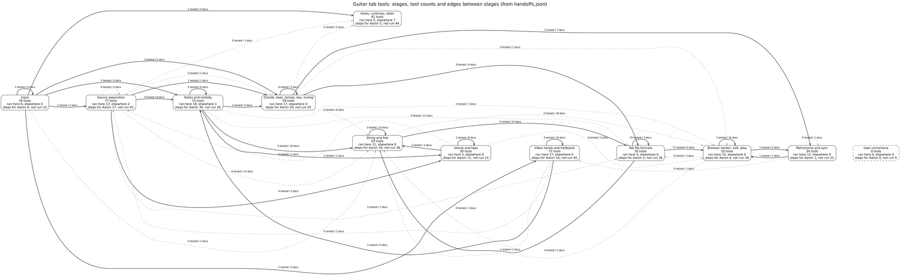

# Handoffs: what each tool takes and gives, and what connects to what

Written 2026-11-12 by the `handoff-graph` agent from the ten lanes' `tools.json`, `trials.md` and `survey.md`
files, the chains lane's `trials.md`, the run ledger (`/home/user/gtr/ledger/runs.jsonl`, copied to
`ledger/runs.jsonl.gz`) and the scoring ledger (`/home/user/gtr/eval/ledger/evals.jsonl`, copied to
`ledger/evals.jsonl.gz`). The gzipped copies were refreshed on 2026-11-12, after this file was
written, and hold every run and score cited here (through r0730 and e1856). It states what each tool the lanes looked at takes in and gives out, where it ran, and
which outputs other tools accept, with the evidence for each connection. It does not choose tools for the finished
program.

The same facts, machine-readable: [`handoffs.json`](handoffs.json). Diagrams: [`handoffs/`](handoffs/) (section 7).
The stage tables, the edge lines and the counts are generated by [`handoffs/build_handoffs.py`](handoffs/build_handoffs.py)
from the lane files and the ledger; sections 3, 4 and 5 are written by hand from the files they cite. Two checkers
reviewed the file on 2026-11-12 and a repair pass fixed what held up; the verification log at the end lists each
problem and what was done.

## 0. How to read this

- **Lanes:** ss = source-separation, a2n = audio-to-notes, cbk = chords-beats-key, gt = guitar-tab,
  fvt = fingerstyle-voices-taps, vhf = video-hands-fretboard, web = web-tab-render, bas = browser-audio-sync,
  apps = apps-survey, api = hosted-apis. Each lane's files are under `lanes/<lane>/`.
- **One tool, one row.** Entries that name the same software, model or service in several lanes (or a pointer from one
  lane to another's entry) are merged into one tool by the alias table in `handoffs/count_tools.py`. A tool sits in
  the table of one stage; a tool a lane used at another stage is named again under "also used at this stage".
  Entries of kind "dataset" are not tools; they are listed at the end of section 6.
- **How an agent calls it:** the lane's `callable_via` values (CLI, Python, HTTP, WASM, browser JS, desktop, phone app,
  Vamp plugin, ...); "desktop only" / "phone app only" when nothing else is recorded; "—" when the lane recorded none.
- **Input / Output:** the first one or two items of the lane's `inputs` / `outputs`, shortened (marked "…"); the full
  text is in the lane's `tools.json`.
- **Where it ran:** "here" = this box (4 vCPU Xeon, no GPU; `ENVIRONMENT.md`) with the test clip read, the wall-clock
  seconds and core use from the run ledger ("2 cores" = a pinned 2-core slot, "not pinned" = a `--nolock` run, whose
  time is not a 2-core figure) and the run id. The time is that whole ledger run's: a run can cover several clips,
  settings or models (its ledger label says what it did), and a run whose label says "batch" or "N clips" is shown
  as "batch". "public Space" / "API" = run remotely, with the ledger's wall-clock. "not run" = a short form of the
  lane's `not_run_reason` (a keyword digest; rule in `build_handoffs.py`), and "steps for Aaron" when a lane's
  `for-aaron.md` has steps for it.
- **Licences:** exactly as the lane recorded them: the code's SPDX field (several lanes' values joined by ";"), and for
  weights the opening words of the clause the lane quoted, "none quoted" when the lane quoted none, "—" when the
  lane recorded no weights. The full clauses with links and dates are in each lane's `survey.md`. Two code cells are
  written out instead, where the SPDX field says more than the lane's survey (libKeyFinder and keyfinder-cli; HF Space
  Hmjz100/MT3; `CODE_LICENCE_TEXT` in `build_handoffs.py`).
- **Edges:** "X outputs ..., which Y accepts as ...". **TESTED** = a run in which Y read X's output, with run ids
  (`rNNNN`, run ledger) and scoring ids (`eNNNN`, scoring ledger); **DOCS** = both halves come from documentation
  or code reading, with the reference. "Glue" names what had to be done between the two.

## 1. The stages

Pipeline order: input -> source separation -> notes and melody -> chords, beat, downbeat, tempo, key, tuning ->
string and fret assignment -> fingerstyle voices and taps -> video hands and fretboard -> tab file formats ->
rendering, editing and playback in the browser -> metronome and sync -> user corrections that re-run analysis. A last
table holds the tools that are not a step of their own (hosts, runtimes, platforms, client libraries,
general-purpose models) and apps the lanes listed without reading.

<!-- BEGIN GENERATED: stages -->
### 1.1 Input: audio file, video file, link

16 tools: 6 ran here, 0 ran elsewhere (public Space or API), 0 not run with steps for Aaron, 10 not run with nothing for Aaron. 0 tools with their own table elsewhere are also used at this stage.

| Tool | Lanes | How an agent calls it | Input | Output | Where it ran | Code licence | Weights licence |
|---|---|---|---|---|---|---|---|
| @alexanderolsen/libsamplerate-js | bas | browser JS, WASM | — | — | not run: survey listing only | MIT | — |
| @remotion/media-parser | bas | — | — | — | not run: survey listing only | Remotion License https://remotion.dev/license (npm license… | — |
| @remotion/webcodecs | bas | browser JS | — | — | not run: survey listing only | Remotion License (See https://remotion.dev/docs/webcodecs#l… | — |
| audio-decode | bas | — | — | — | not run: survey listing only | MIT | — |
| ffmpeg | api | CLI | WAV and MP4 files of the shared set; MP3 stems from ElevenLabs | WAV excerpts (PCM 16-bit), JPEG frames, float WAVs of decoded and trimmed stems | here: R3a, 0.6 s, 2 cores, r0662 | — | — |
| ffmpeg.wasm | bas | browser JS, WASM | whatever the core's FFmpeg 5.1.4 build demuxes and decodes (her… | any format FFmpeg writes (here WAV) | here: 5 inputs (S1 …), 213.8 s, not pinned, r0451 | MIT (@ffmpeg/ffmpeg wrapper); GPL-2.0-or-later (@ffmpeg/cor… | — |
| libav.js | bas | browser JS, WASM | via libav.writeFile and ff_init_demuxer_file; default variant:… | decoded frames via ff_decode_multi; ffmpeg and ffprobe CLIs | not run: Not run here (survey.md section 53). | LGPL-2.1 | — |
| libavjs-webcodecs-polyfill | bas | browser JS | — | — | not run: Not run here (survey.md section 53, companion package). | 0BSD | — |
| Mediabunny | bas | browser JS | MP4, MOV, WebM, MKV, HLS, WAVE, MP3, Ogg, ADTS, FLAC, MPEG-TS (… | VideoSample objects with timestamp and duration in seconds, format 'I420', toVideoF… | here: 5 inputs (S1 …), 213.8 s, not pinned, r0451 | MPL-2.0 | — |
| mp4box.js | bas | browser JS | MP4 only | samples for VideoDecoder (WebCodecs) | not run: not reached in the time | BSD-3-Clause | — |
| PolyMap: A 64-Channel Polyphonic Guitar Pickup System | gt | — | — | — | not run: survey listing only | — | — |
| SoX | a2n | CLI | audio file | audio file (pitch shift in cents); with 16-bit output and an effect such as pitch,… | here: S7flat30, 0.3 s, not pinned, r0602 | GPL-2.0-or-later (sox program); LGPL-2.1-or-later (libsox) | — |
| web-demuxer | bas | browser JS, WASM | — | — | not run: not reached in the time | MIT | — |
| WebCodecs (AudioDecoder, VideoDecoder, VideoFrame) | bas | browser JS | EncodedVideoChunk / EncodedAudioChunk (needs a demuxer: Mediabu… | VideoFrame (timestamp and duration in microseconds); AudioData (sample data extract… | here: 2 inputs (S4 …), 223.0 s, not pinned, r0433 | — | — |
| YouTube (Terms of Service and API Services terms) | api | — | — | — | not run: YouTube was not contacted by any agent here (the yt-dlp run used an a… | — | — |
| yt-dlp | api | CLI, Python | a media URL (thousands of sites); `-f` picks a format; `--downl… | audio-only files via `-x --audio-format wav` ("-x, --extract-audio Convert video fi… | here: R3a, 10.9 s, not pinned, r0126 | Unlicense | — |

### 1.2 Source separation

77 tools: 17 ran here, 2 ran elsewhere (public Space or API), 17 not run with steps for Aaron, 41 not run with nothing for Aaron. 1 tool with its own table elsewhere is also used at this stage.

| Tool | Lanes | How an agent calls it | Input | Output | Where it ran | Code licence | Weights licence |
|---|---|---|---|---|---|---|---|
| adityalakhani/htdemucs-6s-guitar-ft (also steps for Aaron) | ss | CLI, Python | audio read with soundfile | six sources drums, bass, other, vocals, guitar, piano (the repository's inference.p… | here: S4, 26.0 s, 2 cores, r0636 | — | "This model is released under the **Apache 2.0**…" |
| asteroid | ss | Python | — | — | not run: survey listing only | MIT | — |
| AudioSep (Separate Anything You Describe) | ss | Python, HTTP | an audio file and a free-text query (e.g. 'acoustic guitar'); l… | one mono 16-bit wav at 32 kHz, only the target is written: write(output_file, 32000… | not run; steps for Aaron (ss): refused by the session's permission system | MIT | none quoted |
| AudioShake (Tasks API) | ss, api | HTTP, Python, CLI | POST https://api.audioshake.ai/tasks with JSON {"url": "<media… | per-target `output` array with download links ("Output download links expire after… | not run; steps for Aaron (api): needs an account or key | — | — |
| Band-Split RNN (BSRNN) | ss | — | — | — | not run: survey listing only | — | — |
| Banquet (query-bandit) | ss | CLI | mixture audio file (torchaudio.load), resampled to 44.1 kHz | one waveform per call: the estimate of the stem 'of the “same” stem type as the que… | not run; steps for Aaron (ss): refused by the session's permission system | MIT | "If you've **benefited commercially from this wo…" |
| barvarvara/demucs-guitar-lora | ss | Python | audio through demucs.apply.apply_model (script scripts/demucs_l… | drums, bass, other, vocals: 44,100 Hz, 2 channels, PCM_16, same length as the input… | here: S4, 34.8 s, 2 cores, r0529 | — | none quoted |
| becruily Mel-Band RoFormer guitar | ss | CLI, Python | 44.1 kHz stereo audio through MSST (config sample_rate 44100) | Guitar.wav, float32, 44,100 Hz, 2 channels (the Other part only with --extract_inst… | here: S4_0-10s, 67.6 s, 2 cores, r0547 | — | none quoted |
| BS PolarFormer | ss | CLI | — | vocals, other | not run: survey listing only | — | — |
| BS-Mamba2 | ss | CLI | — | — | not run: survey listing only | — | — |
| BS-RoFormer / Mel-Band RoFormer (lucidrains implementation) | ss | Python | — | — | not run: no weights found | MIT | — |
| bs-roformer-infer and melband-roformer-infer (OpenMIRLab) | ss | CLI, Python | — | — | not run: repackages a tool run here | MIT | "Do not treat this package's MIT code license as…" |
| BS-RoFormer-SW (BS Roformer SW by jarredou, 6 stems) (also steps for Aaron) | ss | CLI, Python | 44.1 kHz stereo audio through audio-separator or MSST; ONNX exp… | six stems: bass, drums, other, vocals, guitar, piano (ONNX card order 0: bass 1: dr… | here: S4_0-10s, 110.3 s, 2-core slot of a batch, r0489 | — | "Edited version of that checkpoint to allow its…" |
| BS-RoFormer-SW ONNX (elicwhite/bs-roformer-sw-6stem-onnx) | ss | WASM, browser JS | inputs spec_real and spec_imag, traced at 176400 samples (4 s @… | Outputs (both shape [1, 6, 2, 1025, T], float32); stem order 0: bass 1: drums 2: ot… | not run: needs a GPU (or WebGPU) | — | "The pretrained weights themselves were [rehoste…" |
| BSRoformer.cpp (chenmozhijin) | ss | CLI | input.wav | output.wav; mirror card FractalSurfer/BS-RoFormer-SW-6stem: the CLI writes stem_0 .… | not run: needs a GPU (or WebGPU) | MIT | — |
| Demucs v4 (htdemucs, htdemucs_ft, htdemucs_6s, mdx_extra) (also steps for Aaron) | ss, a2n, cbk, fvt, bas, api | CLI, Python | wav, flac, mp3, ogg, aac (and other formats supported by sphn);… | drums.wav, bass.wav, other.wav, vocals.wav: stereo wav, 44.1 kHz, int16 by default,… | here: S4, 38.9 s, 2 cores, r0019 | MIT | "Demucs code is released under the MIT license a…" |
| demucs-infer (OpenMIRLab) | ss | Python | — | — | not run: repackages a tool run here | MIT | "demucs-infer hosts no mirror" |
| demucs-js (bakkot) | bas | browser JS, CLI | CLI 'wants 44.1 kHz files' (README) | — | not run: Not run here (survey.md section 50). Web version: https://bakkot.gith… | MIT | "However, this repository/package also include a…" |
| demucs-onnx (StemSplit) / StemSplitio htdemucs ONNX exports | ss, bas | CLI, Python, WASM, browser JS | mix: float32 tensor (1, 2, 343980), stereo 44.1 kHz, a 7.8 s se… | stems: float32 tensor (1, 6, 2, 343980), rows drums, bass, other, vocals, guitar, p… | here: S4, 50.4 s, 2 cores, r0548 | MIT; MIT (card licence field mit; demucs-onnx LICENSE MIT) | "The 6 source variant of htdemucs was trained on…" |
| demucs-rs (nikhilunni) | ss, bas | CLI, WASM, browser JS | S4.wav (38.7 s band mix with known stems) in the for-aaron steps | 4 stems (Standard), 6 stems incl. guitar and piano (6-Stem) | not run; steps for Aaron (ss, bas): needs a GPU (or WebGPU) | Apache-2.0 | "Model weights are downloaded automatically from…" |
| demucs-wasm (bengfarrell) | bas | browser JS, WASM | — | — | not run: not reached in the time | MIT | none quoted |
| demucs-web (timcsy) with ONNX Runtime Web | bas | browser JS, WASM | two Float32Arrays (left, right) at 44.1 kHz from decodeAudioDat… | separate(left, right) returns {drums, bass, other, vocals}, each {left: Float32Arra… | here (headless Chromium): batch run, 295.4 s, not pinned, r0329 | MIT | none quoted |
| demucs.cpp (sevagh) | ss | CLI | WAV read through the vendored libnyquist; 44.1 kHz stereo used… | <out dir>/target_<index>_<source>.wav: target_0_drums, target_1_bass, target_2_othe… | here: S4_0-10s, 69.1 s, 2 cores, r0541 | MIT | none quoted |
| demucs.onnx (sevagh) | ss, bas | CLI, WASM | — | — | not run: survey listing only | MIT | — |
| DTTNet | ss | CLI | — | — | not run: survey listing only | — | — |
| Dynamic Band Splitting (dbs_bsrnn, dbs_mel_roformer, dbs_bs_roformer) | ss | Python | — | music, sfx, speech (README example) | not run: survey listing only | Apache-2.0 | — |
| ElevenLabs Stem Separation API (six_stems_v1) | api | HTTP, Python | multipart form: `file` (required, "The audio file to separate i… | "ZIP archive containing separated audio stems. Each stem is provided as a separate… | API: S4, 14.4 s wall, r0064 | — | — |
| Fadr API | api | HTTP | file upload: POST /assets/upload2 returns a presigned S3 upload… | main `stemType`: four primary stems (vocals, bass, drums, melodies) plus "instrumen… | not run; steps for Aaron (api): needs an account or key | — | — |
| fal.ai fal-ai/demucs | api | HTTP, Python | `audio_url` (required); `model` default "htdemucs_6s" (options… | `File` objects `vocals`, `drums`, `bass`, `other`, `guitar` ("only available for 6s… | not run; steps for Aaron (api): needs an account or key | — | "The 6 source variant of htdemucs was trained on…" |
| free-music-demixer (sevagh, in-browser WASM) | ss, bas | WASM, browser JS | — | stems in the browser; weights: htdemucs 81 MB and htdemucs_6s 53 MB stored as float… | not run: no weights found | MIT | "While the WASM modules and JavaScript in this r…" |
| Gaborformer (sevagh) | ss | CLI | audio read with soundfile, with an ffmpeg fallback (M4A/AAC req… | <out>/<input name>/{vocals,drums,bass,other}.wav, 44.1 kHz stereo, 32-bit float (sf… | not run; steps for Aaron (ss): refused by the session's permission system | MIT | "The pretrained weights in this directory are re…" |
| Ghilda/htdemucs-onnx | bas | browser JS, WASM | raw waveform and a pre-computed complex spectrogram | — | not run: Not run here (survey.md section 50). | MIT (card licence field mit) | "This model was **reconverted from the official…" |
| Guitar string separation (deep-guitar-separation, Bastas, Katsouros, Maragos) | fvt | CLI | a guitar WAV (python predict.py --load_model checkpoints/{check… | six per-string audio stems (one per string) | not run: no weights found | MIT | none quoted |
| guitar_source_separation (LukeSutor) | ss | — | — | — | not run: survey listing only | MIT | — |
| HF Space akhaliq/demucs | api | Python, HTTP | — | — | not run: stage `RUNTIME_ERROR` on 2026-11-10 | — | — |
| HF Space lpeterl/sam-audio-webui | api | Python, HTTP | model size, audio or video file, text `prompt`, `chunk_duration` | — | not run; steps for Aaron (api): needs a GPU (or WebGPU) | — | — |
| HF Space nakas/demucs_playground | api | Python, HTTP | audio file: WAV 44.1 kHz stereo 16-bit accepted (the upload is… | four WAV file paths (vocals, bass, drums, other), 16-bit 44.1 kHz stereo, sample co… | public Space: S4, 2.8 s wall, r0119 | MIT | "The license of the weights is not clear: MusDB…" |
| LALAL.AI (API) | ss, api | HTTP | raw bytes as `application/octet-stream` via POST /api/v1/upload… | done task carries `tracks`, each {type: "stem"\|"back", label, url, name, size, wave… | not run; steps for Aaron (api): needs an account or key | — | — |
| librosa (HPSS, onsets, pyin, beat_track, estimate_tuning) | ss, a2n, cbk, fvt | Python | audio samples as a NumPy array (the lane script used librosa.lo… | beat_track: tempo (numpy array of one value by default, "estimated global tempo (in… | here: S6taps, 19.6 s, 2 cores, r0530 | ISC | — |
| MDX-Net (KUIELab; UVR MDX-Net models) | ss | CLI, Python | via audio-separator: 44.1 kHz stereo wav | instrumental.wav and vocals.wav, PCM_16, 44,100 Hz, 2 channels, frame count equal t… | here: S4, 85.8 s, 2 cores, r0615 | MIT | "[Kuielab & Woosung Choi] - Developed the origin…" |
| MDX23C / TFC-TDF-Net v3 (KUIELab, SDX 2023) | ss | CLI, Python | via audio-separator: first 10 s of S4 | instrumental.wav and vocals.wav, PCM_16, 44,100 Hz, 2 channels | here: S4_0-10s, 502.8 s, 2-core slot of a batch, r0496 | MIT | "[ZFTurbo] - Created & trained the weights for t…" |
| Mini-BS-RoFormer-V2.5-46.2M (HiDolen) | ss | — | — | bass, drums, other, vocals | not run: survey listing only | — | none quoted |
| mlx-audio-separator | ss | Python | — | — | not run: Not runnable on this Linux box (MLX targets Apple Silicon) | MIT | — |
| Moises (app) | ss, apps, api | phone app, desktop, HTTP | audio file ("Upload a song and play along in seconds") | stems (vocals, drums, guitar, bass, piano, strings, and other instruments; up to 27… | not run; steps for Aaron (apps): refused by the session's permission system | — | — |
| Moises-Light (crlandsc, unofficial implementation) | ss | Python | — | model(x) returns [batch, stems, channels, samples], e.g. [1, 4, 2, 264600] | not run: no weights found | MIT | — |
| monteslu/htdemucs-web-onnx | bas | browser JS | — | — | not run: needs a GPU (or WebGPU) | — | "License: MIT, matching demucs." |
| MuS3D (Music Source Separation via Stem Discovery, Aalto University) | ss | CLI | a song audio file (wav); a 10 s segment (centred by default, or… | mixture.wav, one <name>.wav per discovered source (<name>_2.wav for repeats), and t… | not run; steps for Aaron (ss): disk space | MIT | "The model weights are released under [CC BY 4.0…" |
| musdb (Python package for MUSDB18) | ss | Python | — | — | not run: survey listing only | MIT | — |
| Music Source Restoration systems (ICASSP 2026 MSR Challenge, e.g. DTT-BSR) | ss | — | — | — | not run: survey listing only | — | — |
| Music-Source-Separation-Training (MSST, ZFTurbo) | ss | CLI, Python | .wav, .flac, .aif(f), .mp3 and others listed in docs/compatibil… | WAV (default subtype FLOAT; PCM_24, PCM_16) or FLAC (PCM_24 default, PCM_16); file… | here: S4_0-10s, 67.6 s, 2 cores, r0547 | MIT | "lists configs and weight links but no license p…" |
| Music.AI API | a2n, cbk, gt, api | HTTP, Python, CLI, desktop | audio URL (workflow param `inputUrl` in the API reference's job… | Chords module: `key` and `chordMap` (start time, end time, chord classes); file-for… | not run; steps for Aaron (api): needs an account or key | — | — |
| MVSEP (site and API) | ss, api | HTTP | POST https://mvsep.com/api/separation/create with form fields `… | audio files only (no notes, chords or tab); `output_format` 0 mp3 320 kbps (default… | not run; steps for Aaron (api): needs an account or key | — | — |
| MVSEP-MDX23 ensemble (ZFTurbo) | ss | CLI | input_audio mixture wav | 4 stems into --output_folder | not run: survey listing only | — | — |
| nussl | ss, fvt | Python | — | — | not run: no reason recorded | MIT | none quoted |
| Open-Unmix (umxhq, umxl) | ss, fvt, apps | CLI, Python | wav, flac, ogg (not mp3) read through torchaudio/torchcodec; 44… | vocals.wav, drums.wav, bass.wav, other.wav in <outdir>/<input file stem>/: 44,100 H… | here: S4, 28.8 s, 2 cores, r0085 | MIT | "__`umxl` (default)__ trained on private stems d…" |
| PolUVR (Politrees) | ss | CLI, Python | — | — | not run: repackages a tool run here | MIT | — |
| python-audio-separator (audio-separator) with the UVR model zoo (also steps for Aaron) | ss | CLI, Python, HTTP | a file path, a list of paths, or a directory; 44.1 kHz stereo 1… | one audio file per stem, file names carry the stem name (custom_output_names), samp… | here: S4, 84.6 s, 2 cores, r0531 | MIT | "For all third-party application developers who…" |
| Replicate: ryan5453/demucs | api | HTTP, Python | `audio` (required), `model` (single value `htdemucs`), `isolate… | URIs `bass`, `drums`, `other`, `vocals`, `no_bass`, `no_drums`, `no_other`, `no_voc… | not run; steps for Aaron (api): needs an account or key | MIT | "The license of the weights is not clear: MusDB…" |
| RipX DAW | apps | desktop only | — | MIDI (Print Audio to Midi); separated stems as WAVs | not run; steps for Aaron (apps): desktop app | — | — |
| SAM Audio (Meta) | ss | Python | audio file path or tensor (video for visual prompts); text prom… | result.target and result.residual, each list[torch.Tensor] where each tensor is a 1… | not run; steps for Aaron (ss): The weights are gated (Hugging Face reports gated: manual for all rep… | — | "“SAM Materials” means, collectively, Documentat…" |
| SCNet (Sparse Compression Network) | ss | CLI, Python | audio through MSST or python -m scnet.inference --input_dir IN… | drums, bass, other, vocals; through MSST: float32 WAV, 44,100 Hz, 2 channels | here: S4, 109.1 s, 2 cores, r0559 | MIT | "The model checkpoint was trained on the MUSDB d…" |
| Score-Informed SS on Guitars | ss | — | — | — | not run: survey listing only | — | — |
| SepGen | ss | — | — | — | not run: survey listing only | — | none quoted |
| Soundverse enterprise API (stem separation) | api | HTTP | — | — | not run: survey listing only | — | — |
| Spleeter | ss, cbk | CLI, Python | anything ffmpeg decodes (default adapter spleeter.audio.ffmpeg.… | one file per instrument, template {filename}/{instrument}.{codec}: vocals, drums, b… | here: S4, 21.5 s, 2-core slot of a batch, r0419 | MIT | "Spleeter [@spleeter] source code and pre-traine…" |
| Spleeter 2-stem ONNX (sherpa-onnx-spleeter-2stems-fp16) | a2n | — | — | — | not run: pointer to another lane | — | — |
| Spleeter Pro (Deezer) | ss | — | — | — | not run: survey listing only | — | — |
| StemDeck | ss | desktop only | — | — | not run: survey listing only | — | — |
| STEMMA (hoyso48/STEMMA-MOSS-Music) | ss | — | — | — | not run: survey listing only | — | — |
| StemSplit (hosted service and API) | ss, api | HTTP | upload job or YouTube URL job; limits (launch post table): requ… | "`SIX_STEMS` \| Vocals, drums, bass, guitar, piano, other" (launch post); quality mo… | not run: needs an account or key | — | — |
| SubRoformer | ss | CLI | — | — | not run: survey listing only | MIT | none quoted |
| torchaudio HDEMUCS_HIGH_MUSDB_PLUS and HDEMUCS_HIGH_MUSDB pipelines | ss | Python | — | drums, bass, other, vocals | not run: survey listing only | — | none quoted |
| Ultimate Vocal Remover GUI (UVR5) | ss | desktop only | — | — | not run: desktop app | MIT | "For all third-party application developers who…" |
| VR Architecture (tsurumeso/vocal-remover; UVR VR Arch models) | ss | CLI, Python | via audio-separator: 44.1 kHz stereo wav | instrumental.wav and vocals.wav, PCM_16, 44,100 Hz, 2 channels; files are shorter t… | here: S4, 84.6 s, 2 cores, r0531 | MIT | "UVR's core developers trained all of the models…" |
| webnn/stem-separator | bas | browser JS | — | — | not run: needs a GPU (or WebGPU) | MIT (model card licence field mit) | "No training or fine-tuning was performed. This…" |
| ZeroSep | ss | CLI, Python | audio file (wav) and a text target, e.g. --target 'acoustic gui… | results folder from separate.py (format not checked) | not run; steps for Aaron (ss): disk space | MIT | — |
| ZFTurbo open-source 53-stem model (MSST release v1.0.21) | ss | CLI, Python | — | 53 instrument stems | not run: survey listing only | MIT | "The weights are published in an MIT-licensed re…" |

Also used at this stage: Segment Anything 2 / 2.1 (SAM 2) (table 1.7).

### 1.3 Notes and melody

75 tools: 18 ran here, 1 ran elsewhere (public Space or API), 30 not run with steps for Aaron, 26 not run with nothing for Aaron. 5 tools with their own table elsewhere are also used at this stage.

| Tool | Lanes | How an agent calls it | Input | Output | Where it ran | Code licence | Weights licence |
|---|---|---|---|---|---|---|---|
| Ableton Live (Convert to MIDI) | a2n, fvt | desktop only | audio clip (recorded breakbeats, beatboxing, tapping on a surfa… | a MIDI clip on a new MIDI track with kick, snare and hihat | not run: no reason recorded | — | none quoted |
| AnthemScore (desktop) | a2n, gt, apps | desktop only | audio files (command-line parser text: "Source file (mp3, wav,… | musicXML; MIDI (.mid) (options: auto-detected tempo map, user annotated tempos, con… | not run; steps for Aaron (apps): refused by the session's permission system | — | — |
| AnthemScore Web | apps | — | MP3 | PDF; MIDI | not run; steps for Aaron (apps): refused by the session's permission system | — | — |
| Aria-AMT (EleutherAI) | a2n | CLI | -load_path <path to mp3/wav file>; -load_dir for batches; aria-… | MIDI files: each input saved as <input stem>.mid (with _<index> before .mid for eac… | not run: needs a GPU (or WebGPU) | Apache-2.0 | "Aria-MIDI is distributed with the CC-BY-NC-SA 4…" |
| aubio | a2n, cbk, fvt, bas | CLI, Python | audio file (WAV; the trials passed 44.1 kHz 16-bit, stereo and… | aubio tempo: one line "<bpm> bpm", no confidence; aubio beat / aubiotrack: one beat… | here: S6taps, 0.9 s, 2 cores, r0079 | GPL-3.0-or-later; GPL-3.0 | — |
| aubiojs | bas | browser JS, WASM | audio hops | Pitch.do() Hz (0 when none) per hop; Tempo.do() non-zero on a beat, getBpm(), getCo… | here: 5 inputs (S1 …), 213.8 s, not pinned, r0451 | MIT | — |
| audio_to_midi_melodia | a2n | CLI, Python | audio_to_midi_melodia.py infile outfile bpm [--smooth SMOOTH] [… | MIDI (notes quantized after melody extraction, tempo taken from the bpm argument) a… | not run: needs the MELODIA Vamp plugin installed (README: Non-python dependenc… | — | — |
| Basic Pitch for the browser (@spotify/basic-pitch, TensorFlow.js) (also steps for Aaron) | bas | browser JS | AudioBuffer at 22,050 Hz mono (throws 'Input audio buffer is no… | note events: pitchMidi, amplitude, pitchBends, startTimeSeconds, durationSeconds; r… | here (headless Chromium): 2 inputs (S1 …), 510.6 s, not pinned, r0270 | Apache-2.0 | none quoted |
| Basic Pitch ONNX model (nmp.onnx) in ONNX Runtime Web (also steps for Aaron) | bas | browser JS, WASM | windows of 43,844 samples at 22,050 mono, 30 overlapping frames… | note = StatefulPartitionedCall:1, onset = StatefulPartitionedCall:2, contour = Stat… | here (headless Chromium): 2 inputs (S1 …), 510.6 s, not pinned, r0270 | Apache-2.0 | "Basic Pitch comes with the original TensorFlow…" |
| basicpitch.io (Basic Pitch web demo) | a2n, bas | browser JS | audio file dropped in by hand (S1.wav, S2n.wav in the steps) | MIDI file if the page offers one | not run; steps for Aaron (bas): Not run here: the demo needs a person to drop a file into a web page;… | — | — |
| ByteDance piano transcription (piano_transcription_inference) | a2n, gt | Python | audio loaded by librosa.load(path, sr=sample_rate, mono=True);… | MIDI file (transcribe(audio, 'out.mid')) and a Python dict transcribed_dict = {'out… | here: 6 inputs (S1 …), 849.0 s, 2 cores, r0216 | MIT | "License Creative Commons Attribution 4.0 Intern…" |
| CREPE | a2n | CLI, Python | audio file (WAV); resampled to 16 kHz with resampy; monophonic… | <name>.f0.csv: header time,frequency,confidence (timestamps with a 10 ms hop by def… | not run; steps for Aaron (a2n): refused by the session's permission system | MIT | none quoted |
| CREPE Notes (crepe_notes) | a2n | CLI, Python | audio file (path_to_original_audio) | a .mid file in the current directory named [audio_file_stem].[pitch_tracker].transc… | here: 3 inputs (S1 …), 35.2 s, 2 cores, r0616 | GPL-3.0 | "All model and data files are distributed under…" |
| Deep Salience | a2n, fvt | CLI, Python | audio_fpath; python predict/predict_on_audio.py <audio_fpath> <… | -f salience (default): <name>_<task>_salience.npz with arrays salience, times, freq… | not run; steps for Aaron (a2n, fvt): refused by the session's permission system | MIT | none quoted |
| Essentia | a2n, cbk, fvt | Python, CLI | mono audio signal (MonoLoader; 44100 Hz for most algorithms, 16… | PitchYinProbabilistic: pitch and voicedProbabilities; PredominantPitchMelodia: pitc… | here: S3, 2.4 s, 2 cores, r0088 | AGPL-3.0 | "All the models are available under the CC BY-NC…" |
| FCPE / torchfcpe | a2n | Python | mono torch.Tensor of audio (README example resamples to 16 kHz… | f0 tensor per frame in Hz (0.0.4: shape (B, (n_sample//hop_size + 1) or output_inte… | here: batch run, 2694.6 s, 2 cores, r0321 | MIT | "license: cc-by-nc-sa-4.0" |
| fnaught | bas | — | detector.detect(audio, { sampleRate: 44100 }) after PitchDetect… | per-frame pitch (Hz) and confidence in [0, 1] | not run: survey listing only | MIT (card licence field mit; npm MIT) | — |
| GAME (Generative Adaptive MIDI Extractor, openvpi) | a2n | CLI, Python | python infer.py extract [path-or-directory] -m [model-path] [--… | MIDI files saved besides each audio file by default (--output-formats mid,txt,csv);… | not run: not reached in the time | MIT | none quoted |
| Harmonica | a2n | — | — | — | not run: no code found | — | — |
| HF Space Hmjz100/MT3 | api | Python, HTTP | — | — | not run: stage `RUNTIME_ERROR` on 2026-11-10 ("Exit code: 1" with a numpy trac… | the Space's code was not read; magenta/mt3, which the Space is named after: Apache-2.0 | — |
| HF Space hugging-apps/muscriptor-music-transcription | api | Python, HTTP | audio file, `instruments` list, `use_sampling`, `temperature` | API returns: "Download MIDI file" (a file path), "Summary", "MIDI playback & visual… | not run; steps for Aaron (api): needs a GPU (or WebGPU) | — | — |
| HF Space Richhiey/basic_pitch_fastapi | api | HTTP | — | — | not run: stage `SLEEPING` on 2026-11-10; no Gradio API (docker app) | — | — |
| HF Space teamup-tech/Transkun | api | Python, HTTP | — | — | not run; steps for Aaron (api): needs a GPU (or WebGPU) | MIT | — |
| hFT-Transformer | a2n | CLI | MAESTRO-V3 corpus scripts; no single-file transcription CLI in… | — | not run; steps for Aaron (a2n): not reached in the time | MIT | "The checkpoints are distributed under the Creat…" |
| Klangio sibling apps (Piano2Notes, Drum2Notes, ...) | fvt, apps | — | recording, upload or YouTube link | sheet music PDFs, quantized or unquantized MIDI files and MusicXML (detects snare,… | not run: no reason recorded | — | none quoted |
| Klangio Transcription Studio | apps | HTTP, phone app | audio file | PDF; MIDI (quantized and unquantized) | not run; steps for Aaron (apps): refused by the session's permission system | — | — |
| Magenta.js (@magenta/music): Onsets and Frames in the browser | bas | browser JS | raw audio | MIDI | not run: not reached in the time | Apache-2.0 | "A unidirectional piano transcription model." |
| MELODIA Vamp plugin (MTG-UPF) | a2n | Vamp plugin | Audio file in a format supported by your Vamp host (e.g. wav, m… | Melody: The pitch of the main melody. Each row of the output contains a timestamp a… | not run; steps for Aaron (a2n): The download page answered the box with HTTP 403 (a Cloudflare "Just… | — | — |
| melodyExtraction_JDC | a2n | Python | audio file: python melodyExtraction_JDC.py -p <audio> -o <dir> | pitch_<file name>.txt with 2 columns: timestamps (10 ms) and the predicted fundamen… | not run; steps for Aaron (a2n): refused by the session's permission system | MIT | none quoted |
| melodyExtraction_SSL | a2n | Python | audio file: python melodyExtraction_NS.py -p <audio> -o <dir> | pitch_<file name>.txt with 2 columns: timestamps (10 ms) and the predicted fundamen… | not run; steps for Aaron (a2n): refused by the session's permission system | MIT | none quoted |
| Melodyne | a2n, apps | desktop only | audio recordings and samples | MIDI file ("Audio-to-MIDI – export notes to a MIDI file": assistant, editor and stu… | not run; steps for Aaron (apps): desktop app | — | — |
| MIDI Guitar 2 and 3 (Jam Origin) | apps | desktop, phone app only | live guitar signal | real-time MIDI (MPE in version 3); JAM API (beta): notes as text on "a WebSocket at… | not run; steps for Aaron (apps): desktop app | — | — |
| MIROS | a2n | — | — | — | not run: no code found | — | — |
| MR-MT3 | a2n | Python | audio at SAMPLE_RATE = 16000; InferenceHandler(model=None, weig… | a MIDI file written with note_seq.sequence_proto_to_midi_file (default path ./out/<… | not run; steps for Aaron (a2n): refused by the session's permission system | MIT | "card license tag `mit`" |
| MT3 (Magenta) | a2n, fvt, api | Python | audio uploaded in the Colab notebook; SAMPLE_RATE = 16000, load… | a note_seq NoteSequence, written to a MIDI file with note_seq.sequence_proto_to_mid… | not run; steps for Aaron (a2n): refused by the session's permission system | Apache-2.0 | none quoted |
| mt3-infer | a2n | Python, CLI | audio array and sample rate (transcribe(audio, sr=16000)); CLI… | a mido.MidiFile (transcribe() return type; the CLI saves it); mt3_pytorch notes are… | not run; steps for Aaron (a2n): refused by the session's permission system | MIT | none quoted |
| mt3-pytorch (kunato) | a2n | Python | audio file path; librosa.load at 16 kHz (inference.py) | a MIDI file written with note_seq.sequence_proto_to_midi_file (default ./out/<audio… | not run; steps for Aaron (a2n): refused by the session's permission system | — | none quoted |
| MTANet | a2n | Python | — | — | not run: no weights found | — | — |
| Mureka Music Transcription (fal.ai mureka/api/song/transcribe) | api | HTTP, Python, JS | exactly one of `song_id`, `upload_audio_id` or `audio_url`: "Pu… | `zip_url` (required): "The generated transcription archive."; contents per input no… | not run; steps for Aaron (api): needs an account or key | — | — |
| MuScriptor (Kyutai and Mirelo) | a2n | CLI, Python, HTTP | raw waveform (16 kHz, mono) of a 5-second segment; input audio… | MIDI (default) with beats, time signature and bar lines detected from the audio and… | not run; steps for Aaron (a2n): The weights are gated on Hugging Face (MuScriptor/muscriptor-small: g… | MIT | "The model weights, published on HuggingFace, ar…" |
| MuScriptor hosted UI (muscriptor.kyutai.org) | a2n | browser JS | — | MIDI, sheet music PDFs and guitar tabs you can download (page text); MIDI (and Musi… | not run; steps for Aaron (a2n): The page needs JavaScript (Enable JavaScript to use the transcriber.)… | — | — |
| MusicGPT API (audio_to_midi) | api | HTTP | multipart form with `audio_url` ("Input audio URL (supported fo… | response carries `success`, `task_id` and `conversion_id`; result: MIDI file, optio… | not run: needs an account or key | — | — |
| NeuralNote | a2n | desktop only | .wav, .aiff, .flac, .mp3, .ogg (vorbis) and, on macOS, .m4a dro… | MIDI (drag to a track or save the MIDI file) | not run; steps for Aaron (a2n): not reached in the time | Apache-2.0 | "The MuScriptor model weights are not open sourc…" |
| Omnizart | a2n, cbk, fvt | CLI, Python | audio file (omnizart music transcribe <path/to/audio.wav>); the… | a MIDI file (music transcribe: Transcribe a single audio and output as a MIDI file)… | not run; steps for Aaron (a2n, cbk, fvt): (corrected in gap round 1 (gapfill-audio-to-notes, 2026-11-10): one i… | MIT | none quoted |
| Onsets and Frames (Magenta) (also steps for Aaron) | a2n, fvt | CLI | WAV read with scipy (note_seq.audio_io.wav_data_to_samples: 'Au… | for each input file, filename + FLAGS.transcribed_file_suffix + '.midi' written wit… | here: 4 inputs (S1 …), 39.6 s, 2 cores, r0545 | Apache-2.0 | none quoted |
| Onsets and Velocities (iamusica_training) | a2n | Python | — | — | not run: not reached in the time | GPL-3.0 | none quoted |
| onsets-and-frames (PyTorch port, jongwook) | a2n | Python | — | — | not run: no weights found | MIT | — |
| PENN (FCNF0++) | a2n | Python, CLI | audio tensor and its sample rate (the paper's proposed systems… | pitch (Hz) and periodicity per frame; frame-level only; CLI: -pitch.pt and -periodi… | not run; steps for Aaron (a2n): disk space | MIT | "card license tag `mit`" |
| PESTO | a2n | CLI, Python | mono audio (PESTO takes mono audio as input); loads files with… | CSV time,frequency,confidence per frame (CLI default); .npz (Timesteps, pitch, conf… | here: batch run, 2694.6 s, 2 cores, r0321 | LGPL-3.0 | none quoted |
| PianoConvert API | api | HTTP | — | MIDI; MusicXML | not run: the help-page URL the search returned answered HTTP 404 on 2026-11-10 | — | — |
| pitch-core (Rust crate) | a2n | — | — | — | not run: survey listing only | — | — |
| pitchfinder | bas | browser JS | Float32 frame | Hz or null per frame | here: 5 inputs (S1 …), 213.8 s, not pinned, r0451 | GNU v3 (npm license field, not an SPDX id) | — |
| pitchy | bas | browser JS | Float32Array frame and sampleRate | [frequency in Hz, clarity 0 to 1] per call | here: 5 inputs (S1 …), 213.8 s, not pinned, r0451 | MIT | — |
| praat-parselmouth (Praat pitch analysis) | a2n | Python | — | — | not run: survey listing only | GPLv3 | — |
| pYIN Vamp plugin (c4dm/pyin, `notes` output) | a2n | Vamp plugin | audio via a Vamp host (Sonic Visualiser and Sonic Annotator, pe… | smoothedpitchtrack: frame-by-frame pitch estimate after smoothing (Hz); notes: deri… | not run; steps for Aaron (a2n): Building it (make -f Makefile.linux64 pyin.so against the installed V… | GPL-2.0-or-later | — |
| pyworld (WORLD vocoder DIO and Harvest) | a2n | Python | — | — | not run: survey listing only | — | — |
| RMVPE | a2n | Python | audio read with soundfile (CLI help: typically WAV); multichann… | frame-level vocal f0; inference() returns (hidden_vec_segments, out_segments) trimm… | here: S1, 7.4 s, not pinned, r0517 | Apache-2.0 | none quoted |
| rmvpe-onnx | a2n | Python, CLI | audio read with soundfile (CLI help: typically WAV); multichann… | rmvpe-onnx predict(): time (s, hop 160 samples at 16 kHz = 10 ms), frequency (Hz, s… | here: S1, 7.4 s, not pinned, r0517 | MIT | "license: mit" |
| ROSVOT | a2n | Python | a waveform of singing voice; optional word boundaries | MIDI: a sequence of note events; if word boundaries are given the output MIDI notes… | not run: not reached in the time | MIT | none quoted |
| ScoreCloud | apps | desktop, phone app only | recording (Songwriter: "Recording to lead sheet – MP3, YouTube,… | PDFs; MusicXML | not run; steps for Aaron (apps): desktop app | — | — |
| Self-supervised F0 and voicing for monophonic music (Bitra and Beigi, arXiv 2601.11768) | a2n | — | monophonic audio, CQT at 16 kHz (paper) | F0 and voicing per frame (paper) | not run: no code found | — | — |
| Sheet Sage | a2n | CLI | audio file (./sheetsage.sh my_song.mp3) or a YouTube URL | a directory output/<UUID> containing a PDF with the lead sheet (along with the corr… | not run; steps for Aaron (a2n): needs a GPU (or WebGPU) | MIT | "Because they are trained on user contributions…" |
| SOME (openvpi) | a2n | CLI, Python | python infer.py --model CKPT_PATH --wav WAV_PATH (saves a MIDI… | a MIDI file; SOME can produce non-integer MIDI values | not run: not reached in the time | MIT | none quoted |
| SPICE (Self-supervised Pitch Estimation) | a2n | — | — | — | not run: survey listing only | — | — |
| Spotify Basic Pitch (Python) | a2n, cbk, gt, fvt, apps, api | CLI, Python, browser JS | Input audio maybe be of any sample rate, however, all audio wil… | MIDI file (<stem>_basic_pitch.mid): pretty_midi object, program Electric Piano 1 (o… | here: S4 bass stem, 11.8 s, not pinned, r0249 | Apache-2.0 | none quoted |
| SwiftF0 | a2n, bas | Python, WASM, browser JS | WAV, FLAC, OGG, MP3, AIFF and others via detect_file (WAV here;… | PitchResult: timestamps (seconds, one per 16 ms frame), pitch_hz, confidence (voici… | here: batch of 8 clips, 6.4 s, not pinned, r0427 | MIT | none quoted |
| Tencent Smart Music Vocal To Midi | api | HTTP | — | MIDI; JSON | not run: survey listing only | — | — |
| Timbre-Trap | a2n | Python, HTTP | audio; the Space: an audio file and a Remove Timbre checkbox (t… | multi-pitch frames (model.transcribe(), threshold 0.5 after peak picking per experi… | not run; steps for Aaron (a2n): The repository was cloned, its runtime dependencies installed from Py… | MIT | none quoted |
| Tony | a2n | desktop only | audio file opened in the app (analysed on opening) | pitch track and note track, exported via File > Export Note Data... (CSV, RDF, laye… | not run; steps for Aaron (a2n): desktop app | GPL-2.0-or-later | — |
| torchcrepe | a2n | Python, CLI | audio resampled to 16 kHz (SAMPLE_RATE = 16000, WINDOW_SIZE = 1… | pitch tensor in Hz per frame (unvoiced as np.nan after thresholding); as written he… | here: 2 inputs (R1b …), 141.7 s, not pinned, r0287 | MIT | none quoted |
| Transkun | a2n, api | CLI | audio read with pydub (AudioSegment.from_file, 16-bit scaling b… | MIDI file: notes, velocities and sustain pedal (CC64; CC67 soft pedal in some files… | here: 6 inputs (S1 …), 849.0 s, 2 cores, r0216 | MIT | none quoted |
| VocalParse | a2n | Python, CLI | Mono 16 kHz singing audio; from vocalparse import transcribe_on… | Interleaved lyric + pitch + note sequence with global BPM: a string such as `感 <P_6… | not run: not reached in the time | Apache-2.0 | "license: apache-2.0" |
| VOCANO | a2n | CLI | — | MIDI written under generated/midi/ (README); default device -d cpu | not run: survey listing only | MIT | — |
| yourmt3 (PyPI, third party) | a2n | Python | audio file path: predict(filepath, batch_size=8, callback=None,… | a MIDI file written by note_event2midi: MidiFile(ticks_per_beat=480, type=0) follow… | not run; steps for Aaron (a2n): refused by the session's permission system | — | none quoted |
| YourMT3+ (and its Hugging Face Spaces) (also steps for Aaron) | a2n, api | HTTP, Python | audio file: WAV 44.1 kHz (mono 16-bit S2n.mono.wav) accepted; Y… | an HTML string with a MIDI player; the MIDI is inline as a `data:audio/midi;base64,… | public Space: S2n, 6.5 s wall, r0112 | GPL-3.0 | — |

Also used at this stage: Klangio API (table 1.5); librosa (HPSS, onsets, pyin, beat_track, estimate_tuning) (table 1.2); madmom (table 1.4); RipX DAW (table 1.2); Transcribe! (table 1.10).

### 1.4 Chords, beat, downbeat, tempo, key, tuning

59 tools: 17 ran here, 0 ran elsewhere (public Space or API), 20 not run with steps for Aaron, 22 not run with nothing for Aaron. 10 tools with their own table elsewhere are also used at this stage.

| Tool | Lanes | How an agent calls it | Input | Output | Where it ran | Code licence | Weights licence |
|---|---|---|---|---|---|---|---|
| ACR_seq2seq (event-based seq2seq chord recognition) | cbk | — | not documented (README contains only the citation; tree holds b… | — | not run: no weights found | — | — |
| All-In-One (allin1) (also steps for Aaron) | cbk, api | CLI, Python | audio file; every input is first split into stems by Demucs (sr… | JSON per file with "bpm", "beats" (seconds), "downbeats" (seconds), "beat_positions… | here: S3, 103.5 s, 2 cores, r0521 | MIT | "license: mit" |
| AudioEstimate (Hugging Face DionTimmer/audioestimate-1.0) | cbk | — | audio (card); no public code to call it with | card: "key branch: predicts 24 Camelot key classes"; "tempo branch: predicts BPM us… | not run; steps for Aaron (cbk): Gated: the files need an access request the author approves (Hub API… | — | none quoted |
| autochord | cbk | Python | audio file (autochord.recognize('audio.wav', lab_fn='chords.lab… | list of tuples (chord start, chord end, chord name), e.g. (0.0, 5.944308390022676,… | here: 2 inputs (S3 …), 99.3 s, not pinned, r0452 | Apache-2.0 | none quoted |
| BACHI (symbolic chord recognition) | cbk | — | — | — | not run: survey listing only | — | — |
| BEAST (online beat and downbeat tracking, streaming Transformer) | cbk | — | preprocessed GTZAN data (Google Drive); "Run `./code/eval.py`";… | — | not run: Evaluation script plus a Google Drive model; no inference CLI for new… | MIT | none quoted |
| Beat This! (CPJKU) | cbk, gt, bas, api | CLI, Python, HTTP | audio file: WAV 44.1 kHz (stereo 16-bit S4.wav accepted) | a WAV with beat clicks mixed in at the input's sample rate; pyharp labels (`t` in s… | here: 2 inputs (S2n …), 18.8 s, not pinned, r0446 | MIT | — |
| Beat This! ONNX export for the browser (musetric/beat-this-onnx) | bas | browser JS, WASM | beat_this.onnx spect [windows, 1500, 128]; one 1500-frame windo… | beat, downbeat [windows, 1500] activations at fps 50; times in seconds after peak p… | not run: not reached in the time | MIT (card licence field mit) | "Training-data provenance of the upstream checkp…" |
| Beat Transformer (demixed beat and downbeat tracking) | cbk | Python | audio demixed by Spleeter (./preprocessing/demixing.py) | beat and downbeat times (from the paper title; exact output format not read, UNVERI… | not run; steps for Aaron (cbk): not reached in the time | MIT | none quoted |
| BeatNet | cbk | Python | raw audio waveform object or audio file directory; a path is re… | numpy array (num_beats, 2): beat time in seconds and position; offline (madmom DBN,… | here: 2 inputs (S3 …), 36.4 s, not pinned, r0455 | CC-BY-4.0 | none quoted |
| BeatNet+ | cbk | Python | audio file (README: Audio 22050 Hz); estimator = BeatNetPlusInf… | numpy array of shape (num_beats, 2): column 0 "Beat time in seconds", column 1 "Bea… | not run; steps for Aaron (cbk): refused by the session's permission system | — | none quoted |
| BMACE (Bidirectional Mamba-based network for Automatic Chord Estimation) | cbk | — | — | — | not run: no code found | — | — |
| BTC (Bi-directional Transformer for Chord recognition) | cbk | CLI, Python | audio folder: "python test.py --audio_dir audio_folder --save_d… | lab files, lines written as '%.3f %.3f %s\n' % (start_time, time_unit * (n_timestep… | not run; steps for Aaron (cbk): Distributed only as a GitHub repository (no PyPI package). The clone… | MIT | none quoted |
| Capo (SuperMegaUltraGroovy) | cbk, apps | desktop, phone app only | songs in the user's music collection | chords; beats and tempo | not run; steps for Aaron (apps): desktop app | — | — |
| Chord ai | cbk, apps | phone app only | audio files | chords (major, minor, augmented, diminished, 7th, M7th, sus2 and sus4; more in Pro)… | not run; steps for Aaron (apps): survey listing only | — | — |
| Chord Recognition with Deep Learning (Pierre Mackenzie) | cbk | — | — | — | not run: no code found | — | — |
| chord-extractor | cbk | Python | audio files readable by librosa | list of ChordChange(chord='C', timestamp=0.743038548): chord label and start time i… | here: batch of 13 clips, 97.5 s, not pinned, r0215 | GPL-2.0 | — |
| ChordCoT | cbk | — | text conversions of music source separation, key detection, cho… | refined chord recognition results; authors report "overall accuracy gains of 1-2.77… | not run: no code found | — | — |
| ChordFormer | cbk | — | — | — | not run: no code found | — | — |
| Chordify | cbk, apps, api | phone app only | YouTube link | chords; MIDI file ("Download the chords from your favorite songs as MIDI file") | not run; steps for Aaron (apps): refused by the session's permission system | — | — |
| Chordino, NNLS Chroma and NNLS Tuning (Vamp plugins) (also steps for Aaron) | cbk | Python, Vamp plugin, desktop, CLI | a single channel of audio using frame-wise spectral input from… | Chordino: Chord Estimate (estimated chord times and labels), Harmonic Change Value,… | here: 3 inputs (S3 …), 25.8 s, not pinned, r0436 | GPL-2.0-or-later | — |
| ChordMini (ChordMiniApp) | cbk, api | HTTP | audio via the web app UI (backend: cd python_backend && python… | beat-synchronised chord grid in the UI; guitar diagrams from "@tombatossals/chords-… | not run: needs an account or key | MIT | "Copyright (c) 2026 ChordMini contributors" |
| ChordU | apps | — | — | — | not run; steps for Aaron (apps): web service | — | — |
| CREMA (convolutional and recurrent estimators for music analysis) | cbk | CLI, Python | audio file (python -m crema.analyze file.mp3) or samples (analy… | JAMS document (JSON), namespace 'chord', with time, duration, value and confidence… | here: 2 inputs (S3 …), 99.3 s, not pinned, r0452 | BSD-2-Clause | — |
| Cyanite (app and API) | cbk, api | HTTP | — | — | not run: survey listing only | — | — |
| DeepRhythm | cbk | Python, CLI | audio file path (README example 'path/to/song.mp3'; 44.1 kHz WA… | one tempo in BPM per file (whole numbers in these runs) and optional confidence (me… | here: 2 inputs (S3 …), 43.6 s, not pinned, r0445 | AGPL-3.0 | none quoted |
| essentia.js | cbk, bas | browser JS, WASM | Float32 audio as an Essentia vector (arrayToVector) | RhythmExtractor2013: bpm, beat ticks in seconds; KeyExtractor: key, scale, strength | here: 5 inputs (S1 …), 213.8 s, not pinned, r0451 | AGPL-3.0 | "All the models are available under the CC BY-NC…" |
| Fender Studio: Jam & Record | apps | phone app only | audio dragged onto the Chord Track | recognized chords | not run; steps for Aaron (apps): survey listing only | — | — |
| GetSongBPM API | cbk, api | HTTP | — | — | not run: pointer to another lane | — | — |
| Guitar open-string tuning classifier (Hulme et al.) | cbk | Python | evaluation scripts eval_synthetic_songs.py and eval_authentic_s… | five classes in its evaluation code: DADGAD, Drop D, Open D, Open G, Standard | not run; steps for Aaron (cbk): not reached in the time | — | — |
| Harmony Transformer (v1 and v2) | cbk | — | v1: McGill Billboard chroma features (bothchroma.csv, tuning.cs… | v2: 24 maj-min chord representations and Roman-numeral representations | not run: no weights found | — | — |
| HF Space taejunkim/all-in-one | api | Python, HTTP | — | — | not run: stage `RUNTIME_ERROR` on 2026-11-10 (runtime API read at the time; al… | — | — |
| Hooktheory API (Trends) | api | HTTP | `GET trends/nodes?cp=4,1` and `GET trends/songs?cp=4,1` with a… | `trends/nodes`: nodes {"chord_ID", "chord_HTML", "probability", "child_path"} ("Eac… | not run; steps for Aaron (api): needs an account or key | — | — |
| InceptionKeyNet | cbk | — | — | — | not run: survey listing only | MIT | — |
| Jangdan as Downbeats (TCN-RoFormer and Domain-Aware Dynamic Bayesian Network) | cbk | — | — | — | not run: no code found | — | — |
| key-cnn | cbk | CLI | audio file: key -i my_audio.wav (install: clone and run setup.p… | a global key, plain or in MIREX or JAMS format; bin/key (read 2026-11-12): --mirex… | not run; steps for Aaron (cbk): refused by the session's permission system | AGPL-3.0 | "Source code and models can be licensed under th…" |
| libKeyFinder and keyfinder-cli | cbk | CLI | audio file: keyfinder-cli AMajor.mp3 (needs ffmpeg and libkeyfi… | one global key string per file (24 major/minor keys in standard notation, e.g. "A"… | not run; steps for Aaron (cbk): refused by the session's permission system | GPL-3.0-or-later for libkeyfinder (README: 'version 3 or later'); keyfinder-cli: its LICENSE is the GPL v3 text, 'or later' UNVERIFIED (a source-file notice would settle it) | — |
| LiveChord beat refiner (livechord-beat-refiner) | cbk | Python, CLI | refine(audio_path, beats, downbeats): an audio file path (sound… | dict: refined_beats, refined_downbeats (lists of seconds, frame index / (22050 / 20… | here: S3, 40.2 s, 2 cores, r0726 | Apache-2.0 | "[Apache License 2.0](LICENSE) — code AND weight…" |
| lv-chordia / ISMIR 2019 large-vocabulary chord model (Chord-CNN-LSTM) | cbk | CLI, Python | audio file path (mp3, wav) or http, https or ftp URL (downloade… | lv-chordia: JSON list of {"start_time": seconds, "end_time": seconds, "chord": "C:m… | here: S5capo2, 29.8 s, 2 cores, r0671 | MIT | "This repo contains the pretrained models that d…" |
| madmom | a2n, cbk, fvt | Python, CLI | audio file by path (44.1 kHz 16-bit WAV in the trials; stereo a… | beats: one time per line in seconds on a 10 ms grid (fps 100); downbeat tracker: ro… | here: S3, 20.9 s, 2 cores, r0063 | BSD-2-Clause; BSD | "All model and data files are distributed under…" |
| mixedkey (Go) | cbk | Go | mono []float64 in [-1, 1] and the sample rate (Detect, DetectWi… | Key (tonic pitch class 0-11, Major or Minor), String and Camelot() give Camelot not… | not run; steps for Aaron (cbk): refused by the session's permission system | MIT | — |
| Mixxx | cbk | desktop only | audio files added to the library, then Analyze | Key and BPM columns in the library | not run; steps for Aaron (cbk): desktop app | — | — |
| Positive Grid Spark app (Auto Chords) | apps | phone app only | — | — | not run: phone app | — | — |
| pyace | cbk | Python, CLI | README: pyace.simpleace(songpath, respath), pyace.deepace(songp… | a text file at respath, one segment per line "<start> <end> <label>" separated by s… | not run: Not run (gap round 2, 2026-11-12: the task was one README read). RUNN… | BSD-3-style | none quoted |
| QM Vamp Plugins | cbk, fvt | Vamp plugin, Python, CLI, desktop | audio through any Vamp host (vamp Python module, Sonic Annotato… | Tempo and Beat Tracker: Beats ("with timestamp but no value, for each beat, labelle… | not run; steps for Aaron (cbk, fvt): not reached in the time | GPL-2.0 | — |
| realtime-bpm-analyzer (npm) | cbk, bas | browser JS | AudioBuffer (analyzeFullBuffer) or live audio | list of { tempo, count, confidence } candidates (integer tempi) | here: 5 inputs (S1 …), 213.8 s, not pinned, r0451 | Apache-2.0 | — |
| Replicate: sakemin/all-in-one-music-structure-analyzer | api | HTTP, Python | `music_input` ("An audio file input to analyze."), `model` (def… | an array of file URIs | not run; steps for Aaron (api): needs an account or key | MIT | — |
| Replicate: triadmusic/chord-detection-cnn-lstm | api | HTTP, Python | `audio` (required, "Audio file for chord recognition (mp3, wav,… | an object with no properties listed in the output schema; optional .lab file | not run; steps for Aaron (api): needs an account or key | — | — |
| Rochester ECE 477 "Guitar Tuning Detection" (2023 student report) | cbk | — | — | seven tunings: Drop D, Drop C, E Standard, FMaj9 (Model 1) plus Open G, Open D, D S… | not run: no code found | — | — |
| Rochester ECE 477 "Guitar Tuning Identification" (2019 project) | cbk | — | — | — | not run: survey listing only | — | — |
| S-KEY (Deezer self-supervised key estimation) (also steps for Aaron) | cbk | CLI, ONNX file, Python | audio file or directory: poetry skey path/to/audio --device cpu… | a predicted major or minor key per file, printed or saved to a .csv when given a di… | here: 2 inputs (S3 …), 22.3 s, 2 cores, r0588 | MIT | "The MIT license does not apply to the model wei…" |
| Spotify Web API (audio features and analysis) | cbk, api | HTTP | — | key, mode, tempo, time signature, beats, bars (per the survey; "Audio Features" and… | not run: pointer to another lane | — | — |
| STONE (Deezer; key signature and mode) | cbk | CLI, Python | audio: Python 3.10 with Poetry; poetry run python -m inference… | README: "The command will generate a `/results/ckpt_name/results.npz` file with res… | not run; steps for Aaron (cbk): refused by the session's permission system | — | — |
| tempo-cnn (tempocnn) (also steps for Aaron) | cbk | CLI, Python | audio file: tempo -i my_audio.wav | global tempo in BPM (plain, JAMS with --jams, or MIREX with --mirex), tempogram ima… | here: 10 inputs (S2n …), 140.9 s, 2 cores, r0584 | AGPL-3.0 | "Source code and models can be licensed under th…" |
| Tonal (tonal) | web | — | note, interval, chord and scale names | notes, intervals, chord names, key chords | here: S3, 1.2 s, not pinned, r0251 | MIT | — |
| Tunebat | cbk | — | — | — | not run: pointer to another lane | — | — |
| WaveBeat | cbk | — | — | — | not run: survey listing only | GPL-3.0 | — |
| web-audio-beat-detector (npm) | cbk, bas | browser JS | AudioBuffer | analyze(): tempo (float BPM); guess(): { bpm (integer), offset (first beat, seconds… | here: 5 inputs (S1 …), 213.8 s, not pinned, r0451 | MIT | — |
| Yamaha Chord Tracker | cbk, apps | phone app only | audio songs stored in the iOS device | chord symbols (piano keyboard or guitar tab display); chord information sent to a c… | not run; steps for Aaron (apps): phone app | — | — |

Also used at this stage: aubio (table 1.3); Demucs v4 (htdemucs, htdemucs_ft, htdemucs_6s, mdx_extra) (table 1.2); Essentia (table 1.3); Klangio API (table 1.5); librosa (HPSS, onsets, pyin, beat_track, estimate_tuning) (table 1.2); Moises (app) (table 1.2); Music.AI API (table 1.2); music21 (table 1.8); Omnizart (table 1.3); Spleeter (table 1.2).

### 1.5 String and fret assignment

63 tools: 11 ran here, 0 ran elsewhere (public Space or API), 16 not run with steps for Aaron, 36 not run with nothing for Aaron. 7 tools with their own table elsewhere are also used at this stage.

| Tool | Lanes | How an agent calls it | Input | Output | Where it ran | Code licence | Weights licence |
|---|---|---|---|---|---|---|---|
| A Graph Engine for Guitar Chord-Tone Soloing Education | gt | — | — | — | not run: survey listing only | — | — |
| A Machine Learning Approach for MIDI to Guitar Tablature Conversion (arXiv 2510.10619) | cbk | — | MIDI | guitar tablature (per the title) | not run: MIDI input, not audio; not an open-string tuning or capo detector fro… | — | — |
| Algomus bend-prediction and rhythm-guitar-detection repositories | gt | — | — | — | not run: survey listing only | — | — |
| amt-tools (Cwitkowitz) | gt | Python | audio via librosa (`load_normalize_audio`: resampled to 22050 H… | per-string stacked notes; JAMS via `write_stacked_notes_jams(stacked_notes, jams_pa… | here: batch of 8 clips, 185.8 s, 2 cores, r0139 | MIT | — |
| audio2chart: End to End Audio Transcription into playable Guitar Hero charts | gt | — | — | — | not run: survey listing only | — | — |
| audio2guitar | apps | — | MP3, WAV, Suno, Udio, worship recordings, or voice memos | note-by-note tablature with techniques (hammer-ons, pull-offs, slides, bends); chor… | not run; steps for Aaron (apps): refused by the session's permission system | — | — |
| Audio2Tab (Jackson Loth) | gt | Python | audio file of up to 30 seconds ("Currently the model is limited… | a .gp5 file containing a tablature transcription | not run: README describes training (`src/train.py`) and evaluating checkpoints… | — | — |
| Cesure MCP server / connector | apps, api | HTTP, MCP | create_score: `score`, a .cesure text (version 2 JSON; notes as… | a draft id, a summary and a short link that opens the draft in the web app; read_sc… | not run: no tools/call was sent (the gap round asked for a read-only probe), s… | — | — |
| Chieppa, Brutti, Paiva: Automatic Guitar Transcription With Deep Neural Networks (IEEE Access 2025) | gt | — | — | — | not run: no code found | — | — |
| CrispASR `--tab` surface | gt | — | — | — | not run: survey listing only | — | — |
| cstr/tabcnn-onnx and cstr/tabcnn-GGUF (TabCNN ONNX and GGUF exports) | gt | Python | "**Input** `input : float32[N, 192, 9, 1]`"; CQT at sr 22050, h… | "**Output** `output : float32[N, 6, 21]` — per string, a **LogSoftmax** over 21 cla… | here: 2 inputs (S2n …), 72.7 s, 2 cores, r0674 | MIT | "license: cc-by-4.0" |
| Enumerating Left Hand Forms for Guitar Tablatures Using Non-Decreasing Finger Numbers (Gen Hori; TENOR 2023) | gt | — | — | — | not run: survey listing only | — | — |
| Exploring Procedural Data Generation for Automatic Acoustic Guitar Fingerpicking Transcription (Murgul, Heizmann; AIMC 2025) | gt | — | — | — | not run: no code found | — | — |
| Fretiq (Garg; arXiv 2607.18303) | gt | browser JS | — | string classification (guitar string per note) | not run: no code found | — | — |
| FretNet (guitar-transcription-continuous; Cwitkowitz, Hirvonen, Klapuri; ICASSP 2023) | gt | Python | HCQT features: sample_rate 22050, hop_length 512, fmin E2, harm… | per-string stacked notes (`predictions[tools.KEY_NOTES]`), `tools.stacked_notes_to_… | not run: no weights found | MIT | — |
| FretPath (MuseScore Studio 4.4+ plugin; knoguchi) | gt | desktop only | a MuseScore score with a tablature staff (README: "The plugin t… | TAB staff and/or annotations in the MuseScore score; export from MuseScore as Music… | not run; steps for Aaron (gt): desktop app | GPL-3.0 | — |
| Fretting-Transformer | cbk, gt | — | MIDI, with tuning and capo as conditioning inputs | guitar tablature | not run: Found by the gap round's arXiv API query all:capo AND all:guitar (one… | — | — |
| Fretwise | apps | — | MP3, WAV, M4A, etc | PDF; MIDI | not run; steps for Aaron (apps): refused by the session's permission system | — | — |
| From MIDI to Rich Tablatures (Bontempi, Manerba, D'Hooge, Canazza) | gt | — | — | MusicXML | not run: no code found | — | — |
| gtrsnipe (Scott VR) | gt | CLI | `-i` accepts "(.mid, .mp3, .wav, etc.)"; "Convert to and from .… | .tab (ASCII), .vex (VexTab), .abc, .mid (repeatable `-o`); `--analyze` ("ranks them… | not run; steps for Aaron (gt): refused by the session's permission system | PolyForm-Noncommercial-1.0.0 | — |
| Guitab | gt | CLI, WASM, browser JS | audio: wav, flac, ogg, mp3, aiff (other formats and video throu… | gp5 (Guitar Pro 5): one standard-tuned 6-string track, notes on strings and frets q… | not run; steps for Aaron (gt): refused by the session's permission system | MIT | "The datasets keep their own licences: GuitarSet…" |
| Guitar Chord Diagram Suggestion (d'Hooge, Bigo, Déguernel, Martin; SMC 2024) | gt | Python, HTTP | data rows are chord shapes per string such as `'3.2.0.0.3.3'` a… | a chord diagram (a fret per string) | not run: survey listing only | GPL-3.0 | "license: other" |
| Guitar-Transcription-CNN-MTL (M. Eren Reyhanlioglu) | gt | Python | GuitarSet feature files (`extract_features.py --guitarset-root… | "a two-layer MLP with a 256-unit hidden layer (dropout 0.5), projecting to a 6x21 o… | not run; steps for Aaron (gt): refused by the session's permission system | MIT | "license: mit" |
| guitar-transcription-with-inhibition (Cwitkowitz, Driedger, Duan; SMC 2022) | gt | Python | the same frame-level tablature formulation as amt-tools' TabCNN… | frame-level tablature (strings x fret classes); JAMS annotations from Guitar Pro da… | not run: no weights found | MIT | — |
| GuitarConvert | apps | — | YouTube link, audio/video file, or direct recording on browser | PDF; MIDI | not run; steps for Aaron (apps): refused by the session's permission system | — | — |
| GuitarTab (Hsu et al., arXiv 2607.26440) | gt | Python | `.mid`, `.mp3`, `.wav`, `.flac`, `.ogg`, `.m4a` (single file: a… | ASCII tablature + MIDI output | not run: no weights found | — | — |
| Joint Transcription of Acoustic Guitar Strumming Directions | gt, fvt | — | — | — | not run: no code found | — | — |
| Klangio API | a2n, cbk, gt, api | HTTP | multipart upload, form field `file` (audio; which input audio f… | MusicXML (`xml` result path); Guitar Pro 5 (`gp5`; "Guitar Pro 5 ... is available o… | not run; steps for Aaron (api): needs an account or key | — | — |
| Klangio Guitar2Tabs | gt, apps | HTTP, phone app | .wav | PDF (guitar sheet music or bass tab); MIDI (quantized and unquantized) | not run; steps for Aaron (apps): refused by the session's permission system | — | — |
| LilyPond (TabStaff automatic tablature) | gt, web | CLI | LilyPond .ly text (absolute pitches; stringTunings, \N string-n… | PDF (default), PNG (--png), SVG (--svg), MIDI (\midi block); the lane's Scheme call… | here: S2n, 9.7 s, not pinned, r0151 | GPL-3.0; GPL-3.0-or-later | — |
| MIDI-to-Tab (Edwards, Riley, Sarmento, Dixon; ISMIR 2024) | gt | — | MIDI note sequences | string assignment per note; frets derived from it | not run: no code found | — | — |
| midi2tab_Deconvolutions (Kaliakatsos-Papakostas et al.) | gt | Python | MIDI (scripts `reset_files_structure.py`, `run_00_make_events.p… | — | not run: no weights found | — | — |
| Noise2Fret (Simionato and Bigo) | gt | Python | Python training/inference scripts (`Noise2Fret_Aux_Losses/src/d… | predicted tablature tensor (T x S x F): per-string class logits over F fret states | not run; steps for Aaron (gt): refused by the session's permission system | MIT | "cc-by-4.0" |
| Note-level Automatic Guitar Transcription Using Attention Mechanism (Kim et al.; EUSIPCO 2022) | gt | — | — | — | not run: survey listing only | — | — |
| Note2Tabs | gt, apps | — | Upload audio file (MP3, WAV, M4A) | editable tab in the browser; "Import and export tab files" (export file formats are… | not run; steps for Aaron (apps): refused by the session's permission system | — | — |
| NoteHound | apps | phone app only | audio (stays on the device) | MIDI; PDF | not run: phone app | — | — |
| nylon-amt (d-f) | gt | — | — | — | not run: no weights found | — | — |
| openai/whisper-small (base model of Audio2Tab) | gt | — | — | — | not run: Not run; named as Audio2Tab's base model. | — | "license: apache-2.0" |
| polytab (vanajmoorthy/cs4099-polytab) | gt | — | — | — | not run: survey listing only | — | — |
| Practice Pro - AI Music Tools | apps | phone app only | — | — | not run; steps for Aaron (apps): Existence UNVERIFIED: the App Store URL answered HTTP 404 (2026-11-10… | — | — |
| Rhythm Guitar Tablature Continuation through Picking Pattern Generation (D'Hooge, Déguernel, Bigo) | gt | — | — | — | not run: Not run; restricted data record. | — | — |
| RiffToTab | apps | browser JS | MIDI (.mid or .midi) | Guitar Pro; MIDI | not run; steps for Aaron (apps): refused by the session's permission system | — | — |
| Riley et al. guitar note models (guitar-fl.pth, guitar-gaps.pth) via hf_midi_transcription (also steps for Aaron) | gt | CLI, Python | README "Model Details": "Input: Audio files (WAV, MP3, etc.)";… | MIDI file ("Output: MIDI files"); as run here: type-1 MIDI, 384 ticks per beat, 2 t… | here: R1c, 29.0 s, 2 cores, r0494 | MIT | "license: mit" |
| scorify (Aron Homberg) | gt | browser JS, Node.js | `createScore([...notes], { tempoMap, keyMap })` with notes such… | "`success` includes output score, fingerings, separate source/realized harmony, edi… | here: R1b, 1.4 s, 2 cores, r0633 | MIT | — |
| Songscription | gt, apps, api | — | recording (audio) | sheet music; MIDI | not run; steps for Aaron (apps): refused by the session's permission system | — | — |
| Songsterr (and Songsterr AI) | gt, apps, api | phone app only | YouTube link | Songsterr tab (interactive, opens in the Songsterr Editor); Guitar Pro | not run; steps for Aaron (apps): refused by the session's permission system | — | — |
| string-fingerings (npm) | gt | — | — | — | not run: survey listing only | MIT | — |
| STRUM (spectral transcription and rhythm model) | gt, fvt | — | — | — | not run: no code found | — | none quoted |
| SynthTab pretrained TabCNN / TabCNNx4 checkpoints (Zang et al., ICASSP 2024) | gt | Python | any audio file librosa reads; resampled to 22050 Hz mono and pe… | raw output: a (6 strings x frames) array of fret classes, -1 = silent, index 0 = lo… | here: R1c, 21.1 s, 2 cores, r0501 | CC-BY-4.0 | "SynthTab is released with CC BY-NC 4.0 license…" |
| TabCNN (original code, Wiggins and Kim, ISMIR 2019) | gt | Python | GuitarSet WAV resampled to 22050 Hz; CQT with `n_bins = 192`, `… | per frame, 6 strings x 21 classes (closed/not played, open, frets 1 to 19); frame-l… | not run: no weights found | — | — |
| TabCNN + GuitarProFX weights (Zenodo 11406378, Pedroza et al., DAFx 2024) | gt | Python | per the amt-tools TabCNN pipeline (CQT, 192 bins, 24 bins per o… | per frame, per string: fret 0-19 or silent (amt-tools TabCNN SoftmaxGroups: class 2… | here: 2 inputs (S2n …), 72.7 s, 2 cores, r0674 | CC0-1.0 (repository root) / MIT (AMT-Tools folder) | "cc-by-4.0" |
| TabGenius | apps | phone app only | typed text | guitar tab | not run: phone app | — | — |
| tabsynth | gt | Python, CLI | Python objects only (no file reader): `NoteEvent(pitch_hz: floa… | JSON: list of states `{index, start (s), duration (s), kind: "note"\|"chord", string… | here: batch of 8 clips, 8.7 s, not pinned, r0186 | MIT | — |
| Tabtify | apps | — | audio | MIDI (.mid); Guitar Pro (.gp) (a .gp file for Guitar Pro 7 and 8, not the older .gp… | not run; steps for Aaron (apps): web service | — | — |
| TART (technique-aware audio-to-tablature) | gt, fvt | — | per-note audio chunk (22.05 kHz, FFT window 1024; 40 MFCCs, 40… | technique class per note among bend, hammer-on/pull-off, harmonics, kick drum, palm… | not run: no code found | — | none quoted |
| tayuya (Vipul Sharma) | gt | Python | a MIDI file and a track index: `MIDIParser(path, track=n)`; rea… | `generate_notes()`: Python list of `(note name with octave, string 1-6 (1 = high E)… | here: batch of 8 clips, 7.3 s, 2 cores, r0117 | MIT | — |
| Tone-informed Transformer / EGDB-PG (Chen et al.) | gt | — | — | — | not run: no code found | — | — |
| TPMNet (Kim, Kim, Ahn; Neural Computing and Applications 2025) | gt | — | — | — | not run: survey listing only | — | — |
| Transcribing Rhythmic Patterns of the Guitar Track in Polyphonic Music | gt | — | — | — | not run: survey listing only | — | — |
| tutts and tutts-alphatab | gt, web | browser JS | note list `{ midi, startBeats, durationBeats }` (C4 = 60, time… | `tab.data` TabData JSON `{tuning: [MIDI, thin->thick], measures: [{events: [{beats,… | here: batch of 8 clips, 7.6 s, not pinned, r0205 | MIT | — |
| tuttut | gt, fvt | CLI, Python, desktop | a `.mid`/`.midi` file read with pretty_midi; "The tool works be… | ASCII tab text `<output_dir>/<name>.txt`: one line per string, thinnest string firs… | here: S2n, 0.4 s, 2 cores, r0027 | MIT | — |
| Tämja hagelbössan / Taming the Shotgun (Ottosson and Ölund Danielsson; Lund University bachelor thesis, 2026) | gt | — | audio (a full mix goes through htdemucs_6s first, then a high-p… | tablature from filtered Basic Pitch MIDI (no file format stated) | not run: no code found | — | — |
| Velocity Prediction in Automatic Guitar Transcription (Loth, Riley, Dixon, Benetos; EUSIPCO 2026) | gt | — | — | — | not run: no code found | — | — |

Also used at this stage: AnthemScore (desktop) (table 1.3); Beat This! (CPJKU) (table 1.4); Guitar Pro 8 (table 1.8); MuseScore Studio (mscore command line, desktop) (table 1.8); music21 (table 1.8); Spotify Basic Pitch (Python) (table 1.3); TuxGuitar (table 1.8).

### 1.6 Fingerstyle voices and taps

30 tools: 5 ran here, 0 ran elsewhere (public Space or API), 11 not run with steps for Aaron, 14 not run with nothing for Aaron. 15 tools with their own table elsewhere are also used at this stage.

| Tool | Lanes | How an agent calls it | Input | Output | Where it ran | Code licence | Weights licence |
|---|---|---|---|---|---|---|---|
| ADT_STR | fvt | CLI, Python | audio (default configuration 24 kHz, 2.56-second chunks) | MIDI file named after the input audio stem with onsets, pitches, velocities; 47 per… | not run; steps for Aaron (fvt): refused by the session's permission system | CC-BY-SA-4.0 | none quoted |
| ADTLib | fvt | CLI, Python | Drum.wav (CLI: ADT Drum.wav; Python: ADT(['Drum.wav'])) | a .txt file of kick drum, snare drum and hi-hat onsets; a drum tabulature saved as… | not run; steps for Aaron (fvt): no code found | BSD | none quoted |
| ADTOF (original, Keras/TensorFlow) | fvt | Python | audio (via the README's Colab notebook or its Jupyter notebook… | five drum classes (target 400 frames, 5 classes); the PyTorch port maps them to MID… | not run; steps for Aaron (fvt): refused by the session's permission system | CC-BY-NC-SA-4.0 | "The content of this repository is licensed unde…" |
| ADTOF-pytorch | fvt | CLI, Python | audio loaded with librosa.load(..., sr=44100) (a file or a dire… | MIDI file (default suffix _adtof-pt.mid) with drum notes: pitches LABELS_5 = [35, 3… | not run; steps for Aaron (fvt): refused by the session's permission system | — | "The content of this repository is licensed unde…" |
| Cluster and Separate (piano_svsep) | fvt | CLI | a score file read by partitura: pt.load_score(path_to_score, fo… | the same score with newly produced voice and staff information, as MEI when --save_… | not run; steps for Aaron (fvt): refused by the session's permission system | MIT | none quoted |
| drumsep | fvt | CLI | an audio file (mp3, wav, flac, or ogg) | 4 audio files: Bombo (Kick), Redoblante (Snare), Platillos (Cymbals), Toms; inside… | not run; steps for Aaron (fvt): refused by the session's permission system | MIT | none quoted |
| EngravingGNN | fvt | — | — | — | not run: no code found | — | none quoted |
| ExpressiveGuitar-TechniqueClassifier | fvt | Python | pre-computed feature vectors (four Google Drive links in data/p… | class among Kick, Snare 1, Tom, Snare 2, Natural Harmonics, Palm Mute, Pick Near Br… | not run: no weights found | GPL-3.0 | none quoted |
| Hi-Drum | fvt | — | — | — | not run: no code found | — | none quoted |
| Inverse Drum Machine (IDM) | fvt | Python | audio path (read with sf.read) or tensor, resampled to the mode… | one WAV per drum class (sf.write(output_path / f"{class_name}.wav", ...)); the mode… | not run; steps for Aaron (fvt): cloned repository (same reason as ADTOF-pytorch: running a clone was… | Apache-2.0 | none quoted |
| ipt~ / libipt / IPT Vamp plugin with eguitar_ircam.ts (EG-IPT electric guitar technique classifier) | fvt | Vamp plugin, desktop, Python | raw audio (batch, 1, segment_length) float32; sample rate 8000… | logits (batch, num_classes) over 14 classes: behind-nut, bend, bottleneck, glissand… | here (the eguitar_ircam.ts model only, through torch.jit.load; ipt~, libipt and the Vamp plugin were not run): 3 inputs (S6taps …), 13.4 s, 2 cores, r0643 | CC-BY-NC-4.0 | "## License CC-BY-NC-4.0." |
| LarsNet | fvt | CLI | a folder searched recursively for *.wav files (separate.py -i <… | five stem WAV files per input, written as <output_dir>/<stem>/<input name>.wav for… | not run; steps for Aaron (fvt): refused by the session's permission system | — | "Pretrained LarsNet model checkpoints can be fou…" |
| libfmp (HPS and HRPS) | fvt | Python | a 1-D NumPy signal x and its sampling rate Fs; N, H, L_h (secon… | hps: x_h harmonic and x_p percussive signals; hrps: harmonic, percussive and x_r re… | here: S6taps, 34.1 s, 2 cores, r0620 | MIT | none quoted |
| libnmfd (KAM HPSS + NMFD + percussiveness threshold) | fvt | Python | soundfile.read of any WAV, made mono with make_monaural; works… | spectrograms; audio comes from the caller's inverse STFT with the mixture phase | here: S6taps, 186.7 s, not pinned, r0238 | MIT | none quoted |
| Martelloni, McPherson, Barthet: PercCNN, PercVAE, TablaCNN (percussive fingerstyle guitar) | fvt | — | guitar audio from a six-channel pickup (one magnetic pickup and… | 2-class Kick (heel) / Non-Kick; 4-class Heel, Thumb, Fingers, Nails; hierarchical 4… | not run: no code found | — | none quoted |
| McLeod and Steedman HMM voice separation (voice-splitting) | fvt | CLI | MIDI (quantized, or live performance with -l) | MIDI with voices divided by both channel and track, written into a new folder (-w v… | not run; steps for Aaron (fvt): refused by the session's permission system | MIT | none quoted |
| MDX23C DrumSep (aufr33 and jarredou) | fvt | — | — | — | not run: pointer to another lane | — | none quoted |
| MERTech | fvt | — | — | — | not run: survey listing only | — | none quoted |
| MidiBERT-Piano melody extraction | fvt | CLI | MIDI file (--input_path); read in raw ticks as if at 480 ticks… | the predicted melody MIDI file (--output_path): input notes predicted as melody (cl… | not run; steps for Aaron (fvt): disk space | MIT | none quoted |
| Noise-to-Notes (N2N) | fvt | — | — | — | not run: no code found | — | none quoted |
| partitura estimate_voices | fvt | Python | note information as a Part or PerformedPart or as a structured… | numpy int array: voice for each note in the notearray, 1-based (the MusicXML conven… | here: S2n, 4.5 s, not pinned, r0184 | Apache-2.0 | none quoted |
| Procedural fingerpicking data (Murgul and Heizmann) | fvt | — | — | — | not run: no code found | — | none quoted |
| Riley and Dixon: enhanced ADT via drum stem separation | fvt | — | — | — | not run: no code found | — | none quoted |
| scikit-learn NMF (sklearn.decomposition.NMF) | fvt | Python | magnitude spectrogram | basis matrix W and activations H; no labels | here: S6taps, 8.8 s, not pinned, r0296 | BSD-3-Clause | none quoted |
| Separate-and-Detect | fvt | CLI | audio (python single_audio_onset_detection.py --input_audio /pa… | five separated drum stems (kick, snare, toms, hi-hats, cymbals) as val_0/stem_0..4… | not run; steps for Aaron (fvt): refused by the session's permission system | MIT | "This repository is released under the MIT Licen…" |
| SoloLa (TENT, technique-embedded note tracking for guitar solos) | fvt | — | — | — | not run: survey listing only | — | none quoted |
| SpectroFusionNet | fvt | — | — | — | not run: no code found | — | none quoted |
| SuperFlux reference implementation | fvt | CLI | input.wav | input.superflux.txt (detected onsets) | not run: ran only inside another tool | BSD | none quoted |
| torchnmf | fvt | Python | — | — | not run: no reason recorded | MIT | none quoted |
| vocsep_ijcai2023 | fvt | Python | — | — | not run: no weights found | MIT | none quoted |

Also used at this stage: Ableton Live (Convert to MIDI) (table 1.3); aubio (table 1.3); Deep Salience (table 1.3); Demucs v4 (htdemucs, htdemucs_ft, htdemucs_6s, mdx_extra) (table 1.2); Essentia (table 1.3); Joint Transcription of Acoustic Guitar Strumming Directions (table 1.5); Klangio sibling apps (Piano2Notes, Drum2Notes, ...) (table 1.3); librosa (HPSS, onsets, pyin, beat_track, estimate_tuning) (table 1.2); madmom (table 1.4); music21 (table 1.8); Omnizart (table 1.3); Onsets and Frames (Magenta) (table 1.3); Open-Unmix (umxhq, umxl) (table 1.2); QM Vamp Plugins (table 1.4); TART (technique-aware audio-to-tablature) (table 1.5).

### 1.7 Video hands and fretboard

72 tools: 17 ran here, 0 ran elsewhere (public Space or API), 10 not run with steps for Aaron, 45 not run with nothing for Aaron. 0 tools with their own table elsewhere are also used at this stage.

| Tool | Lanes | How an agent calls it | Input | Output | Where it ran | Code licence | Weights licence |
|---|---|---|---|---|---|---|---|
| AAPA AutoTabs | apps | — | guitar video ("Upload a guitar video") | editable tabs; PDF | not run; steps for Aaron (apps): refused by the session's permission system | — | — |
| AllTracker (dense point tracking at high resolution) | vhf | Python, CLI | python demo.py --mp4_path ./demo_video/monkey.mp4 --query_frame… | long-range point tracks (field names not read) | not run: survey listing only | MIT | "license:mit" |
| AnyHand | vhf | — | — | — | not run: survey listing only | CC0-1.0 | — |
| Asmar, Seoud, Bilodeau: RGB-D video reading of guitar fingering | gt, vhf | — | — | — | not run: UNVERIFIED: known only from search-result summaries (RGB-D video, sem… | — | — |
| Bae, Kwon, Park: audio-visual bass guitar fingering framework (UIST Adjunct 2025 poster) | vhf | — | bass guitar video (21 YouTube videos collected) | optimal fingering sequences | not run: no code found | — | — |
| Burns and Wanderley: Visual Methods for the Retrieval of Guitarist Fingering (NIME 2006) | vhf | — | camera on a 'guitar mount' | left-hand fingering | not run: no code found | — | — |
| Canales and Jorg: hand motion synthesis for virtual guitar playing (ACM MIG 2025) | vhf | — | — | — | not run: no code found | — | — |
| ChordAR (manbr21/Computer-Vision-Guitar-Tutor) | apps | Python | webcam | fingertip labels with string and fret (e.g. D2); chord-shape scores | not run: not reached in the time | — | — |
| CLIP ViT-B/32 (OpenAI text encoder used by YOLO-World in Ultralytics) | vhf | — | — | — | not run: ran only inside another tool | — | — |
| CoTracker3 (offline model) | vhf | Python | video tensor (B, T, 3, H, W) float RGB; queries (B, N, 3) in fo… | pred_tracks (B, T, N, 2) pixel coordinates in the input frame size, pred_visibility… | here: 2 inputs (R3a …), 170.0 s, 2 cores, r0497 | CC-BY-NC-4.0 | "license:cc-by-nc-4.0" |
| Duke and Salgian: Guitar Tablature Generation Using Computer Vision (2019) | vhf | — | — | — | not run: no code found | — | — |
| DWPose (whole-body 133 keypoints, DWPose-l via rtmlib) | vhf | Python | numpy BGR frames; person boxes from YOLOX | keypoints (N, 133, 2) pixels and scores (N, 133) in COCO-WholeBody order (hands 91-… | here: 2 inputs (R3a …), 297.3 s, 2 cores, r0495 | Apache-2.0 | "license: apache-2.0" |
| EgoHand v1 (NVIDIA) | vhf | Python | 2D hand crops from egocentric video | SOMA-Hand parameters (field names not read) | not run: survey listing only | LicenseRef-OpenMDW-1.1 | "If you distribute any portion of the Model Mate…" |
| FAH (Fast and Accurate Hand Estimation) | vhf | Python | images / video: 'call model.reset() before each clip and proces… | 2D and 3D hand joints and surface points; MANO / MHR-Hand fit; optional heads add p… | not run: survey listing only | Apache-2.0 | "In addition to the applicable upstream terms, t…" |
| Goldstein and Moses: Guitar Music Transcription from Silent Video (BMVC 2018) | vhf | — | 240 fps video from a camera mounted on the guitar | note pitches | not run: no code found | — | — |
| GrabTab | apps | — | recording in the app (audio plus video) | tab + standard notation; PDF export | not run: phone app | — | — |
| Grounded-SAM-2 | vhf | Python | root files grounded_sam2_dinox_demo.py, grounded_sam2_florence2… | — | not run: survey listing only | Apache-2.0 | — |
| Grounding DINO (IDEA Research; tiny in transformers) (also steps for Aaron) | vhf | Python, CLI, HTTP | README: load_model('groundingdino/config/GroundingDINO_SwinT_OG… | boxes, logits (scores), phrases; boxes are normalized (center x, center y, width, h… | here: 6 inputs (R3a_f0100 …), 107.7 s, 2 cores, r0648 | Apache-2.0 | "license:apache-2.0" |
| GuiFiR (hand pose from guitar video) | gt, vhf | — | guitar playing images / videos; training supervision: 'pseudo-G… | hand pose with fingertip-to-fret assignment; 126 fretboard landmarks | not run: no code found | MIT | — |
| Guitar-Learning (DecoudJuan/Guitar-Learning) | apps | browser JS, CLI | live webcam frames | neck-check text lines: `image <w>x<h>, <n> channels`, then `DETECTOR RETURNED NULL`… | not run; steps for Aaron (apps): refused by the session's permission system | MIT | ""LICENSED UNDER" "Apache License, Version 2.0"" |
| Hamba (single-view 3D hand reconstruction, graph-guided Bi-Scanning Mamba) | vhf | Python, CLI | HaMeR-style install plus mamba (causal-conv1d>=1.4.0) and VMamb… | 3D MANO hand reconstruction (output fields not read in the reports) | not run; steps for Aaron (vhf): NOT RUN HERE: needs the MANO model (registered account); demo weights… | CC-BY-NC-4.0 | "This work is licensed under a [Creative Commons…" |
| HaMeR (3D MANO hand mesh from one image) | vhf | Python, CLI | README: pip install -e .[all]; pip install -v -e third-party/Vi… | hamer/models/hamer.py returns pred_cam, pred_mano_params (MANO pose and shape), pre… | not run; steps for Aaron (vhf): NOT RUN HERE: the MANO hand model needs a registered account (https:/… | MIT | none quoted |
| HaWoR (world-space 3D hand motion from egocentric video) | vhf | Python, CLI | python demo.py --video_path ./example/video_0.mp4 --vis_mode wo… | per-frame MANO hands in world coordinates, SLAM camera trajectory (field names not… | not run: survey listing only | CC-BY-NC-ND-4.0 | none quoted |
| HOPformer (Sid2697/HOPformer) | vhf | — | — | — | not run: survey listing only | — | — |
| Hrybyk and Kim (2010) | vhf | — | — | — | not run: no code found | — | — |
| Kerdvibulvech and Saito (2007-2008) | vhf | — | — | — | not run: no code found | — | — |
| MANO hand model (Max Planck Institute) | vhf | Python | — | manotorch: 778 vertices, 21 joints and 16 SE3 transforms of each articulation; vert… | not run; steps for Aaron (vhf): Not runnable on its own; downloads need a registered account (the box… | — | "To use the Software for the sole purpose of per…" |
| manopth (PyTorch MANO layer) | vhf | Python | — | — | not run: survey listing only | GPL-3.0 | "Note that all code and data from this download…" |
| manotorch (PyTorch MANO layer) | vhf | Python | — | verts = mano_output.verts # (B, 778, 3), root(center_joint) relative | not run: survey listing only | Apache-2.0 | "Note that all code and data from this download…" |
| MediaPipe Hand Landmarker (Tasks API, Python and @mediapipe/tasks-vision) (also steps for Aaron) | vhf, bas, apps | Python, browser JS, WASM, phone app | mp.Image SRGB uint8 HxWx3 per call (Python); still images, deco… | HandLandmarkerResult with three parallel lists, one entry per hand: handedness (Cat… | here: R3a, 27.8 s, 2 cores, r0071 | Apache-2.0 | "LICENSED UNDER Apache License, Version 2.0" |
| MediaPipe Holistic Landmarker (Tasks API) | vhf | Python, browser JS, WASM, phone app | same mp.Image frames as the Hand Landmarker; in VIDEO mode Holi… | pose_landmarks (33 normalized, z relative to midpoint of hips), pose_world_landmark… | here: 2 inputs (R3a …), 297.3 s, 2 cores, r0495 | Apache-2.0 | "LICENSED UNDER Apache License, Version 2.0" |
| MediaPipe legacy JS solutions (@mediapipe/hands, @mediapipe/holistic) | vhf | browser JS, WASM | — | — | not run: survey listing only | — | — |
| MediaPipe legacy solutions Hands API (Python) | vhf | Python | RGB frames; Hands(static_image_mode=False, max_num_hands=2, mod… | results.multi_hand_landmarks (per hand 21 landmark with x, y normalized and z); res… | here: 2 inputs (R3a …), 297.3 s, 2 cores, r0495 | Apache-2.0 | — |
| MediaPipe Pose Landmarker (heavy) | vhf | Python, browser JS, WASM, phone app | same mp.Image frames as the Hand Landmarker | pose_landmarks (per person 33 NormalizedLandmark with x, y, z, visibility, presence… | here: 2 inputs (R3a …), 297.3 s, 2 cores, r0495 | Apache-2.0 | "LICENSED UNDER Apache License, Version 2.0" |
| MediaPipe Studio hand landmarker demo | bas | browser JS | video or image file, or the webcam | landmarks drawn, speed figures | not run; steps for Aaron (bas): needs a GPU (or WebGPU) | — | — |
| ml5.js (handPose) | vhf, bas | browser JS | — | — | not run: not reached in the time | MIT (npm package.json); the LICENSE.md in the package is th… | — |
| MMPose 1.x (OpenMMLab; RTMPose hand, RTMW, DWPose) | vhf | Python, CLI | images, arrays or video files; MMPoseInferencer('human') on the… | per detected instance a dict with 'keypoints' and 'keypoint_scores' (the docs page… | not run: disk space | Apache-2.0 | none quoted |
| MobileCLIP2-B (Apple; text encoder used by YOLOE-26 prompts) | vhf | — | text prompts (via Ultralytics set_classes) | text embeddings used as YOLOE-26 class embeddings | not run: ran only inside another tool | — | "Apple hereby grants you a personal, non-exclusi…" |
| Monocular Biomechanical Tracking of Fingers (arXiv 2605.09258) | vhf | — | — | — | not run: survey listing only | — | — |
| OpenCV (Python; OpenCV.js in the browser) | vhf, bas | Python, browser JS, WASM | images as numpy arrays (Python) or cv.Mat (JS) | HoughLinesP returns an array of shape (N, 4) in OpenCV 5 (not (N, 1, 4) as in 4.x);… | here: 3 inputs (R3a …), 2.7 s, 2 cores, r0651 | Apache-2.0 | — |
| OpenPose (CMU, full C++ program) | vhf | CLI, Python | video / images; ./build/examples/openpose/openpose.bin --video… | --write_json <dir>: one JSON file per frame with a people array; pose_keypoints_2d,… | not run; steps for Aaron (vhf): disk space | — | none quoted |
| OV-DEIM | vhf | — | — | — | not run: survey listing only | — | — |
| OWLv2 (google/owlv2-base-patch16-ensemble) via the public Space merve/owlv2 (also steps for Aaron) | vhf | Python, HTTP | Space API: predict(img: filepath, text_queries: str, score_thre… | Space: AnnotatedImage = {image: filepath, annotations: [{image: filepath (a mask),… | here: 6 inputs (R3a_f0100 …), 87.2 s, 2 cores, r0639 | Apache-2.0 | "license: apache-2.0" |
| Paleari, Huet, Schutz, Slock: A Multimodal Approach to Music Transcription | gt, vhf | — | guitar video stream plus audio | tablature | not run: no code found | — | — |
| pytorch-openpose hand model (PyTorch port of OpenPose's 21-keypoint hand network) | vhf | Python | a hand box per hand (here: a square around MediaPipe's 21 point… | per hand 21 (x, y, peak value) in full-frame pixels, in the OpenPose hand order (0… | here: 2 inputs (R3a …), 519.1 s, 2 cores, r0336 | — | "OPENPOSE: MULTIPERSON KEYPOINT DETECTION SOFTWA…" |
| RF-DETR (Roboflow) | vhf | — | — | — | not run: survey listing only | Apache-2.0 | — |
| Roboflow hosted inference | api | HTTP | — | — | not run: survey listing only | — | — |
| Roboflow Inference (roboflow/inference) | vhf | HTTP, Python, CLI | pip install inference-cli && inference server start --dev (pull… | workflow outputs (fields not read) | not run: survey listing only | Apache-2.0 | none quoted |
| rtmlib (RTMPose hand: RTMDet-nano + RTMPose-m Hand5) | vhf | Python | numpy BGR image / video frame arrays | keypoints (instances x 21 x 2, pixel coordinates of the input image) and scores (in… | here: 2 inputs (R3a …), 297.3 s, 2 cores, r0495 | Apache-2.0 | none quoted |
| RTMW (RTMW-x-l whole-body 133 keypoints, via rtmlib) | vhf | Python | numpy BGR frames; YOLOX person detector yolox_m_8xb8-300e_human… | keypoints (N, 133, 2) pixels and scores (N, 133), COCO-WholeBody order: 0-16 body,… | here: batch run, 2458.0 s, 2 cores, r0448 | Apache-2.0 | none quoted |
| SAM 3D Body (Meta) | vhf | Python | README points to INSTALL.md (not read); single image plus optio… | full-body 3D human mesh with 'hand refinement from the hand decoder' (README) | not run: survey listing only | — | "i. Grant of Patent License. Subject to the term…" |
| Sapiens (Meta) | vhf | Python | — | Body: 17 Keypoints; Body + Face + Hands + Feet: 133 Keypoints (following the COCO-W… | not run: survey listing only | CC-BY-NC-4.0 | "license:cc-by-nc-4.0" |
| Sapiens2 (Meta) | vhf | Python | — | 308 whole-body keypoints | not run: survey listing only | — | "(ii) for biometric processing;" |
| Scarr and Green (2010) | vhf | — | — | — | not run: no code found | — | — |
| Segment Anything 1 (SAM) | vhf | — | — | — | not run: survey listing only | Apache-2.0 | — |
| Segment Anything 2 / 2.1 (SAM 2) | ss, vhf | Python | image or video; points with labels (1 foreground, 0 background)… | results[0].masks.data (N x H x W boolean tensor, one mask per prompt point; Ultraly… | here: 2 inputs (R3a …), 170.0 s, 2 cores, r0497 | Apache-2.0 | "license:apache-2.0" |
| Segment Anything 3 (SAM 3 / SAM 3.1, Meta) | vhf | Python, HTTP | image: build_sam3_image_model(); Sam3Processor(model); processo… | image: output['masks'], output['boxes'], output['scores'] for a text prompt; video:… | not run; steps for Aaron (vhf): needs an account or key | — | "a. Grant of Rights. You are granted a non-exclu…" |
| Synchronize Dual Hands for Physics-Based Dexterous Guitar Playing (Xu and Wang; SIGGRAPH Asia 2024) | gt | — | — | — | not run: Not run; tab-to-motion direction, not transcription. | MIT | — |
| Tabbers (You Just Play) | vhf, apps | — | video and audio of a guitar performance | tablature; color-coded finger visualizations | not run: no code found | — | — |
| TAPIP3D (Tracking Any Point in Persistent 3D Geometry) | vhf | — | — | — | not run: survey listing only | Apache-2.0 | — |
| TAPIR / BootsTAPIR / TAPNext / TAPNext++ (google-deepmind/tapnet) | vhf | Python, CLI | Colab notebooks colabs/torch_tapnextpp_demo.ipynb, torch_tapir_… | per-point tracks over the video (array names and units in the notebooks were not re… | not run; steps for Aaron (vhf): disk space | Apache-2.0 | "All pre-trained model checkpoints released in t…" |
| TapToTab (Ghaleb et al.) | gt, vhf, apps | — | video | guitar tabs | not run: no code found | — | — |
| TensorFlow.js hand-pose-detection | vhf | browser JS | images / video in the browser; options runtime: 'mediapipe' or… | per hand: handedness (left or right), a confidence score of this prediction, and an… | not run: survey listing only | Apache-2.0 | — |
| Ultralytics YOLO26 pose (yolo26n-pose, yolo26s-pose) | vhf | Python, CLI | image, video or stream; model.predict(frame, imgsz=640, conf=0.… | results[0].keypoints.xy (N persons x 17 x 2 pixels), .keypoints.conf (N x 17), .xyn… | here: 2 inputs (R3a …), 297.3 s, 2 cores, r0495 | AGPL-3.0 | "Using custom-trained or fine-tuned YOLO models…" |
| ViTPose (ViTPose-s whole-body ONNX via rtmlib) | vhf | Python | numpy BGR frames; rtmlib lists 'ViTPose for 133 keypoints' | keypoints (N, 133, 2) pixels and scores (N, 133) in COCO-WholeBody order | here: batch run, 2458.0 s, 2 cores, r0448 | Apache-2.0 | "Refer to official https://github.com/ViTAE-Tran…" |
| WeDetect | vhf | — | — | — | not run: survey listing only | — | — |
| WiLoR (hand detector + 3D MANO hand mesh) | vhf | Python, CLI, HTTP | python demo.py --img_folder demo_img --out_folder demo_out --sa… | demo Space: 'Reconstructions' image and 'Hands Detected' text (for-aaron.md); WiLoR… | not run; steps for Aaron (vhf): NOT RUN HERE (mesh: MANO login; detector: pickle load refused). The M… | CC-BY-NC-ND-4.0 | "license:cc-by-nc-4.0" |
| WiLoR-mini (repackaged WiLoR inference) | vhf | Python | pip install git+https://github.com/warmshao/WiLoR-mini; pipe =… | a list with one dict per detected hand: hand_bbox (x1, y1, x2, y2 pixels), is_right… | not run: survey listing only | — | none quoted |
| YOLO-World (AILab-CVC; also YOLOWorld in Ultralytics) (also steps for Aaron) | vhf | Python, CLI | model = YOLOWorld('yolov8s-worldv2.pt'); model.set_classes(['pe… | Ultralytics Results (boxes with xyxy, conf, cls) | here: 6 inputs (R3a_f0100 …), 10.6 s, 2 cores, r0650 | GPL-3.0 | "GNU AFFERO GENERAL PUBLIC LICENSE Version 3, 19…" |
| YOLOE (THU-MIG repository) | vhf | Python | — | — | not run: survey listing only | AGPL-3.0 | — |
| YOLOE-26 (yoloe-26s-seg in Ultralytics) | vhf | Python, CLI | images; text prompt list via set_classes(); visual prompts also… | Ultralytics Results: results[0].boxes (xyxy, conf, cls index into the prompt list)… | here: 6 inputs (R3a_f0100 …), 9.7 s, 2 cores, r0628 | AGPL-3.0 | "GNU AFFERO GENERAL PUBLIC LICENSE Version 3, 19…" |
| YouTube Guitar Tab Parser (marcelpanse/youtube-guitar-tab-parser) | apps | CLI | YouTube guitar-lesson video | PDF of image crops of the tab | not run: needs an account or key | GPL-3.0 | — |

### 1.8 Tab file formats (readers, writers, converters, desktop editors)

35 tools: 5 ran here, 0 ran elsewhere (public Space or API), 2 not run with steps for Aaron, 28 not run with nothing for Aaron. 2 tools with their own table elsewhere are also used at this stage.

| Tool | Lanes | How an agent calls it | Input | Output | Where it ran | Code licence | Weights licence |
|---|---|---|---|---|---|---|---|
| @holm/asciitabs-to-gp (holm/asciitabs-to-gp) | web | CLI | 6-string ASCII guitar tabs (parseAsciiTab) | alphaTex (toAlphaTex); Guitar Pro 7/8 .gp via @coderline/alphatab (toGuitarPro); CL… | not run: found by the verifier's npm registry search on 2026-11-10; survey: "N… | MIT | — |
| @musicbird/gp-parser (npm) | web | — | .gp3 .gp4 .gp5 | — | not run: survey listing only | AGPL-3.0-or-later | — |
| @musicbird/gpx-parser (npm) | web | — | GPX (Guitar Pro 6) | — | not run: not reached in the time | AGPL-3.0-or-later | — |
| @tonejs/midi | bas | browser JS | MIDI file (ArrayBuffer or Midi.fromUrl) | header: tempos, timeSignatures, PPQ; per track notes: midi, time (seconds), ticks,… | not run: not reached in the time | MIT | — |
| ABC (format) | web | — | — | pitches and durations; no string or fret per note | not run: a file format | — | — |
| abjad and python-ly | web | Python | — | LilyPond .ly text | not run: survey listing only | — | — |
| alphaTex (format) | web, apps | — | plain text score source | alphaTab data model | not run: pointer to another lane | — | — |
| ApolloTab (PyPI) | web | Python | Guitar Pro .gp3 .gp4 .gp5 .gpx .gp | tablature images (QPixmap) using QPainter; real-time MIDI synthesis engine based on… | not run: not reached in the time | LGPL-2.1 | — |
| ASCII tab (informal convention) | web | — | — | hyphens for string lines and digits for frets; barlines, rhythms, bends, chord symb… | not run: a file format | — | — |
| Beat This! .beats TSV | cbk | — | — | time in seconds, tab, beat number (1 = downbeat) | not run: no reason recorded | — | — |
| ChordPro (format) | web | — | — | tab inside ChordPro is opaque text (ASCII tab), not parsed notes; directives {capo}… | not run: a file format | — | — |
| ChordPro (reference program, Perl) | web | CLI | ChordPro text (language version 6) | PDF etc.; tab blocks as text | not run: not reached in the time | Artistic License 2.0 | — |
| DadaGP encoder / decoder (dadagp.py) | gt | CLI, Python | `python dadagp.py encode input.gp3 output.txt [artist_name]` (g… | token text; .gp5 on decode | not run: survey listing only | MIT | — |
| dart_gp_tab_reader (pub.dev), parsegp (Go), PhilPotter/gp_parser (C++) | web | — | Guitar Pro | — | not run: survey listing only | — | — |
| Guitar Pro 8 | gt, web, apps | desktop, phone app only | .gp5 (inputs/S2n/S2n.gp5, S5capo2.gp5) | MusicXML export (asked for in for-aaron.md item 6) | not run; steps for Aaron (web): a paid desktop program, not on the box; only for Aaron if it is alrea… | — | — |
| Guitar Pro formats (.gp3/.gp4/.gp5, .gpx, .gp) | web | — | — | per note string and fret; capo and tuning per track (GP5: Track.offset, Track.strin… | not run: a file format | — | — |
| guitar-pro-api (npm) | web | — | Guitar Pro | — | not run: survey listing only | — | — |
| guitarpro (Rust crates, slundi; "Guitar Pro Tools") | web | CLI | GP3, GP4, GP5, GPX, GP7 (BCFZ/BCFS container for GPX; ZIP conta… | read and write of the same formats; ASCII tablatures via the CLI score_tool | not run: not reached in the time | MIT | — |
| guitarpro-parser (npm) | web | — | Guitar Pro .gp (7 and 8), .gpx (6), .gp5, .gp4, .gp3 (format de… | typed score model: track fields index, name, shortName, program, lyrics, kind, tuni… | here: S2n, 0.2 s, not pinned, r0293 | Apache-2.0 | — |
| HAYA-TAB (HAYASAKA7/HAYA-TAB) | web | desktop only | PDF | on-screen notation and tab (alphaTab 1.8.1), playback with looping and speed; PDF a… | not run; steps for Aaron (web): not reached in the time | Apache-2.0 | — |
| JAMS (JSON Annotated Music Specification) | cbk | — | — | chord annotation with time, duration, value, confidence (CREMA) | not run: no reason recorded | — | — |
| keyjockey (npm) | gt, web | — | guitar tablature | notes, MIDI, frequency | not run: survey listing only | MIT | — |
| kk9293/guitar-tab-omr, guitar-tab-transformer/*, vldsavelyev/guitar_tab_gpt2* (Hugging Face models) | gt | — | — | — | not run: survey listing only | — | — |
| MEI (format), tablature module | web | — | — | staffDef notationtype: tab.guitar, tab.lute.italian, tab.lute.french, tab.lute.germ… | not run: a file format | ECL-2.0 | — |
| MIREX / Harte chord .lab files | cbk | — | — | start end label per line, seconds | not run: no reason recorded | — | — |
| MNX (format) | web | — | — | — | not run: a file format | — | — |
| MuseScore Studio (mscore command line, desktop) (also steps for Aaron) | a2n, gt, web | CLI, desktop | Guitar Pro (gtp, gp3, gp4, gp5, gpx, gp, ptb reader registered… | flac, metajson, mid, midi, mlog, mp3, mpos (measure positions XML), mscx, mscz, mus… | here: S2n, 0.5 s, not pinned, r0120 | GPL-3.0 | — |
| music21 | a2n, cbk, gt, fvt, web | Python | MIDI (read with converter.parse, run through a single-track MID… | Stream (Score > Part > Measure > Voice > Note/Chord) with offsets in quarter notes;… | here: S2n, 1.6 s, not pinned, r0153 | BSD-3-Clause | none quoted |
| MusicXML 4.0 (format) | web | — | — | <string>: String numbers start with 1 for the highest pitched full-length string. (… | not run: a file format | — | — |
| Power Tab Editor 2.0 (powertab/powertabeditor) | web | desktop only | .pt2 | tab editor with a mixer (README) | not run: not reached in the time | GPL-3.0 | — |
| PyGuitarPro | gt, web | Python | GP3 / GP4 / GP5 files: `guitarpro.parse('... .gp5')` | GP3 / GP4 / GP5 files: `guitarpro.write(curl, '... .gp5')` | here: S2n, 0.6 s, not pinned, r0236 | LGPL-3.0-only | — |
| score-parser (@jbfullstack/score-parser) | web | — | MIDI via @tonejs/midi (key signatures not extracted; multi-chan… | format-neutral JSON | not run: not reached in the time | MIT | — |
| SLiMTAB (tim37021/SLiMTAB) | web | desktop only | — | — | not run: survey listing only | CC0-1.0 | — |
| tuitar (cod-e-codes/tuitar) | web | CLI | — | ASCII tab in the terminal; audio (Karplus-Strong) | not run: not reached in the time | MIT | — |
| TuxGuitar (also steps for Aaron) | gt, web, apps | desktop only | Guitar Pro 1 to 5 (GTP, GP3/GP4/GP5) | Guitar Pro 3/4/5 (kept 90/90 notes with string, fret, capo and tuning); MusicXML (o… | here: S2n, 0.9 s, not pinned, r0221 | LGPL-2.1 | — |

Also used at this stage: alphaTab (@coderline/alphatab) (table 1.9); LilyPond (TabStaff automatic tablature) (table 1.5).

### 1.9 Rendering, editing and playback in the browser

53 tools: 15 ran here, 0 ran elsewhere (public Space or API), 4 not run with steps for Aaron, 34 not run with nothing for Aaron. 1 tool with its own table elsewhere is also used at this stage.

| Tool | Lanes | How an agent calls it | Input | Output | Where it ran | Code licence | Weights licence |
|---|---|---|---|---|---|---|---|
| @coderline/alphaskia | web | — | alphaTab score | PNG | not run: named in alphaTab's headless-rendering docs and as a dependency of @d… | — | — |
| @coderline/alphatab-monaco and @coderline/alphatab-language-server | web | browser JS | alphaTex | alphaTex text edited in the Monaco editor (the editor model); Monaco markers from t… | here: S2n, 12.8 s, 2 cores, r0614 | MPL-2.0 | — |
| @coderline/alphatab-react and @coderline/alphatab-ui | web | browser JS | — | — | not run: both packages are marked "private": true and are not on npm (registry… | MPL-2.0 | — |
| @danzw777/tab-score (danzw1995/guitar-app, tools/tab-score) | web | CLI | alphaTex text | PNG (default 2x pixels) or SVG; CLI tab-score song.tex --format svg -o song.svg | not run: found by the verifier's npm registry search on 2026-11-10; survey: "N… | MIT | — |
| @fretfall/player (fretfall/player) | web | browser JS | .gp, .gp3-.gp5, .gpx, .musicxml, .mxl | note highway player lined up with the band's recording | not run: found by the verifier's npm registry search on 2026-11-10; survey: "N… | MIT | — |
| @hidechae/eztab-mcp (EZTab MCP server) | gt, web | HTTP | MCP tool calls | get_tab returns an ASCII rendering; send_to_eztab posts the result to the EZTab app… | not run: found by the verifier's npm registry search on 2026-11-10; survey: "N… | MIT | — |
| @ukegeeks/song-formatter (npm) | web | — | ChordPro | HTML with chord diagrams | not run: survey listing only | — | — |
| abc2svg | web | browser JS | ABC text; tablature via %%strtab <string list> [diafret] [nodot… | SVG, playing, ABC and MEI conversion | not run: the survey says "Not run here." (npm package deprecated: "Package no… | LGPL-3.0-or-later | — |
| abcjs | web, bas | browser JS | ABC notation text (carries pitches and durations, no string or… | SVG (notation and a tab line computed from the notes; tab numbers are text.abcjs-ta… | here (headless Chromium): S2n, 12.6 s, 2 cores, r0598 | MIT | — |
| aibandtab (npm) | web | — | — | — | not run: survey listing only | Inter AI | — |
| alphaTab (@coderline/alphatab) (also steps for Aaron) | a2n, gt, web, bas, apps | browser JS | Guitar Pro 3-8 (.gp3 .gp4 .gp5 .gpx .gp) | Guitar Pro 7+ (.gp ZIP with Content/score.gpif) via Gp7Exporter; Guitar Pro 7 and G… | here: S2n, 0.3 s, 2 cores, r0020 | MPL-2.0 | — |
| ascii-tabs (libasoles/ascii-tabs) | web | browser JS | plain ASCII tab (import { parse, format } from 'ascii-tabs') | <ascii-tabs> web component; ASCII export | not run: found by the verifier's npm registry search on 2026-11-10; survey: "N… | MIT | — |
| Autostrum (michaelongaro/autostrum) | web | browser JS | — | web tab player and editor | not run: not reached in the time | — | — |
| Cesure | apps | phone app only | MP3, WAV or M4A | .cesure; MIDI | not run; steps for Aaron (apps): refused by the session's permission system | — | — |
| ChordSheetJS | web, apps | — | ChordPro (ChordProParser, incl. {start_of_tab}/{end_of_tab}) | TextFormatter text; HtmlTableFormatter / HtmlDivFormatter HTML | here: S3, 1.2 s, not pinned, r0251 | GPL-2.0-only | — |
| expo-alphatab (juapperez/expo-alphatab) | web | phone app only | Guitar Pro | playback with a soundfont, cursor, speed control, looping, metronome, count-in, per… | not run: found by the verifier's npm registry search on 2026-11-10; survey: "N… | MIT | — |
| Expressive Guitar Synthesis via Controllable Latent Flow Matching | gt | — | — | — | not run: survey listing only | — | — |
| FingerstylePal - Guitar Tab AI | apps | phone app only | Guitar Pro file | — | not run: phone app | — | — |
| Flat.io (embed and API) | web, api | HTTP, browser JS | REST API: creating and importing new music scores using MusicXM… | REST API: browsing, updating, copying, exporting the user's scores (for example in… | not run; steps for Aaron (web, api): needs an account or key | Apache-2.0 | — |
| FluidSynth | bas | CLI | — | — | not run: Not run as a tool in this lane; the native FluidSynth 2.3.4 render of… | LGPL-2.1 | — |
| fretboard.js (@moonwave99/fretboard.js) | web | browser JS | — | SVG fretboard diagrams | not run: not reached in the time | ISC | — |
| Guitar (1j01/guitar) | web | browser JS | pasted ASCII tab | audio; records notes | not run: not reached in the time | MIT | — |
| GuitarFlow: Realistic Electric Guitar Synthesis From Tablatures via Flow Matching and Style Transfer | gt | — | — | — | not run: survey listing only | — | — |
| howler | bas | — | — | — | not run: survey listing only | MIT | — |
| It's MyTabs (louislam/its-mytabs) | web | browser JS | .gp | viewer and player | not run: not reached in the time | MIT | — |
| js-synthesizer (FluidSynth in WASM) | bas | browser JS, WASM | SoundFont (loadSFont) and a Standard MIDI File (addSMFDataToPla… | audio frames (AudioWorklet or Web Worker); render() for offline rendering without W… | here: 2 inputs (S2n …), 209.6 s, not pinned, r0441 | BSD-3-Clause | "libfluidsynth JS file is not `import`-able (but…" |
| jTab (jtab, telesoho fork) | web | browser JS | text (chord and tab notation) | SVG drawing | not run: not reached in the time | MIT | — |
| MidiPlayerJS | bas | browser JS | standard MIDI file | JSON events in real time | not run: not reached in the time | MIT | — |
| muzart (thegedge/muzart) | web | browser JS | Guitar Pro and MusicXML loaders (packages/loaders: guitarpro.ts… | browser tab editor with Web Audio playback | not run; steps for Aaron (web): cloned (git clone --depth 1, 3.2 MB; a pnpm monorepo with packages ca… | MIT | — |
| OpenSheetMusicDisplay (opensheetmusicdisplay) | web | browser JS | MusicXML (also .mxl); a TAB staff is drawn when the part's clef… | SVG or PNG, also via a Node script (generateImages), headless | here (headless Chromium): S2n, 2.6 s, not pinned, r0158 | BSD-3-Clause | — |
| osmd-audio-player | web | browser JS | OSMD score (depends on opensheetmusicdisplay ^0.8.4) | audio via soundfont-player (musyngkiteInstruments) | not run: not reached in the time | MIT | — |
| react-guitar (and react-guitar-sound) | web | browser JS | strings prop: array where each number is the fret the string is… | fretboard view; sound via the useSound hook of react-guitar-sound (default withSoun… | not run: not reached in the time | MIT | — |
| smplr | bas | browser JS | MIDI note numbers (or note names) with times in AudioContext se… | audio inside the Web Audio graph (an AudioNode to connect) | here: 2 inputs (S2n …), 209.6 s, not pinned, r0441 | MIT | — |
| Songshed (danjutan/Songshed) | web | browser JS | — | — | not run: not reached in the time | — | — |
| soundfont-player (npm) | web, bas | browser JS | MIDI note numbers with time in AudioContext seconds | audio inside the Web Audio graph | here: 2 inputs (S2n …), 209.6 s, not pinned, r0441 | MIT | — |
| Soundslice (player, embed and data API) | web, apps, api | HTTP, browser JS, Python | YouTube videos (free account) | PDF; MusicXML | not run; steps for Aaron (web, api): No automatic transcription found; acceptable use policy bars automate… | — | — |
| SpessaSynth (spessasynth_lib, spessasynth_core) | bas | browser JS | SF2/SF3/DLS SoundFont plus MIDI (also MOD/XM/S3M) | audio through Web Audio (lib) or rendered sample arrays (core) | here: 2 inputs (S2n …), 209.6 s, not pinned, r0441 | Apache-2.0 | — |
| SuNett (@zklau/sunett-engine, @zklau/sunett-react, sunett-parser) | web | browser JS | parsed Guitar Pro song data (parser README carries the slundi/g… | SVG guitar tablature | not run: found by the verifier's npm registry search on 2026-11-10; survey: "N… | MIT | — |
| svguitar | web | browser JS | new svguitar.SVGuitarChord(el).configure({strings: 6, frets: 4,… | SVG chord chart (chord charts only: no tab staff, no audio) | here (headless Chromium): no test-clip file among the ledger inputs, 2.8 s, not pinned, r0253 | MIT | — |
| Tab Flow (LIUBINfighter/Obsidian-Tab-Flow) | web | desktop only | alphaTex (.atex files, or alphatex code blocks in notes) | rendered, playable tab inside Obsidian | not run: survey listing only | MPL-2.0 | — |
| tab-editor (calesce/tab-editor) | web | browser JS | — | — | not run: not reached in the time | MIT | — |
| tabkit (@tabkit/core, @tabkit/parser, @tabkit/player, @tabkit/react, @tabkit/audio) | web | browser JS | @tabkit/parser: ASCII tabs and MusicXML into JSON | SVG tablature; PNG, SVG data URL, or direct file download; @tabkit/player: playback… | not run: found by the verifier's npm registry search on 2026-11-10; survey: "N… | MIT | — |
| tonal-guitar (npm) | web | — | — | — | not run: survey listing only | — | — |
| Ultimate Guitar | apps | phone app only | YouTube link (AI chords; maximum video length 15 minutes) | AI chords (ready in 10 minutes or less); "Personal" tabs | not run: phone app | — | — |
| Verovio (verovio) | web | CLI, Python, WASM, browser JS | MEI (default when auto-detection fails) | SVG (RenderToSVG); MEI | here: S2n, 0.5 s, 2 cores, r0626 | LGPL-3.0-only | — |
| vexchords | web | browser JS | draw(el, {chord: [[string, fret]...], position, barres}, {width… | SVG chord box | here (headless Chromium): no test-clip file among the ledger inputs, 2.8 s, not pinned, r0253 | MIT | — |
| VexFlow (vexflow) | web | browser JS | JavaScript calls (Factory/EasyScore API or low-level Renderer) | SVG or HTML Canvas drawing of TabStave / TabNote | here (headless Chromium): S2n, 2.0 s, not pinned, r0110 | MIT | — |
| vexflow-react-native-svg (npm) | web | phone app only | — | SVG via React Native | not run: survey listing only | — | — |
| vexflow_smoosic (npm) | web | browser JS | — | — | not run: survey listing only | — | — |
| VexTab (vextab) | web | browser JS | VexTab text (tabstave notation=true key=A time=4/4; notes :q 0/… | VexFlow drawing (SVG or canvas); no audio in the README | here (headless Chromium): S2n, 2.9 s, not pinned, r0109 | LicenseRef-LICENSE | — |
| Visual Guitar Tab Comparison (Heyen et al.; ISMIR 2023 LBD) | gt | — | — | — | not run: Not run; an interface, not a transcriber. | — | — |
| WebAudioFont | bas | browser JS | — | — | not run: not reached in the time | GPL-3.0-or-later | — |
| webmscore | web | browser JS, WASM | mscz | SVG, PNG, PDF sheets; MIDI | here: S2n, 4.0 s, not pinned, r0288 | GPL | — |

Also used at this stage: tutts and tutts-alphatab (table 1.5).

### 1.10 Metronome and sync

34 tools: 12 ran here, 0 ran elsewhere (public Space or API), 1 not run with steps for Aaron, 21 not run with nothing for Aaron. 5 tools with their own table elsewhere are also used at this stage.

| Tool | Lanes | How an agent calls it | Input | Output | Where it ran | Code licence | Weights licence |
|---|---|---|---|---|---|---|---|
| @echogarden/rubberband-wasm | bas | browser JS, WASM | — | — | not run: not reached in the time | GPL-2.0-only | — |
| @echogarden/sonic-wasm | bas | browser JS, WASM | — | — | not run: survey listing only | Apache-2.0 | — |
| @ircam/sc-components | bas | browser JS | — | — | not run: survey listing only | BSD-3-Clause | — |
| @ircam/sc-scheduling | bas | browser JS | — | — | not run: not reached in the time | BSD-3-Clause | — |
| @soundtouchjs/audio-worklet and @soundtouchjs/core (SoundTouchJS monorepo) | bas | browser JS | register the processor file with SoundTouchNode.register(audioC… | real-time pitch shifting, tempo adjustment, and rate transposition on the audio ren… | not run: not reached in the time | MPL-2.0 | — |
| audiowaveform (C++ CLI) | bas | CLI | MP3 or WAV | waveform data files in binary (.dat) or JSON format | not run: not reached in the time | GPL-3.0 | — |
| AudioWorklet (AudioWorkletNode, AudioWorkletProcessor) (also steps for Aaron) | bas | browser JS | AudioWorklet module (addModule) and messages via node.port | audio blocks of 128 frames from process(inputs, outputs, parameters) | here: no test-clip file among the ledger inputs, 7.5 s, 2 cores, r0042 | — | — |
| browser-timing-check.html (measuring page for Aaron's own browser) (also steps for Aaron) | bas | browser JS | none (no clip needed); options: 15 or 61 s per metronome run, '… | JSON to copy: per metronome run clicks found, mean and largest deviation from the i… | here (headless Chromium): no test-clip file among the ledger inputs, 272.2 s, not pinned, r0271 | — | — |
| Bungee (Parabola Research) | bas | WASM | — | — | not run: not reached in the time | MPL-2.0 | — |
| Bungee Pro / Bungee Pro Web SDK | bas | — | — | — | not run: Needs a commercial agreement (survey.md Access needs: contact through… | — | — |
| bungee-pitch-shift (npm WASM build) | bas | browser JS, WASM | — | ~40ms latency using AudioWorklet and WebAssembly | not run: not reached in the time | MIT | — |
| HTMLMediaElement.playbackRate and preservesPitch | bas | browser JS | an <audio> or <video> element | audio played at the changed speed (can be recorded from the graph through createMed… | here: 2 inputs (S2n …), 209.6 s, not pinned, r0441 | — | — |
| HTMLVideoElement.requestVideoFrameCallback() | bas | browser JS | a <video> element | now and metadata: expectedDisplayTime, height, mediaTime, presentationTime, present… | here: R3a, 40.5 s, not pinned, r0157 | — | — |
| OpenVoicing | bas | browser JS, CLI | a score (.musicxml in the README example) plus a recording (mp3) | .ovb bundle (not yet version-stable); embed: OpenVoicing.create('#slot', { bundle:… | not run: not reached in the time | MIT | — |
| Output latency reporting (AudioContext.baseLatency, outputLatency, getOutputTimestamp(), playbackStats) (also steps for Aaron) | bas | browser JS | — | baseLatency and outputLatency as doubles in seconds; getOutputTimestamp(): {context… | here: S4, 44.2 s, not pinned, r0143 | — | — |
| peaks.js | bas | browser JS | Peaks.init({ zoomview, overview, mediaElement, webAudio }) | waveform-data objects (min/max pairs per scale samples); point and segment marker a… | here: 5 inputs (S1 …), 213.8 s, not pinned, r0451 | LGPL-3.0 | — |
| Rubber Band Library (upstream) | bas | — | — | — | not run: Only its licence page and the WASM builds' READMEs were read; the lib… | GPL-2.0-or-later | — |
| rubberband-wasm (Rubber Band Library in WASM) | bas | browser JS, WASM | planar float arrays per channel through the Rubber Band C API | planar float arrays per channel, length exactly input length / rate | here: 5 inputs (S1 …), 213.8 s, not pinned, r0451 | GPLv2 (npm license field, not an SPDX id; LICENSE file is G… | — |
| rubberband-web | bas | browser JS, WASM | — | — | not run: not reached in the time | GPL-2.0-or-later | — |
| Signalsmith Stretch | bas | browser JS, WASM | SignalsmithStretch(audioContext, ?channelOptions) returns an Au… | an AudioNode (here rendered by an OfflineAudioContext); latency reported in live in… | here: 5 inputs (S1 …), 213.8 s, not pinned, r0451 | MIT | — |
| SoundTouch (C++ library, upstream) | bas | — | — | — | not run: Only its licence page was read (survey.md section 22). | LGPL-2.1 | — |
| SoundTouchJS (soundtouchjs) | bas | browser JS | AudioBuffer via WebAudioBufferSource | interleaved stereo float frames from extract() | here: 5 inputs (S1 …), 213.8 s, not pinned, r0451 | LGPL-2.1 | — |
| standardized-audio-context | bas | browser JS | — | — | not run: Not tried in trials.md; it appears only as a dependency in the instal… | MIT | — |
| Superpowered Web Audio JavaScript & WebAssembly SDK | bas | browser JS, WASM | — | — | not run: Not tried in this session. Its terms are quoted in survey.md section… | SEE LICENSE IN /license (proprietary: SUPERPOWERED SDKS MAS… | — |
| Tone.js (also steps for Aaron) | bas | browser JS | audio URLs or AudioBuffers | a Web Audio graph | here: 2 inputs (S4 …), 223.0 s, not pinned, r0433 | MIT | — |
| Transcribe! | apps | desktop only | audio | no notes as data: "Transcribe! does not output MIDI at all."; processed sound or vi… | not run; steps for Aaron (apps): refused by the session's permission system | — | — |
| WAAClock | bas | browser JS | callbacks with a time (callbackAtTime(fn, time)), setTimeout(fn… | — | not run: not reached in the time | MIT | — |
| waveform-data.js | bas | browser JS | WaveformData.create(arrayBuffer) for .dat/JSON from audiowavefo… | — | not run: not reached in the time | LGPL-3.0 | — |
| waveform-playlist | bas | browser JS | — | — | not run: survey listing only | MIT | — |
| wavesurfer.js | bas | browser JS | audio URL (WaveSurfer.create({container, url})) | peaks as arrays of floats (-1 to 1) per channel; events timeupdate, interaction, re… | here: 5 inputs (S1 …), 213.8 s, not pinned, r0451 | BSD-3-Clause | — |
| Web Audio API (AudioContext clock, start(when) scheduling) (also steps for Aaron) | cbk, bas | browser JS | AudioBuffer (decoded with decodeAudioData) or generated signal | sound at the context's sample rate | here: S4, 44.2 s, not pinned, r0143 | — | — |
| worker-timers | bas | browser JS | — | — | not run: not reached in the time | MIT | — |
| Yousician | apps | phone app, desktop only | — | — | not run: App that listens to live playing; transcribing a recording you give i… | — | — |
| YouTube iframe player API (as used with alphaTab) | bas | browser JS | — | getCurrentTime() in seconds (alphaTab guide passes player.getCurrentTime() * 1000 t… | not run: pointer to another lane | — | — |

Also used at this stage: alphaTab (@coderline/alphatab) (table 1.9); Moises (app) (table 1.2); realtime-bpm-analyzer (npm) (table 1.4); Soundslice (player, embed and data API) (table 1.9); web-audio-beat-detector (npm) (table 1.4).

### 1.11 User corrections that re-run analysis

0 tools: 0 ran here, 0 ran elsewhere (public Space or API), 0 not run with steps for Aaron, 0 not run with nothing for Aaron. 0 tools with their own table elsewhere are also used at this stage.

No lane entry has re-running the analysis under a user's correction as its own function, so this stage has no table of its own. The tools that take a correction as an input, with the parameter and what happened when it was used, are in section 3.

### 1.12 Not a step of their own: hosts, runtimes, platforms, client libraries, general-purpose models, apps listed without being read

61 tools: 5 ran here, 7 ran elsewhere (public Space or API), 5 not run with steps for Aaron, 44 not run with nothing for Aaron. 0 tools with their own table elsewhere are also used at this stage.

| Tool | Lanes | How an agent calls it | Input | Output | Where it ran | Code licence | Weights licence |
|---|---|---|---|---|---|---|---|
| @csound/browser | bas | browser JS, WASM | — | — | not run: survey listing only | Apache-2.0 | — |
| @elemaudio/core | bas | browser JS | — | — | not run: survey listing only | MIT | — |
| @elemaudio/web-renderer | bas | browser JS | — | — | not run: survey listing only | MIT | — |
| @grame/faustwasm | bas | browser JS, WASM | — | — | not run: survey listing only | LGPL-2.1 | — |
| @rnbo/js | bas | browser JS | — | — | not run: survey listing only | MIT | — |
| @webaudiomodules/api | bas | — | — | — | not run: survey listing only | MIT | — |
| Alibaba Cloud Model Studio Qwen-Omni | api | HTTP | audio as an OpenAI-style `{"type": "input_audio", "input_audio"… | — | not run: needs an account or key | — | — |
| Amazon Nova | api | HTTP | Nova 2 Lite: text, images, video, documents; Nova 2 Sonic: spee… | text (Lite), speech and text (Sonic), embeddings (Multimodal Embeddings) | not run: needs an account or key | — | — |
| Anthropic Claude Messages API | api | HTTP | text, image, document, search_result | — | not run: no audio or video content block in its reference; not trialled | — | — |
| Audacity | a2n | — | — | — | not run: survey listing only | — | — |
| audiomotion-analyzer | bas | — | — | — | not run: survey listing only | AGPL-3.0-or-later | — |
| audioshake (PyPI client and CLI) | api | Python, CLI | — | — | not run: no AudioShake key; not installed in this lane | MIT | — |
| Beatstorapon API | api | — | — | — | not run: survey listing only | — | — |
| bytedance/seed-2.1-turbo (via Vercel AI Gateway) | api | HTTP | JPEG frames as `image_url` parts; MP4 as a `file` part refused | chat-completion JSON | API: R3a, 2.2 s wall, r0086 | — | — |
| Cross-origin isolation (COOP/COEP) for SharedArrayBuffer and WASM threads | bas | browser JS | — | — | here (headless Chromium): 2 inputs (S1 …), 510.6 s, not pinned, r0270 | — | — |
| DeepSeek API | api | HTTP | text, image (deepseek-flash); text (deepseek-v4-pro) | — | not run: no audio or video input, so no DeepSeek trial was run; only the free… | — | — |
| elevenlabs (Python SDK) | api | Python | — | — | not run: the ElevenLabs trials called the HTTP API through scripts/elevenlabs_… | MIT | — |
| ElevenLabs Speech to Text (scribe_v3) | api | HTTP, Python | multipart form: `model_id`, `file` or `source_url`, `language_c… | JSON: `language_code`, `language_probability`, `text`, `words` (entries of type `wo… | API: R2, 31.1 s wall, r0108 | — | — |
| fal-client (Python) | api | Python | — | — | not run: no fal key; not installed in this lane | — | — |
| Fender Play | apps | — | — | — | not run: survey listing only | — | — |
| Fender Songs (with Apple Music) | apps | — | — | — | not run: survey listing only | — | — |
| Fender Studio Pro 8 (desktop DAW) | apps | — | — | — | not run: survey listing only | — | — |
| Fender Tune | apps | — | — | — | not run: survey listing only | — | — |
| Gibson App | apps | — | — | — | not run: survey listing only | — | — |
| Google Gemini API | api | HTTP, Python | audio formats `audio/wav`, `audio/mp3`, `audio/aiff`, `audio/aa… | text (JSON when requested with `response_format: {type: "text", mime_type: "applica… | not run; steps for Aaron (api): needs an account or key | — | — |
| gradio_client | api | Python | a Space id and its API endpoint parameters (read with `Client(i… | returned files and values per Space | public Space: S2n, 6.5 s wall, r0112 | — | — |
| Hugging Face Inference Providers | api | HTTP | — | — | not run: needs an account or key | — | — |
| IBM ILOG CPLEX Optimization Studio (used by Bontempi et al.) | gt | — | — | — | not run: Not run; named only as the paper's solver. | — | — |
| iText (Java PDF library, com.itextpdf:itextpdf 5.5.13.3) | web | — | — | PDF | not run: not run; TuxGuitar's PDF export was not tried | AGPL v3 (per its Maven pom) | — |
| libqm-dsp (Ubuntu packages libqm-dsp0t64 and libqm-dsp-dev) | cbk | — | — | — | not run: Not tried: a lane-written program calling libqm-dsp's key-mode and te… | — | — |
| LiteRT.js | bas | browser JS, WASM | .tflite models | — | not run: not reached in the time | Apache-2.0 | — |
| magnjorg/ast-finetuned-guitar (Hugging Face model) | cbk | — | — | the 13 effect labels above | not run: Classifies guitar effects, not tuning or capo; nothing was run. | — | — |
| meta/muse-spark-open (via Vercel AI Gateway) | api | HTTP | WAV via `file` part (accepted on baseten and togetherai; firewo… | chat-completion JSON; `message.reasoning` present via baseten and via fireworks, ab… | API: S3, 7.7 s wall, r0024 | — | "Meta claims no ownership of outputs generated b…" |
| Meyda | bas | browser JS | — | extractors such as chroma, mfcc, rms | not run: not reached in the time | MIT | — |
| Mistral audio (Voxtral) | api | HTTP | — | — | not run: seen by verify-docs only; music understanding not described; not tria… | — | — |
| musicai-sdk | api | Python | — | — | not run: no Music.AI key; not installed in this lane | MIT | — |
| NATTEN | cbk | Python | — | — | installed or built here (97.5 s, 2 cores, r0518); no ledger run of its own on a clip | MIT | — |
| node-web-audio-api | bas | — | — | — | not run: survey listing only | BSD-3-Clause | — |
| ONNX Runtime (Python; onnxruntime-web) (also steps for Aaron) | vhf, bas | Python, browser JS, WASM | ONNX models (.onnx; ORT-format files) | tensors | here: 2 inputs (S4 …), 49.7 s, 2 cores, r0597 | MIT | — |
| OpenAI audio in Chat Completions (gpt-audio-1.5) | api | HTTP | `input_audio` content part (base64); `input_audio.format`: "The… | text and audio (model page: Audio "Input and output") | not run: needs an account or key | — | — |
| Replicate (hosted models) | cbk, api | HTTP, Python | JSON `version` and `input` (both required; also `webhook`, `web… | prediction object (GET /v1/predictions/{prediction_id}); "The request will wait up… | not run; steps for Aaron (api): needs an account or key | — | — |
| replicate (Python client) | api | Python | — | — | not run: no Replicate token; not installed in this lane | — | — |
| Riffstation | apps | — | — | — | not run: survey listing only | — | — |
| Rocksmith+ (Ubisoft) | apps | — | — | — | not run: survey listing only | — | — |
| Samplab | apps | — | — | — | not run: Closed: site redirects to apple.com; nothing to run (for-aaron.md tes… | — | — |
| Sonic Annotator | a2n, cbk, fvt | CLI, Vamp plugin | — | — | not run: survey listing only | — | — |
| Sonic Visualiser | a2n, cbk | desktop, Vamp plugin | audio file (e.g. S3.wav); installed Vamp plugins appear "in the… | annotation layers; File, Export Annotation Layer: "The file type will be determined… | not run; steps for Aaron (cbk): desktop app | GPL-2.0-or-later | — |
| soundsliceapi (Python client) | api | Python | — | — | not run: no Soundslice key; not installed in this lane | — | — |
| TensorFlow.js (also steps for Aaron) | bas | browser JS, WASM | TF.js graph models | — | here (headless Chromium): 2 inputs (S1 …), 510.6 s, not pinned, r0270 | Apache-2.0 | — |
| Transformers.js | bas | browser JS, WASM | any ONNX export in the Hub with a supported architecture | — | not run: disk space | Apache-2.0 | — |
| vamp (Python Vamp host, vampy-host) | cbk | Python | decoded audio data of one or more channels as a NumPy array ("N… | vamp.collect(data, rate, "nnls-chroma:nnls-chroma") returns a dict such as {'matrix… | here: batch of 13 clips, 97.5 s, not pinned, r0215 | MIT | — |
| Vamp Plugin Pack | cbk | Vamp plugin, desktop | installed alongside a 64-bit Vamp host: "Use this if you have 6… | — | not run; steps for Aaron (cbk): Installer step for Aaron on Windows (for-aaron.md step 1); not run on… | — | — |
| Vamp plugin SDK (vamp-simple-host) | a2n, cbk | CLI, Vamp plugin | — | — | not run: present on the box, but no Vamp plugin could be run (MELODIA download… | MIT | — |
| Vercel AI Gateway (also steps for Aaron) | api | HTTP | Chat Completions `file` part with `filename` and a `file_data`… | OpenAI chat-completion JSON: `choices[0].message.content` (string holding the JSON… | API: the route of the MiMo, Muse Spark and Seed rows (r0024, r0028, r0086 and others); its Google models were refused with HTTP 403 (r0022, r0023) | — | — |
| WaveSpeedAI | api | — | — | — | not run: survey listing only | — | — |
| WebGPU | bas | browser JS | — | — | not run; steps for Aaron (bas): no WebGPU adapter in headless Chromium (requestAdapter() returned null in the environment probes r0042 and r0050; r0313 skipped its WebGPU section) | — | — |
| webmidi (WEBMIDI.js) | bas | browser JS | — | — | not run: survey listing only | Apache-2.0 | — |
| WebNN (Web Neural Network API) | bas | browser JS | — | — | not run: Not tried in trials.md. survey.md Access needs: BCD lists Chrome 112… | — | — |
| xAI language models (grok-4.x, grok-build-0.1) | api | HTTP | text, image | — | not run: no listed language model takes audio or video, so the chord, note, ca… | — | — |
| xAI Speech to Text (grok-voice-transcribe-2.0) (also steps for Aaron) | api | HTTP | multipart `file`; `language=en` used | JSON: `text`, `duration`, `words[]` with `text`, `start`, `end` | API: R2, 7.0 s wall, r0105 | — | — |
| xiaomi/mimo-v2.6-flash (via Vercel AI Gateway) | api | HTTP | WAV audio as a Chat Completions `file` part (data URL); JPEG fr… | chat-completion JSON with the answer as a JSON string (chords with times, BPM, key,… | API: S3, 34.5 s wall, r0028 | — | "license: mit" |
<!-- END GENERATED: stages -->

## 2. The edges

One fact per line, grouped by joint (the stage of the sending tool's role -> the stage of the receiving tool's role).
Within a joint, tested edges come first. Kinds of line (the `kind` field in `handoffs.json`): "X outputs ..., which Y
accepts as ..." (`data`, a handoff); "Y runs X itself" (`target-runs-source`) and "X runs Y itself"
(`source-runs-target`), chains built into one tool; "lined up by time" (`join`: two outputs joined by glue, neither
tool taking the other's output as input); "a file in <format> ... is read by Y" (`format-read`: a reader tested on a
file the lane wrote from the ground truth); "X writes <format>" (`format-write`).

Not drawn as edges (they are in the lanes' `handoffs_out` records): handoffs into the project's scoring tool
`gtr-eval`; a tool's hand-off to a later step of the same tool (SwiftF0 `detect_file` -> `segment_notes`, r0131;
librosa HPSS -> librosa onsets, r0031 and the source-separation lane's onsets of r0262's percussive part, e0815; Essentia contours -> Essentia `PitchContourSegmentation`, r0321 and
r0341; All-In-One -> `allin1.sonify`; music21 `makeVoices` -> `voicesToParts`; alphaTab's re-import of its own `.gp`
and alphaTex exports, e0005, e0009, e0015 and e0006, e0010, e0016); code or weight reuse that is not a data handoff (NeuralNote v1 bundling Basic
Pitch's model, NeuralNote v2 loading MuScriptor GGUF files, the cstr ONNX re-export of the Zenodo TabCNN weights,
amt-tools re-implementing TabCNN, OSMD being built on VexFlow, tutts being a port of tuttut); handoffs whose source is a
dataset entry (GuitarSet JAMS -> amt-tools, McGill Billboard chroma -> autochord, chords-db -> react-guitar, the RT1
clip -> Demucs and onset detectors); and handoffs to a target that is not a tool (Soundslice -> "a host web page",
Deep Salience -> "any MIDI consumer", the TabCNN ONNX/GGUF emission scores -> "a constrained decoder (not named in
the reports)", pitchy -> "a tuning offset check").

<!-- BEGIN GENERATED: edges -->
### Input -> Input

1 edges, 1 tested, 0 from documentation only.

- **yt-dlp** runs **ffmpeg** itself: yt-dlp passes the stream of the chosen format and the requested section, which ffmpeg takes as the input of the section download (`--download-sections`) and of the WAV conversion (`-x --audio-format wav`). Glue: called by yt-dlp itself ('-x, --extract-audio ... (requires ffmpeg and ffprobe)', yt-dlp README). TESTED: r0126 (211.61 KiB fetched, 'only the section, through ffmpeg'; a WAV, 48 kHz mono); r0323 (verifier re-run, byte-identical WAV); lanes/hosted-apis/trials.md (yt-dlp; 'ffmpeg 6.1.1 (box)', gap H2).

### Input -> Source separation

3 edges, 1 tested, 2 from documentation only.

- **Web Audio API (AudioContext clock, start(when) scheduling)** outputs an AudioBuffer from `decodeAudioData` in an `OfflineAudioContext(2, 1, 44100)`, which **demucs-web (timcsy) with ONNX Runtime Web** accepts as `separate(left, right)`: two Float32Arrays at 44.1 kHz. Glue: `getChannelData(0)` and `getChannelData(1)`. TESTED: r0329 (S4_10s); `lanes/browser-audio-sync/scripts/pages/demucs.html`.
- **yt-dlp** outputs an audio-only file, which **LALAL.AI (API)** accepts as an upload as application/octet-stream, up to 10 GB. Glue: none documented. DOCS: yt-dlp README; https://www.lalal.ai/api/v1/openapi.json.
- **yt-dlp** outputs an audio-only file, which **MVSEP (site and API)** accepts as the `audiofile` field. Glue: none documented. DOCS: yt-dlp README; https://mvsep.com/full_api.

### Input -> Notes and melody

5 edges, 2 tested, 3 from documentation only.

- **SoX** outputs a WAV, 44.1 kHz, 2 channels, 16-bit, shifted +30 cents (`sox S7flat30.wav S7flat30.plus30c.wav pitch 30`), which **Spotify Basic Pitch (Python)** accepts as an audio file path. Glue: none; the shift stands in for a 'the guitar is 30 cents flat' correction, since Basic Pitch has no tuning input. TESTED: r0319: Basic Pitch read `inputs/S7flat30.plus30c.wav` (SHA-256 31f6f3a9…), a SoX output made on 2026-11-10 without a ledger line (e1203); r0602: the same SoX command re-run with a ledger line; its output (SHA-256 4f54aac7…) differs from that file by at most 2 in 16-bit sample units (SoX's default dither); lanes/audio-to-notes/trials.md (gap round 2, A2).
- **Web Audio API (AudioContext clock, start(when) scheduling)** outputs an AudioBuffer from `decodeAudioData` in an OfflineAudioContext at 44.1 kHz ('which resamples to its own rate', trials.md), rendered through an `OfflineAudioContext(1, n, 22050)`: mono, 22,050 Hz, which **Basic Pitch for the browser (@spotify/basic-pitch, TensorFlow.js)** accepts as `evaluateModel` on a mono 22,050 Hz AudioBuffer. Glue: the downmix and the resampling are the browser's (the render). TESTED: r0270 (S1, S2n); r0451 (verifier re-run on S1); lanes/browser-audio-sync/trials.md (Basic Pitch, input handling); `scripts/pages/basicpitch.html`.
- **ffmpeg.wasm** outputs `exec([... '-ac', '1', '-ar', '22050' ...])` writes a mono 22,050 Hz audio file into its in-memory file system, which **Basic Pitch for the browser (@spotify/basic-pitch, TensorFlow.js)** accepts as `evaluateModel` on a mono 22,050 Hz AudioBuffer. Glue: the two flags convert; `readFile` then returns the file's bytes, which still have to become a mono 22,050 Hz AudioBuffer (`decodeAudioData` resamples to its context's rate, `lanes/browser-audio-sync/trials.md`); the lane's ffmpeg.wasm page wrote a WAV at the input's rate and fed no transcriber (`scripts/pages/ffmpegwasm.html`). DOCS: lanes/browser-audio-sync/survey.md Handoff fact 12.
- **Mediabunny** outputs WebCodecs AudioData, samples as a Float32Array through `copyTo`, which **Basic Pitch for the browser (@spotify/basic-pitch, TensorFlow.js)** accepts as `evaluateModel` on mono 22,050 Hz samples (it throws 'Input audio buffer is not at correct sample rate!' or '... not mono!'). Glue: downmix to mono and resample to 22,050 Hz. DOCS: lanes/browser-audio-sync/survey.md Handoff fact 12; lanes/browser-audio-sync/survey.md Handoff fact 13.
- **WebCodecs (AudioDecoder, VideoDecoder, VideoFrame)** outputs WebCodecs AudioData, samples as a Float32Array through `copyTo`, which **Basic Pitch for the browser (@spotify/basic-pitch, TensorFlow.js)** accepts as `evaluateModel` on mono 22,050 Hz samples (it throws 'Input audio buffer is not at correct sample rate!' or '... not mono!'). Glue: downmix to mono and resample to 22,050 Hz. DOCS: lanes/browser-audio-sync/survey.md Handoff fact 12; lanes/browser-audio-sync/survey.md Handoff fact 13.

### Input -> Chords, beat, downbeat, tempo, key, tuning

1 edges, 1 tested, 0 from documentation only.

- **Web Audio API (AudioContext clock, start(when) scheduling)** outputs an AudioBuffer from `decodeAudioData` in an OfflineAudioContext at 44.1 kHz ('which resamples to its own rate', trials.md), which **essentia.js** accepts as `arrayToVector` of a mono Float32Array (RhythmExtractor2013, KeyExtractor, TonalExtractor). Glue: the channels averaged to mono by the page's own loop. TESTED: r0314 (S3, S4, S1); `lanes/browser-audio-sync/scripts/pages/essentia.html`.

### Input -> String and fret assignment

1 edges, 0 tested, 1 from documentation only.

- **yt-dlp** outputs an audio-only file (`-x, --extract-audio`; WAV in r0126), which **Klangio API** accepts as the multipart `file` of POST /transcription. Glue: Klangio's docs list no accepted audio formats (UNVERIFIED which stem files it takes; one call per format would settle it). DOCS: yt-dlp README; https://api-docs.klang.io/docs/getting-started/basic-job-workflow; r0126 tested the yt-dlp half only.

### Input -> Video hands and fretboard

2 edges, 2 tested, 0 from documentation only.

- **Mediabunny** outputs decoded video samples: `VideoSample.toVideoFrame()` (a WebCodecs VideoFrame) and `timestamp` in seconds, which **MediaPipe Hand Landmarker (Tasks API, Python and @mediapipe/tasks-vision)** accepts as `detectForVideo(videoFrame, timestampMs)` in runningMode VIDEO. Glue: `Math.round(timestamp * 1000)`. TESTED: r0314, r0329 (headless Chromium, R3 clips); lanes/browser-audio-sync/survey.md Handoff fact 10.
- **WebCodecs (AudioDecoder, VideoDecoder, VideoFrame)** outputs a VideoFrame, timestamp in microseconds, which **MediaPipe Hand Landmarker (Tasks API, Python and @mediapipe/tasks-vision)** accepts as `detectForVideo(videoFrame, timestampMs)` (VideoFrame is a TexImageSource). Glue: timestamp / 1000, documented only (Handoff fact 10); the runs timed each frame with Mediabunny's `timestamp` in seconds instead, `Math.round(s.timestamp * 1000)`. TESTED: r0314, r0329: a VideoFrame made by Mediabunny's `toVideoFrame()` was accepted by `detectForVideo` (WebCodecs reached through Mediabunny: the same runs as Mediabunny's edge; `lanes/browser-audio-sync/scripts/pages/mediapipe.html`); lanes/browser-audio-sync/survey.md Handoff fact 10.

### Input -> Not a step of their own

3 edges, 3 tested, 0 from documentation only.

- **ffmpeg** outputs 18 JPEG frames at 1 fps (`ffmpeg -vf fps=1 -q:v 3`), which **bytedance/seed-2.1-turbo (via Vercel AI Gateway)** accepts as `image_url` parts of one chat request through the Vercel AI Gateway, each after a text label 'Frame at t = <k>.0 s:'. Glue: no audio goes in this way; the R3a frames were made without a ledger line and re-made byte-identical in r0600. TESTED: r0127 (R3a); lanes/hosted-apis/trials.md trial (c), 'As still frames instead'.
- **ffmpeg** outputs 18 JPEG frames at 1 fps (`ffmpeg -vf fps=1 -q:v 3`), which **meta/muse-spark-open (via Vercel AI Gateway)** accepts as `image_url` parts of one chat request through the Vercel AI Gateway, each after a text label 'Frame at t = <k>.0 s:'. Glue: no audio goes in this way; the R3a frames were made without a ledger line and re-made byte-identical in r0600. TESTED: r0129 (R3a); lanes/hosted-apis/trials.md trial (c), 'As still frames instead'.
- **ffmpeg** outputs 18 JPEG frames at 1 fps (`ffmpeg -vf fps=1 -q:v 3`), which **xiaomi/mimo-v2.6-flash (via Vercel AI Gateway)** accepts as `image_url` parts of one chat request through the Vercel AI Gateway, each after a text label 'Frame at t = <k>.0 s:'. Glue: no audio goes in this way; the R3a frames were made without a ledger line and re-made byte-identical in r0600. TESTED: r0107 (R3a); verifier r0360 (R3b) and r0391 (R3c), frames made with the same command; lanes/hosted-apis/trials.md trial (c), 'As still frames instead'.

### Source separation -> Source separation

4 edges, 0 tested, 4 from documentation only.

- **AudioShake (Tasks API)** outputs a per-target download link ('Output download links expire after one hour.'), which **fal.ai fal-ai/demucs** accepts as `audio_url`. Glue: the link expires after one hour. DOCS: lanes/hosted-apis/tools.json handoffs_out; https://developer.audioshake.ai/quickstart.md; https://fal.ai/models/fal-ai/demucs/llms.txt.
- **AudioShake (Tasks API)** outputs a per-target download link ('Output download links expire after one hour.'), which **Music.AI API** accepts as a job's `inputUrl`. Glue: the link expires after one hour. DOCS: lanes/hosted-apis/tools.json handoffs_out; https://developer.audioshake.ai/quickstart.md; https://music.ai/docs/api/reference/.
- **AudioShake (Tasks API)** outputs a per-target download link ('Output download links expire after one hour.'), which **MVSEP (site and API)** accepts as `url` with `remote_type` direct. Glue: the link expires after one hour. DOCS: lanes/hosted-apis/tools.json handoffs_out; https://developer.audioshake.ai/quickstart.md; https://mvsep.com/full_api.
- **Demucs v4 (htdemucs, htdemucs_ft, htdemucs_6s, mdx_extra)** outputs a guitar stem file, which **Banquet (query-bandit)** accepts as `inference_byoq --query_path=...` (resampled to 44.1 kHz, cut or tiled to 10 s). Glue: none documented. DOCS: lanes/source-separation/survey.md Handoff facts.

### Source separation -> Notes and melody

13 edges, 4 tested, 9 from documentation only.

- **becruily Mel-Band RoFormer guitar** outputs one WAV `Guitar.wav` (capital G), float32 stereo, the model's only target (run through MSST `msst-inference`), which **Spotify Basic Pitch (Python)** accepts as an audio file path. Glue: the guitar file is picked by a per-tool name rule (`Guitar.wav` here, `guitar.wav` for Demucs); MSST needs an input folder, a config and a checkpoint. TESTED: r0491 -> r0511 (S4; e1447: 229 of 369); lanes/chains/trials.md chain A.
- **Demucs v4 (htdemucs, htdemucs_ft, htdemucs_6s, mdx_extra)** outputs htdemucs_6s: six WAVs `drums bass other vocals guitar piano`.wav, PCM_16, stereo, 44.1 kHz, which **Spotify Basic Pitch (Python)** accepts as an audio file path; Basic Pitch loads it with librosa at 22,050 Hz mono itself. Glue: the stem is picked by file name (`guitar.wav`); the 4-stem htdemucs has no guitar stem (it put 0.961 of S6taps' energy in `other`), and on the solo-guitar S2s and S6taps htdemucs_6s put 0.826 and 0.623 of the energy in `piano`. TESTED: r0021 + r0054 -> r0243 (S4, S6taps; e0652: 233 of 369 S4 guitar notes matched); r0428 -> r0511 (R2, chains lane); lanes/fingerstyle-voices-taps/trials.md (energy shares).
- **ElevenLabs Stem Separation API (six_stems_v1)** outputs `guitar.mp3` of six_stems_v1 (MP3 192 kb/s, 44.1 kHz, stereo, 38.79 s), which **YourMT3+ (and its Hugging Face Spaces)** accepts as an audio upload to `/process_audio` of the Space mimbres/YourMT3-cpu. Glue: the MIDI comes back inside HTML as a `data:audio/midi;base64,` URL and is cut out; the stems arrive inside a ZIP; decoded with ffmpeg 6.1.1 each starts 1,105 samples (25.06 ms) late and is 2,225 samples longer than S4, so it is trimmed by 1,105 samples (or its times shifted by -25.06 ms) before it is lined up with the mix or another stream: YourMT3's matched onsets came out a median 23.4 ms late (e0522) and -1.7 ms after a 25.057 ms shift (e0525). TESTED: r0064 -> r0231 (S4: 516 notes, 334 of 369 truth guitar notes, e0522); lanes/hosted-apis/trials.md ('Timing of the stems', 'Output format facts, for handoffs').
- **librosa (HPSS, onsets, pyin, beat_track, estimate_tuning)** outputs the HPSS harmonic part: `harmonic.wav`, float32, stereo, 44.1 kHz, which **Spotify Basic Pitch (Python)** accepts as an audio file path (Basic Pitch downmixes and resamples itself). Glue: none; from the harmonic part 7 of 48 bass notes were lost on S6taps and 4 of 48 on S2s. TESTED: r0262, r0268 -> r0511 (e1448, e1449); lanes/chains/trials.md chain B.
- **AudioSep (Separate Anything You Describe)** outputs one mono 16-bit WAV at 32 kHz, which **Spotify Basic Pitch (Python)** accepts as a .wav path. Glue: none documented. DOCS: lanes/source-separation/survey.md Handoff facts; Basic Pitch README.
- **Demucs v4 (htdemucs, htdemucs_ft, htdemucs_6s, mdx_extra)** outputs stereo 44.1 kHz WAV stems, which **CREPE** accepts as a WAV file, resampled to 16 kHz. Glue: CREPE is a monophonic pitch tracker. DOCS: lanes/audio-to-notes/tools.json (Demucs handoffs_out); CREPE README.
- **Demucs v4 (htdemucs, htdemucs_ft, htdemucs_6s, mdx_extra)** outputs `vocals.wav`, which **GAME (Generative Adaptive MIDI Extractor, openvpi)** accepts as dirty or separated voice (GAME README). Glue: none documented. DOCS: lanes/audio-to-notes/tools.json (Demucs handoffs_out).
- **Demucs v4 (htdemucs, htdemucs_ft, htdemucs_6s, mdx_extra)** outputs `vocals.wav`, which **SOME (openvpi)** accepts as `python infer.py --model CKPT_PATH --wav WAV_PATH`. Glue: none documented. DOCS: lanes/audio-to-notes/tools.json (Demucs handoffs_out); SOME README.
- **Demucs v4 (htdemucs, htdemucs_ft, htdemucs_6s, mdx_extra)** outputs stereo 44.1 kHz WAV stems, which **SwiftF0** accepts as `detect_file`: WAV, FLAC, OGG, MP3, AIFF; mixed to mono and resampled to 16 kHz. Glue: none documented. DOCS: lanes/audio-to-notes/tools.json (Demucs handoffs_out); SwiftF0 README.
- **demucs-onnx (StemSplit) / StemSplitio htdemucs ONNX exports** outputs the guitar row of the 6-stem output, a Float32Array at 44.1 kHz, which **Basic Pitch for the browser (@spotify/basic-pitch, TensorFlow.js)** accepts as mono 22,050 Hz samples. Glue: the graph takes and returns fixed 7.8 s segments, `(1, 2, 343980)` in and `(1, 6, 2, 343980)` out: longer audio is cut into 343,980-sample segments joined by overlap-add (`infer.py` `separate`, overlap a quarter segment); then row 4 (guitar) is taken, downmixed and resampled to 22,050 Hz. DOCS: lanes/browser-audio-sync/survey.md section 55 (not run as a pipeline).
- **demucs-rs (nikhilunni)** outputs stems as Float32Array (the 6-stem model adds a guitar stem), which **Basic Pitch for the browser (@spotify/basic-pitch, TensorFlow.js)** accepts as mono 22,050 Hz samples. Glue: downmix and resample. DOCS: lanes/browser-audio-sync/survey.md Handoff fact 14.
- **demucs-web (timcsy) with ONNX Runtime Web** outputs four stems as `{ left: Float32Array, right: Float32Array }` (stereo 44.1 kHz), which **Basic Pitch for the browser (@spotify/basic-pitch, TensorFlow.js)** accepts as mono 22,050 Hz samples. Glue: downmix and resample; the 4-stem model has no guitar stem. DOCS: lanes/browser-audio-sync/survey.md Handoff fact 14.
- **python-audio-separator (audio-separator) with the UVR model zoo** outputs one file per stem, FLAC by default from the CLI and WAV by default from the Python `Separator`; `separate()` returns the written paths; `--single_stem Guitar` with htdemucs_6s.yaml or BS-Roformer-SW.ckpt, which **Spotify Basic Pitch (Python)** accepts as a .flac or .wav path. Glue: none documented. DOCS: lanes/source-separation/survey.md Handoff facts; https://raw.githubusercontent.com/spotify/basic-pitch/main/README.md.

### Source separation -> Chords, beat, downbeat, tempo, key, tuning

2 edges, 1 tested, 1 from documentation only.

- **All-In-One (allin1)** runs **Demucs v4 (htdemucs, htdemucs_ft, htdemucs_6s, mdx_extra)** itself: Demucs v4 (htdemucs, htdemucs_ft, htdemucs_6s, mdx_extra) gives htdemucs stems (bass, drums, other, vocals), which All-In-One (allin1) takes as All-In-One's own demix step (`python -m demucs.separate --name htdemucs`) before its networks. Glue: called by All-In-One itself. TESTED: r0521, r0563, r0576 (All-In-One runs, each with its htdemucs step); lanes/chords-beats-key/trials.md (All-In-One 1.1.0).
- **Beat Transformer (demixed beat and downbeat tracking)** runs **Spleeter** itself: Spleeter gives Spleeter stems, which Beat Transformer (demixed beat and downbeat tracking) takes as Beat Transformer's `preprocessing/demixing.py`. Glue: called by Beat Transformer itself. DOCS: Beat-Transformer README (lanes/chords-beats-key/tools.json).

### Source separation -> String and fret assignment

12 edges, 0 tested, 12 from documentation only.

- **AudioShake (Tasks API)** outputs `guitar` / `guitar_electric` / `guitar_acoustic` stems (wav, mp3, flac, aiff, mp4), which **Klangio API** accepts as the multipart `file` of /transcription?model=guitar. Glue: Klangio's docs list no accepted audio formats (UNVERIFIED which stem files it takes; one call per format would settle it); AudioShake's output download links 'expire after one hour'. DOCS: lanes/hosted-apis/tools.json handoffs_out; https://api-docs.klang.io/docs/getting-started/basic-job-workflow; lanes/hosted-apis/survey.md Handoff facts (result lifetimes).
- **ElevenLabs Stem Separation API (six_stems_v1)** outputs `guitar.mp3` of six_stems_v1 (r0064), which **Klangio API** accepts as the multipart `file` of /transcription?model=guitar. Glue: Klangio's docs list no accepted audio formats (UNVERIFIED which stem files it takes; one call per format would settle it); the stems arrive inside a ZIP; decoded with ffmpeg 6.1.1 each starts 1,105 samples (25.06 ms) late and is 2,225 samples longer than S4, so it is trimmed by 1,105 samples (or its times shifted by -25.06 ms) before it is lined up with the mix or another stream. DOCS: lanes/hosted-apis/tools.json handoffs_out; https://api-docs.klang.io/docs/getting-started/basic-job-workflow; lanes/hosted-apis/trials.md ('Timing of the stems').
- **Fadr API** outputs electric and acoustic guitar stems (`melodic-stem`), which **Klangio API** accepts as the multipart `file` of /transcription?model=guitar. Glue: Klangio's docs list no accepted audio formats (UNVERIFIED which stem files it takes; one call per format would settle it). DOCS: lanes/hosted-apis/tools.json handoffs_out; https://api-docs.klang.io/docs/getting-started/basic-job-workflow.
- **fal.ai fal-ai/demucs** outputs the `guitar` stem of htdemucs_6s (wav or mp3), which **Klangio API** accepts as the multipart `file` of /transcription?model=guitar. Glue: Klangio's docs list no accepted audio formats (UNVERIFIED which stem files it takes; one call per format would settle it). DOCS: lanes/hosted-apis/tools.json handoffs_out; https://api-docs.klang.io/docs/getting-started/basic-job-workflow.
- **LALAL.AI (API)** outputs `guitar` / `electric_guitar` / `acoustic_guitar` stems (mp3, wav, flac, aac, ogg), which **Klangio API** accepts as the multipart `file` of /transcription?model=guitar. Glue: Klangio's docs list no accepted audio formats (UNVERIFIED which stem files it takes; one call per format would settle it); LALAL.AI: 'A task stays here for 24 hours after it finishes'. DOCS: lanes/hosted-apis/tools.json handoffs_out; https://api-docs.klang.io/docs/getting-started/basic-job-workflow; lanes/hosted-apis/survey.md Handoff facts (result lifetimes).
- **Moises (app)** outputs an isolated guitar stem (audio), which **Klangio Guitar2Tabs** accepts as an audio upload (.wav, .mp3, .flac ...). Glue: Guitar2Tabs' store page warns of bad results when several instruments play; Moises's stem download file format was not read: UNVERIFIED (apps fact 11). DOCS: lanes/apps-survey/survey.md Handoff facts line 11; https://klang.io/help/file-limitations/.
- **Moises (app)** outputs an isolated guitar stem (audio), which **Songsterr (and Songsterr AI)** accepts as 'upload an audio file' (Songsterr help). Glue: Moises's stem download file format was not read: UNVERIFIED (apps fact 11). DOCS: lanes/apps-survey/survey.md Handoff facts line 11; https://www.songsterr.com/help.
- **Music.AI API** outputs `acoustic_guitar` / `electric_guitar` and `rhythm_guitars` / `solo_guitars` stems, which **Klangio API** accepts as the multipart `file` of /transcription?model=guitar. Glue: Klangio's docs list no accepted audio formats (UNVERIFIED which stem files it takes; one call per format would settle it); Music.AI keeps pay-as-you-go results in '48h temporary storage'. DOCS: lanes/hosted-apis/tools.json handoffs_out; https://api-docs.klang.io/docs/getting-started/basic-job-workflow; lanes/hosted-apis/survey.md Handoff facts (result lifetimes).
- **MVSEP (site and API)** outputs guitar stems of sep_type 31 / 66 / 81 / 101 (mp3, wav, flac, m4a), which **Klangio API** accepts as the multipart `file` of /transcription?model=guitar. Glue: Klangio's docs list no accepted audio formats (UNVERIFIED which stem files it takes; one call per format would settle it). DOCS: lanes/hosted-apis/tools.json handoffs_out; https://api-docs.klang.io/docs/getting-started/basic-job-workflow.
- **RipX DAW** outputs MIDI export, which **RiffToTab** accepts as 'Opens Guitar Pro, MusicXML and alphaTex files' and '.mid or .midi' (https://rifftotab.com/). Glue: none documented. DOCS: lanes/apps-survey/survey.md Handoff facts 27; https://hitnmix.com/ripx-daw/.
- **RipX DAW** outputs MIDI export, which **Tabtify** accepts as 'GP3, GP4, GP5, GPX, and GP', 'MusicXML files including XML and MXL' and MIDI uploads (https://tabtify.com/). Glue: none documented. DOCS: lanes/apps-survey/survey.md Handoff facts 27; https://hitnmix.com/ripx-daw/.
- **StemSplit (hosted service and API)** outputs the `SIX_STEMS` guitar stem, which **Klangio API** accepts as the multipart `file` of /transcription?model=guitar. Glue: Klangio's docs list no accepted audio formats (UNVERIFIED which stem files it takes; one call per format would settle it). DOCS: lanes/hosted-apis/tools.json handoffs_out; https://api-docs.klang.io/docs/getting-started/basic-job-workflow.

### Source separation -> Fingerstyle voices and taps

6 edges, 4 tested, 2 from documentation only.

- **Demucs v4 (htdemucs, htdemucs_ft, htdemucs_6s, mdx_extra)** outputs `drums.wav` of htdemucs / htdemucs_6s (PCM_16, stereo, 44.1 kHz), which **librosa (HPSS, onsets, pyin, beat_track, estimate_tuning)** accepts as `librosa.load` as mono, then `onset.onset_detect(units='time')`. Glue: the stem is loaded as mono; S6taps' taps are General MIDI drum hits, not hands on a guitar body. TESTED: r0404 (verifier re-run through gtr-run; the lane's own onset run was not timed); htdemucs_6s drums: 32 onsets, 32 of 32 taps (e0171 fingerstyle lane, e0928 source-separation lane); 4-stem htdemucs drums: 34 onsets, 31 of 32 taps, precision 0.912 (e0173, e0919); RT1 (no truth): Demucs r0554 (htdemucs_6s) and r0556 (htdemucs), librosa onsets on their drums stems r0557 (351 and 1,078 onsets), verifier re-run of r0554 r0571.
- **Open-Unmix (umxhq, umxl)** outputs `drums.wav` of umxhq, which **librosa (HPSS, onsets, pyin, beat_track, estimate_tuning)** accepts as `onset.onset_detect` on the stem loaded as mono. Glue: as above. TESTED: r0404; e0934 (82 onsets; 32 of 32 taps, precision 0.390).
- **SCNet (Sparse Compression Network)** outputs `drums.wav` of SCNet (MUSDB18 small), which **librosa (HPSS, onsets, pyin, beat_track, estimate_tuning)** accepts as `onset.onset_detect` on the stem loaded as mono. Glue: as above. TESTED: e1595 (47 onsets; 32 of 32 taps, precision 0.681); the onset step has no run-ledger line.
- **Spleeter** outputs `drums.wav` of the 4stems model, which **librosa (HPSS, onsets, pyin, beat_track, estimate_tuning)** accepts as `onset.onset_detect` on the stem loaded as mono. Glue: as above. TESTED: e1397 (75 onsets; 32 of 32 taps, precision 0.427); the onset step has no run-ledger line.
- **Demucs v4 (htdemucs, htdemucs_ft, htdemucs_6s, mdx_extra)** outputs the htdemucs_6s drums stem of S6taps, which **drumsep** accepts as a drum-mixture WAV for drum-part separation. Glue: none documented. DOCS: lanes/fingerstyle-voices-taps/for-aaron.md lists 9 and 10.
- **Demucs v4 (htdemucs, htdemucs_ft, htdemucs_6s, mdx_extra)** outputs the htdemucs_6s drums stem of S6taps, which **LarsNet** accepts as a drum-mixture WAV for drum-part separation. Glue: none documented. DOCS: lanes/fingerstyle-voices-taps/for-aaron.md lists 9 and 10.

### Source separation -> Tab file formats

1 edges, 0 tested, 1 from documentation only.

- **RipX DAW** outputs MIDI export, which **Guitar Pro 8** accepts as imports of .gp5, .gp, MusicXML and MIDI (https://www.guitar-pro.com/c/14-guitar-pro-features). Glue: none documented. DOCS: lanes/apps-survey/survey.md Handoff facts 27; https://hitnmix.com/ripx-daw/.

### Source separation -> Not a step of their own

1 edges, 0 tested, 1 from documentation only.

- **AudioShake (Tasks API)** outputs a per-target download link ('Output download links expire after one hour.'), which **Replicate (hosted models)** accepts as an HTTP or data URL. Glue: the link expires after one hour. DOCS: lanes/hosted-apis/tools.json handoffs_out; https://developer.audioshake.ai/quickstart.md; https://api.replicate.com/openapi.json.

### Notes and melody -> Notes and melody

11 edges, 5 tested, 6 from documentation only.

- **FCPE / torchfcpe** outputs f0 in Hz on a 10 ms grid, 0 Hz for unvoiced frames, which **Essentia** accepts as `PitchContourSegmentation` as above. Glue: as above. TESTED: r0341 (e1318-e1320).
- **CREPE Notes (crepe_notes)** runs **madmom** itself: madmom gives `CNNOnsetProcessor` onsets, which CREPE Notes (crepe_notes) takes as repeated-note splitting inside CREPE Notes (off with `--disable-splitting`). Glue: called by CREPE Notes itself. TESTED: r0616 (log: 'Running onset detection...').
- **PESTO** outputs f0 in Hz on a 10 ms grid, every frame voiced, which **Essentia** accepts as `PitchContourSegmentation` as above. Glue: as above. TESTED: r0341 (e1321-e1323).
- **torchcrepe** outputs f0 CSV `time_s,frequency_hz,confidence` (10 ms), which **CREPE Notes (crepe_notes)** accepts as `--f0 <path>`: a CSV read with `np.genfromtxt(names=True)`, columns frequency and confidence. Glue: the header renamed to `time,frequency,confidence`; values unchanged. TESTED: r0616 (e1781-e1791).
- **torchcrepe** outputs f0 in Hz on a 10 ms grid (frames with periodicity below 0.21 set to 0 Hz), which **Essentia** accepts as `PitchContourSegmentation` pitch contour [Hz] plus the signal (hopSize=441, sampleRate=44100). Glue: notes with a NaN MIDI pitch dropped (the first attempt, r0338, exited 1). TESTED: r0341 (e1324-e1326).
- **CREPE** outputs `<name>.f0.csv` with header time,frequency,confidence, which **CREPE Notes (crepe_notes)** accepts as `--f0 <path>`, or the file found next to the audio. Glue: none. DOCS: crepe_notes/cli.py at 5390b17 (lanes/audio-to-notes/tools.json).
- **CREPE** outputs `<name>.f0.csv`: time, frequency, confidence (10 ms), which **Essentia** accepts as `PitchContourSegmentation` pitch contour [Hz]. Glue: none documented. DOCS: lanes/audio-to-notes/survey.md Handoff facts; Essentia algorithm reference.
- **librosa (HPSS, onsets, pyin, beat_track, estimate_tuning)** outputs pYIN f0 per frame in Hz (23.2 ms frames in r0321: hop 512 at 22,050 Hz), which **Essentia** accepts as `PitchContourSegmentation` pitch contour [Hz] with a hopSize. Glue: none documented; r0341 passed the 10 ms contours with `hopSize=441, sampleRate=44100` (10 ms). DOCS: lanes/audio-to-notes/survey.md Handoff facts; lanes/audio-to-notes/trials.md (r0321, r0341).
- **CREPE Notes (crepe_notes)** runs **PENN (FCNF0++)** itself: PENN (FCNF0++) gives f0 per frame (run by CREPE Notes), which CREPE Notes (crepe_notes) takes as `--pitch-tracker penn`. Glue: called by CREPE Notes itself. DOCS: CREPE Notes README (lanes/audio-to-notes/tools.json).
- **CREPE Notes (crepe_notes)** runs **PESTO** itself: PESTO gives f0 per frame (run by CREPE Notes), which CREPE Notes (crepe_notes) takes as `--pitch-tracker pesto`. Glue: called by CREPE Notes itself. DOCS: CREPE Notes README (lanes/audio-to-notes/tools.json).
- **SwiftF0** outputs PitchResult: timestamps, pitch_hz, confidence, loudness_db (frames 16 ms apart in r0321), which **Essentia** accepts as `PitchContourSegmentation` pitch contour [Hz] with a hopSize. Glue: none documented; r0341 passed the 10 ms contours with `hopSize=441, sampleRate=44100` (10 ms). DOCS: lanes/audio-to-notes/survey.md Handoff facts; lanes/audio-to-notes/trials.md (r0321, r0341).

### Notes and melody -> Chords, beat, downbeat, tempo, key, tuning

1 edges, 1 tested, 0 from documentation only.

- **Spotify Basic Pitch (Python)** outputs MIDI: type 1, 220 ticks per quarter, one tempo of 120 BPM (a fixed default), which **music21** accepts as `music21.converter.parse` of a .mid; `Stream.analyze('key')` returns a key.Key. Glue: none. TESTED: r0237 (key analysis of r0234's MIDI, chords-beats-key lane).

### Notes and melody -> String and fret assignment

15 edges, 5 tested, 10 from documentation only.

- **Spotify Basic Pitch (Python)** outputs MIDI: type 1, 220 ticks per quarter, one tempo of 120 BPM (a fixed default, not the song's), velocity-0 note-ons as note-offs; pitch bends only for notes that overlap no other note (139 messages in r0243's S4 file, none in r0511's four; r0589, r0590), bend values for every note in the note-events CSV, which **LilyPond (TabStaff automatic tablature)** accepts as LilyPond `.ly` text. Glue: the lane's `run_lilypond_tab.py` groups notes within 30 ms and writes them as 16th chords; notes with 'No string for pitch' are left out; with no fret limit given, frets up to 30 (r0240) and 33 (r0514) were written. TESTED: r0240; r0301, r0479; r0514 (e1451, e1453); r0528 (e1512, e1513).
- **Spotify Basic Pitch (Python)** outputs MIDI: type 1, 220 ticks per quarter, one tempo of 120 BPM (a fixed default, not the song's), velocity-0 note-ons as note-offs; pitch bends only for notes that overlap no other note (139 messages in r0243's S4 file, none in r0511's four; r0589, r0590), bend values for every note in the note-events CSV, which **tabsynth** accepts as a note list in Hz and seconds. Glue: MIDI note number to Hz; notes with no candidate position were dropped silently. TESTED: r0240 (e0650 and others).
- **Spotify Basic Pitch (Python)** outputs MIDI: type 1, 220 ticks per quarter, one tempo of 120 BPM (a fixed default, not the song's), velocity-0 note-ons as note-offs; pitch bends only for notes that overlap no other note (139 messages in r0243's S4 file, none in r0511's four; r0589, r0590), bend values for every note in the note-events CSV, which **tayuya (Vipul Sharma)** accepts as MIDI, one track at a time. Glue: velocity-0 note_on rewritten as note_off (r0242), else twice as many notes; it stopped with UnboundLocalError on files with notes above D6. TESTED: r0240, r0242 (e0653, e0656 and others).
- **Spotify Basic Pitch (Python)** outputs MIDI: type 1, 220 ticks per quarter, one tempo of 120 BPM (a fixed default, not the song's), velocity-0 note-ons as note-offs; pitch bends only for notes that overlap no other note (139 messages in r0243's S4 file, none in r0511's four; r0589, r0590), bend values for every note in the note-events CSV, which **tutts and tutts-alphatab** accepts as notes as `{midi, startBeats, durationBeats}`. Glue: the same merge; `run_tutts.py` gives tutts `startBeats` and `durationBeats` = MIDI ticks / ticks per quarter at the file's tempo, so a 'beat' is a quarter note of the MIDI's 120 BPM placeholder (0.5 s), not a beat of the music, and maps tutts' events back to seconds; chords it cannot finger are written as empty events. TESTED: r0240 (e0648 and others in that lane's table); lanes/guitar-tab/scripts/run_tutts.py.
- **Spotify Basic Pitch (Python)** outputs MIDI: type 1, 220 ticks per quarter, one tempo of 120 BPM (a fixed default, not the song's), velocity-0 note-ons as note-offs; pitch bends only for notes that overlap no other note (139 messages in r0243's S4 file, none in r0511's four; r0589, r0590), bend values for every note in the note-events CSV, which **tuttut** accepts as a MIDI file read with pretty_midi; all non-drum notes pooled. Glue: merged to one track (`merge_midi.py`); tuttut moves out-of-range notes by octaves and leaves out notes of chords it cannot finger; it writes its own JSON (`Tab.to_json`: measures of events with `time` in seconds, each note with `degree`, `octave`, a 0-based `string` counted from the thinnest and `fret`) and an ASCII tab (`Tab.to_ascii`); the lane's `run_tuttut.py` flattens the JSON to onset, pitch, string (index + 1) and fret. TESTED: r0240 (8 clips; e0646-e0743); r0301 (R3a), r0479 (R3b, R3c); r0514 (S4 stems, R2; e1450, e1452); r0528 (Drop D, e1511).
- **AnthemScore (desktop)** outputs MusicXML or MIDI export, which **Tabtify** accepts as 'GP3, GP4, GP5, GPX, and GP', 'MusicXML files including XML and MXL' and MIDI uploads (https://tabtify.com/). Glue: none documented. DOCS: lanes/apps-survey/survey.md Handoff facts 6; https://lunaverus.com/compareEditions.
- **AnthemScore Web** outputs MusicXML or MIDI export, which **Tabtify** accepts as 'GP3, GP4, GP5, GPX, and GP', 'MusicXML files including XML and MXL' and MIDI uploads (https://tabtify.com/). Glue: none documented. DOCS: lanes/apps-survey/survey.md Handoff facts 6; https://lunaverus.com/compareEditions.
- **Basic Pitch for the browser (@spotify/basic-pitch, TensorFlow.js)** outputs note events `pitchMidi`, `startTimeSeconds`, `durationSeconds`, `amplitude`, `pitchBends`, or a MIDI file (`generateFileData`), which **gtrsnipe (Scott VR)** accepts as `gtrsnipe -i input.mid -o out.tab`. Glue: write a MIDI file first. DOCS: lanes/browser-audio-sync/survey.md Handoff fact 3.
- **Basic Pitch for the browser (@spotify/basic-pitch, TensorFlow.js)** outputs note events `pitchMidi`, `startTimeSeconds`, `durationSeconds`, `amplitude`, `pitchBends`, or a MIDI file (`generateFileData`), which **scorify (Aron Homberg)** accepts as a note list arranged 'onto a fretted instrument with tunings'. Glue: none documented. DOCS: lanes/browser-audio-sync/survey.md Handoff fact 3.
- **Basic Pitch for the browser (@spotify/basic-pitch, TensorFlow.js)** outputs note events `pitchMidi`, `startTimeSeconds`, `durationSeconds`, `amplitude`, `pitchBends`, or a MIDI file (`generateFileData`), which **tuttut** accepts as `tuttut-cli <source.mid> <output_dir>`. Glue: write a MIDI file first. DOCS: lanes/browser-audio-sync/survey.md Handoff fact 3.
- **Klangio Transcription Studio** outputs Guitar Pro export, which **RiffToTab** accepts as 'Opens Guitar Pro, MusicXML and alphaTex files' and '.mid or .midi' (https://rifftotab.com/). Glue: none documented. DOCS: lanes/apps-survey/survey.md Handoff facts 1, 10; https://klang.io/help/download-formats/.
- **Klangio Transcription Studio** outputs Guitar Pro export, which **Tabtify** accepts as 'GP3, GP4, GP5, GPX, and GP', 'MusicXML files including XML and MXL' and MIDI uploads (https://tabtify.com/). Glue: none documented. DOCS: lanes/apps-survey/survey.md Handoff facts 1, 10; https://klang.io/help/download-formats/.
- **Melodyne** outputs MIDI export, which **RiffToTab** accepts as 'Opens Guitar Pro, MusicXML and alphaTex files' and '.mid or .midi' (https://rifftotab.com/). Glue: none documented. DOCS: lanes/apps-survey/survey.md Handoff facts 27; https://www.celemony.com/en/melodyne/melodyne-5-editions.
- **Melodyne** outputs MIDI export, which **Tabtify** accepts as 'GP3, GP4, GP5, GPX, and GP', 'MusicXML files including XML and MXL' and MIDI uploads (https://tabtify.com/). Glue: none documented. DOCS: lanes/apps-survey/survey.md Handoff facts 27; https://www.celemony.com/en/melodyne/melodyne-5-editions.
- **GuitarTab (Hsu et al., arXiv 2607.26440)** runs **Spotify Basic Pitch (Python)** itself: Spotify Basic Pitch (Python) gives MIDI notes, which GuitarTab (Hsu et al., arXiv 2607.26440) takes as GuitarTab runs Basic Pitch first for audio input. Glue: the GuitarTab model needs a checkpoint the user trains. DOCS: lanes/guitar-tab/survey.md Handoff facts 6.

### Notes and melody -> Fingerstyle voices and taps

3 edges, 2 tested, 1 from documentation only.

- **Spotify Basic Pitch (Python)** outputs note-events CSV `start_time_s,end_time_s,pitch_midi,velocity,pitch_bend...`, which **music21** accepts as a single-track MIDI parsed by music21 for the lane's voice rule M1. Glue: M1 writes its MIDI at a tempo (the truth tempo, 112 BPM, in chain B); on S2s 122 of 174 notes were not found back in music21's parse and took the default label bass. TESTED: r0258, r0260, r0263, r0265; r0513 (chain B).
- **Spotify Basic Pitch (Python)** outputs note-events CSV `start_time_s,end_time_s,pitch_midi,velocity,pitch_bend...`, which **partitura estimate_voices** accepts as onset, offset, pitch (`estimate_voices`, through the fingerstyle lane's `voice_split.py`). Glue: partitura returned 8 voices on transcribed notes; the lane's rule labels one voice melody. TESTED: r0258, r0260, r0263, r0265 (fingerstyle lane, notes of r0252); r0513 (chain B).
- **Spotify Basic Pitch (Python)** outputs MIDI, 220 ticks per quarter (the lane's files), which **MidiBERT-Piano melody extraction** accepts as `extract.py --input_path <midi> --ckpt <melody checkpoint> --cpu`. Glue: rewrite the MIDI at 480 ticks per beat: MidiBERT's preprocessing works in raw ticks as if every file had 480 per beat and assumes 4/4; r0656 wrote such files (Basic Pitch notes at 120 BPM, and at the truth tempo 112 BPM); MidiBERT itself was not run (no checkpoint the published code loads). DOCS: lanes/fingerstyle-voices-taps/survey.md Handoff 8b; lanes/fingerstyle-voices-taps/trials.md (MidiBERT-Piano, gap F3; r0656).

### Notes and melody -> Tab file formats

12 edges, 0 tested, 12 from documentation only.

- **AnthemScore (desktop)** outputs MusicXML or MIDI export, which **Guitar Pro 8** accepts as imports of .gp5, .gp, MusicXML and MIDI (https://www.guitar-pro.com/c/14-guitar-pro-features). Glue: none documented. DOCS: lanes/apps-survey/survey.md Handoff facts 6; https://lunaverus.com/compareEditions.
- **AnthemScore Web** outputs MusicXML or MIDI export, which **Guitar Pro 8** accepts as imports of .gp5, .gp, MusicXML and MIDI (https://www.guitar-pro.com/c/14-guitar-pro-features). Glue: none documented. DOCS: lanes/apps-survey/survey.md Handoff facts 6; https://lunaverus.com/compareEditions.
- **aubio** outputs note events, written as MIDI by the lane's `notes_csv_to_midi.py` (program 24, velocity 80, 120 BPM), which **MuseScore Studio (mscore command line, desktop)** accepts as a MIDI file on the command line. Glue: notes CSV to MIDI by the lane's script. DOCS: lanes/audio-to-notes/tools.json handoffs_out.
- **Basic Pitch for the browser (@spotify/basic-pitch, TensorFlow.js)** outputs notes `midi`, `time`, `duration`, `velocity` plus pitch bends (`generateFileData`, not exported from the package entry), which **@tonejs/midi** accepts as a MIDI file read back as notes and `track.pitchBends`. Glue: build the file with @tonejs/midi `addNote` / `addPitchBend`. DOCS: lanes/browser-audio-sync/survey.md Handoff fact 1.
- **CREPE Notes (crepe_notes)** outputs a .mid file, which **MuseScore Studio (mscore command line, desktop)** accepts as a MIDI file on the command line (`-o` export). Glue: none. DOCS: lanes/audio-to-notes/survey.md Handoff facts; https://musescore.org/en/handbook/4/command-line-usage.
- **Essentia** outputs note events, written as MIDI by the lane's `notes_csv_to_midi.py` (program 24, velocity 80, 120 BPM), which **MuseScore Studio (mscore command line, desktop)** accepts as a MIDI file on the command line. Glue: notes CSV to MIDI by the lane's script. DOCS: lanes/audio-to-notes/tools.json handoffs_out.
- **Klangio Transcription Studio** outputs Guitar Pro export, which **Guitar Pro 8** accepts as imports of .gp5, .gp, MusicXML and MIDI (https://www.guitar-pro.com/c/14-guitar-pro-features). Glue: none documented. DOCS: lanes/apps-survey/survey.md Handoff facts 1, 10; https://klang.io/help/download-formats/.
- **Melodyne** outputs MIDI export, which **Guitar Pro 8** accepts as imports of .gp5, .gp, MusicXML and MIDI (https://www.guitar-pro.com/c/14-guitar-pro-features). Glue: none documented. DOCS: lanes/apps-survey/survey.md Handoff facts 27; https://www.celemony.com/en/melodyne/melodyne-5-editions.
- **MuScriptor (Kyutai and Mirelo)** runs **MuseScore Studio (mscore command line, desktop)** itself: MuScriptor (Kyutai and Mirelo) passes score.mid and score.musicxml, which MuseScore Studio (mscore command line, desktop) takes as `--format sheets` (PDF scores and a tablature PDF) needs MuseScore 4 or newer. Glue: called by MuScriptor itself. DOCS: MuScriptor README (lanes/audio-to-notes/tools.json).
- **Spotify Basic Pitch (Python)** outputs a MIDI file, which **MuseScore Studio (mscore command line, desktop)** accepts as a MIDI file on the command line (`-o`, `-M`). Glue: none. DOCS: https://musescore.org/en/handbook/4/command-line-usage.
- **SwiftF0** outputs note events, written as MIDI by the lane's `notes_csv_to_midi.py` (program 24, velocity 80, 120 BPM), which **MuseScore Studio (mscore command line, desktop)** accepts as a MIDI file on the command line. Glue: notes CSV to MIDI by the lane's script. DOCS: lanes/audio-to-notes/tools.json handoffs_out.
- **Transkun** outputs a MIDI file, which **MuseScore Studio (mscore command line, desktop)** accepts as a MIDI file on the command line. Glue: none. DOCS: lanes/audio-to-notes/survey.md Handoff facts.

### Notes and melody -> Rendering, editing and playback in the browser

7 edges, 0 tested, 7 from documentation only.

- **AnthemScore (desktop)** outputs MusicXML export, which **Soundslice (player, embed and data API)** accepts as 'Import MusicXML and Guitar Pro files'; no MIDI import is listed (https://www.soundslice.com/plans/). Glue: none documented. DOCS: lanes/apps-survey/survey.md Handoff facts 6; https://lunaverus.com/compareEditions.
- **AnthemScore Web** outputs MusicXML export, which **Soundslice (player, embed and data API)** accepts as 'Import MusicXML and Guitar Pro files'; no MIDI import is listed (https://www.soundslice.com/plans/). Glue: none documented. DOCS: lanes/apps-survey/survey.md Handoff facts 6; https://lunaverus.com/compareEditions.
- **Klangio Transcription Studio** outputs Guitar Pro export, which **Cesure** accepts as 'Import MIDI, MusicXML, Guitar Pro (.gp, .gp3, .gp4, .gp5) and AlphaTex' (https://cesure.app/). Glue: none documented. DOCS: lanes/apps-survey/survey.md Handoff facts 1, 10; https://klang.io/help/download-formats/.
- **Klangio Transcription Studio** outputs Guitar Pro export, which **Soundslice (player, embed and data API)** accepts as 'Import MusicXML and Guitar Pro files'; no MIDI import is listed (https://www.soundslice.com/plans/). Glue: none documented. DOCS: lanes/apps-survey/survey.md Handoff facts 1, 10; https://klang.io/help/download-formats/.
- **Mureka Music Transcription (fal.ai mureka/api/song/transcribe)** outputs MusicXML inside the `zip_url` archive, which **Flat.io (embed and API)** accepts as MusicXML import. Glue: what the ZIP holds is UNVERIFIED until one call. DOCS: https://fal.ai/models/mureka/api/song/transcribe/llms.txt; https://flat.io/developers/docs/openapi.yaml.
- **MuScriptor (Kyutai and Mirelo)** outputs `score.musicxml`, which **alphaTab (@coderline/alphatab)** accepts as MusicXML import (MIDI is not among alphaTab's importers). Glue: none. DOCS: https://alphatab.net/docs/introduction.
- **YourMT3+ (and its Hugging Face Spaces)** outputs MIDI, cut out of the Space's HTML `data:audio/midi;base64,` URL, which **Flat.io (embed and API)** accepts as import of `.mid` / `.midi`. Glue: decode the data URL to a .mid file. DOCS: r0112 tested the Space half; https://flat.io/developers/docs/openapi.yaml.

### Chords, beat, downbeat, tempo, key, tuning -> Source separation

1 edges, 0 tested, 1 from documentation only.

- **Beat This! (CPJKU)** outputs beat times in seconds, which **SAM Audio (Meta)** accepts as SAM Audio's span prompt `anchors=[[['+', start, end]]]` (seconds). Glue: beat and onset times are instants, while the span prompt takes [start, end] pairs; no rule for making spans from instants is in the lane files (UNVERIFIED). DOCS: lanes/source-separation/survey.md Handoff facts.

### Chords, beat, downbeat, tempo, key, tuning -> Chords, beat, downbeat, tempo, key, tuning

11 edges, 6 tested, 5 from documentation only.

- **Beat This! (CPJKU)** outputs beat and downbeat times in seconds, two lists (final0), which **LiveChord beat refiner (livechord-beat-refiner)** accepts as `refine()` priors together with the audio file. Glue: none. TESTED: r0727 (S3, S4, R1a, R1b, R1c; e1837-e1856); r0729 (R2full).
- **chord-extractor** runs **Chordino, NNLS Chroma and NNLS Tuning (Vamp plugins)** itself: chord-extractor passes the decoded audio (or a MIDI file rendered to audio by timidity, documented only), which Chordino, NNLS Chroma and NNLS Tuning (Vamp plugins) takes as the Chordino Vamp plugin through vamp 1.1.0. Glue: chord-extractor is the Python host. TESTED: r0215 (13 clips, audio input); chord-extractor README (the timidity route).
- **autochord** runs **Chordino, NNLS Chroma and NNLS Tuning (Vamp plugins)** itself: Chordino, NNLS Chroma and NNLS Tuning (Vamp plugins) gives NNLS Chroma output `bothchroma` (24 bins: bass and treble chromagram), which autochord takes as autochord's Bi-LSTM-CRF input, via `vamp.collect(..., 'nnls-chroma:nnls-chroma', output='bothchroma')`. Glue: called by autochord itself. TESTED: r0337 (autochord on 9 clips); NNLSChroma.cpp lines 167-173; autochord/__init__.py lines 97-98 (lanes/chords-beats-key/tools.json).
- **All-In-One (allin1)** runs **madmom** itself: madmom gives spectrograms of the four stems, which All-In-One (allin1) takes as the input of All-In-One's 8 networks. Glue: called by All-In-One itself. TESTED: r0521; lanes/chords-beats-key/trials.md (All-In-One 1.1.0).
- **BeatNet** runs **madmom** itself: madmom gives `DBNDownBeatTrackingProcessor(beats_per_bar=[2, 3, 4], fps=50)`, which BeatNet takes as BeatNet's offline mode decodes its activations with madmom's DBN. Glue: called by BeatNet itself. TESTED: r0361; lanes/chords-beats-key/trials.md (BeatNet 1.1.3).
- **madmom** outputs beat and downbeat times in seconds, two lists (DBN downbeat tracker), which **LiveChord beat refiner (livechord-beat-refiner)** accepts as `refine()` priors together with the audio file. Glue: none. TESTED: r0727 (S3, S4, R1a, R1b, R1c; e1837-e1856); r0729 (R2full).
- **Beat This! (CPJKU)** outputs beat times in seconds, which **Essentia** accepts as `ChordsDetectionBeats` ticks (one chord per segment between two ticks) with HPCP frames. Glue: none documented. DOCS: lanes/chords-beats-key/survey.md Handoff facts (19).
- **Chordino, NNLS Chroma and NNLS Tuning (Vamp plugins)** outputs the concert pitch in Hz (NNLS Tuning), which **Essentia** accepts as KeyExtractor `tuningFrequency`. Glue: none documented. DOCS: lanes/chords-beats-key/survey.md Handoff facts (20).
- **Chordino, NNLS Chroma and NNLS Tuning (Vamp plugins)** outputs NNLS Tuning: one label at 0 s holding the concert pitch in Hz, which **QM Vamp Plugins** accepts as the Key Detector's 'Tuning Frequency' parameter. Glue: none documented. DOCS: lanes/chords-beats-key/survey.md Handoff facts (20).
- **Klangio API** outputs chord JSON `[start_s, end_s, 'Root:quality']` and, in the extended job, `key`, which **Hooktheory API (Trends)** accepts as a chord path `cp` of Roman numerals relative to the key. Glue: the key is needed to convert; Klangio: 'Results will be available for 14 days'. DOCS: https://api-docs.klang.io/docs/jobs/chord-recognition-extended-requests; https://www.hooktheory.com/api/trends/docs; lanes/hosted-apis/survey.md Handoff facts (result lifetimes).
- **Beat This! (CPJKU)** runs **madmom** itself: madmom gives the DBN with madmom's default parameters, which Beat This! (CPJKU) takes as `--dbn` post-processing. Glue: called by Beat This! itself. DOCS: Beat This! README (lanes/chords-beats-key/tools.json).

### Chords, beat, downbeat, tempo, key, tuning -> String and fret assignment

6 edges, 0 tested, 6 from documentation only.

- **Guitab** runs **Beat This! (CPJKU)** itself: Beat This! (CPJKU) gives beat activations, which Guitab takes as Guitab's beat grid ('the beats come from the Beat This! activation together with the model's own onset probabilities'); `--tempo 90` replaces it. Glue: called by Guitab itself. DOCS: lanes/guitar-tab/survey.md Handoff facts 10.
- **Capo (SuperMegaUltraGroovy)** outputs MIDI export, which **RiffToTab** accepts as 'Opens Guitar Pro, MusicXML and alphaTex files' and '.mid or .midi' (https://rifftotab.com/). Glue: none documented. DOCS: lanes/apps-survey/survey.md Handoff facts 27; https://supermegaultragroovy.com/products/capo/mac/.
- **Capo (SuperMegaUltraGroovy)** outputs MIDI export, which **Tabtify** accepts as 'GP3, GP4, GP5, GPX, and GP', 'MusicXML files including XML and MXL' and MIDI uploads (https://tabtify.com/). Glue: none documented. DOCS: lanes/apps-survey/survey.md Handoff facts 27; https://supermegaultragroovy.com/products/capo/mac/.
- **Chord ai** outputs MIDI export, which **RiffToTab** accepts as 'Opens Guitar Pro, MusicXML and alphaTex files' and '.mid or .midi' (https://rifftotab.com/). Glue: none documented. DOCS: lanes/apps-survey/survey.md Handoff facts 13; https://apps.apple.com/us/app/id1446177109.
- **Chord ai** outputs MIDI export, which **Tabtify** accepts as 'GP3, GP4, GP5, GPX, and GP', 'MusicXML files including XML and MXL' and MIDI uploads (https://tabtify.com/). Glue: none documented. DOCS: lanes/apps-survey/survey.md Handoff facts 13; https://apps.apple.com/us/app/id1446177109.
- **Chordify** outputs MIDI export, which **Tabtify** accepts as 'GP3, GP4, GP5, GPX, and GP', 'MusicXML files including XML and MXL' and MIDI uploads (https://tabtify.com/). Glue: the MIDI file's layout (one note per chord tone, durations) is not documented on the pages read: UNVERIFIED (apps fact 9). DOCS: lanes/apps-survey/survey.md Handoff facts 9; https://apps.apple.com/us/app/id1073624757.

### Chords, beat, downbeat, tempo, key, tuning -> Tab file formats

7 edges, 3 tested, 4 from documentation only.

- **Beat This! (CPJKU)** outputs `final0_beats.txt` and `final0_downbeats.txt` (seconds), which **PyGuitarPro** accepts as the same GP5 bars and beats. Glue: `tab_beats_to_gp5.py`: the grid extended before the first and after the last tracked beat, a bar started at each grid beat within 35 ms of a downbeat, four 16ths per beat, an integer song tempo by one of three rules (median-interval rule 115 BPM: 53 of 369, e1487; span rule 116 BPM: 223, e1503; per-bar tempo changes: 223, e1506); Beat This! put 3 beats in S4's silent first bar, so the file starts with a 1-beat and a 3-beat bar. TESTED: r0520 (e1487, e1489, e1494, e1503-e1507).
- **Chordino, NNLS Chroma and NNLS Tuning (Vamp plugins)** outputs a `.lab` of plain chord names (`D`, `Bm`), first segment at 0.372 s, which **PyGuitarPro** accepts as GP5 chords on beats (name, root, fingering fields). Glue: each segment start moved to the nearest 16th; names written with `firstFret` 0 and no fingering, so alphaTab drew empty diagrams. TESTED: r0520 (e1496, e1505).
- **madmom** outputs `downbeats.txt` (time<TAB>beat number, 10 ms grid) and CNN chord `.lab` (Harte labels such as `D:maj`), which **PyGuitarPro** accepts as a GP5 song: bars, beats with note values (960 ticks per quarter), one integer song tempo plus optional integer mix-table tempo changes on beats, chord names on beats. Glue: `tab_beats_to_gp5.py`: the grid extended before the first and after the last tracked beat, a bar started at each grid beat within 35 ms of a downbeat, four 16ths per beat, an integer song tempo by one of three rules (median-interval rule 115 BPM: 57 of 369 notes matched after read-back, e1486; span rule 116 BPM: 223, e1497; per-bar mix-table tempo changes, 115 to 117 BPM: 223, e1500); Harte label to name (`B:min` -> `Bm`); PyGuitarPro raised GPException on a chord with `firstFret` unset. TESTED: r0520 (e1486, e1488, e1490, e1492, e1495, e1497-e1502); r0566 (the GPException, verifier).
- **Capo (SuperMegaUltraGroovy)** outputs MIDI export, which **Guitar Pro 8** accepts as imports of .gp5, .gp, MusicXML and MIDI (https://www.guitar-pro.com/c/14-guitar-pro-features). Glue: none documented. DOCS: lanes/apps-survey/survey.md Handoff facts 27; https://supermegaultragroovy.com/products/capo/mac/.
- **Chord ai** outputs MIDI export, which **Guitar Pro 8** accepts as imports of .gp5, .gp, MusicXML and MIDI (https://www.guitar-pro.com/c/14-guitar-pro-features). Glue: none documented. DOCS: lanes/apps-survey/survey.md Handoff facts 13; https://apps.apple.com/us/app/id1446177109.
- **Chordify** outputs MIDI export, which **Guitar Pro 8** accepts as imports of .gp5, .gp, MusicXML and MIDI (https://www.guitar-pro.com/c/14-guitar-pro-features). Glue: the MIDI file's layout (one note per chord tone, durations) is not documented on the pages read: UNVERIFIED (apps fact 9). DOCS: lanes/apps-survey/survey.md Handoff facts 9; https://apps.apple.com/us/app/id1073624757.
- **tempo-cnn (tempocnn)** outputs one tempo (BPM) and a meter per file, which **JAMS (JSON Annotated Music Specification)** accepts as a JAMS tempo annotation (`--jams`). Glue: none. DOCS: tempocnn/commands.py (lanes/chords-beats-key/survey.md handoff fact 26).

### Chords, beat, downbeat, tempo, key, tuning -> Rendering, editing and playback in the browser

1 edges, 0 tested, 1 from documentation only.

- **Chord ai** outputs ChordPro export, which **ChordSheetJS** accepts as `new ChordSheetJS.ChordProParser()` (README). Glue: none documented. DOCS: lanes/apps-survey/survey.md Handoff facts 8; https://apps.apple.com/us/app/id1446177109.

### Chords, beat, downbeat, tempo, key, tuning -> Metronome and sync

8 edges, 1 tested, 7 from documentation only.

- **madmom** outputs tracked beat times in seconds on the audio's clock, which **Web Audio API (AudioContext clock, start(when) scheduling)** accepts as `AudioScheduledSourceNode.start(when)` on one AudioContext. Glue: context time = start + (beat time - GP5 time 0); the -0.01 s offset came from chain A's glue (a GP5 file has no field for it). TESTED: r0535 (65 clicks scheduled, 65 found at their frames; analysis r0538); lanes/chains/trials.md chain E.
- **Beat This! (CPJKU)** outputs beat and downbeat labels (`t` seconds, `label`) from the Space teamup-tech/Beat-This, which **Soundslice (player, embed and data API)** accepts as syncpoints `[zero_based_bar, time_in_seconds, optional_position_0_to_480]`. Glue: one syncpoint per downbeat. DOCS: r0118 tested the Space half only; https://www.soundslice.com/help/data-api/.
- **Beat This! ONNX export for the browser (musetric/beat-this-onnx)** outputs beat and downbeat activations at 50 fps, made into seconds by the host's peak picking or DBN, which **alphaTab (@coderline/alphatab)** accepts as sync points `{ barIndex, barPosition, barOccurence, millisecondOffset }`. Glue: downbeat k at t seconds -> `{ barIndex: k, barPosition: 0, barOccurence: 0, millisecondOffset: 1000 * t }` when the score's bars match the recording's one to one (repeats need barOccurence). DOCS: lanes/browser-audio-sync/survey.md Handoff fact 6.
- **Beat This! ONNX export for the browser (musetric/beat-this-onnx)** outputs beat times in seconds of media time, which **Signalsmith Stretch** accepts as `schedule({ output, input, rate })` (output = context time, input = buffer position). Glue: none. DOCS: lanes/browser-audio-sync/survey.md Handoff fact 8.
- **Beat This! ONNX export for the browser (musetric/beat-this-onnx)** outputs beat times in seconds of media time, which **Web Audio API (AudioContext clock, start(when) scheduling)** accepts as `start(when)` at context time `t0 + (m - m0) / r` at playback rate r. Glue: none. DOCS: lanes/browser-audio-sync/survey.md Handoff fact 8.
- **Klangio API** outputs beat-tracking JSON `[beat_time_in_seconds, beat_number_in_bar]` (1.0 on each downbeat), which **Soundslice (player, embed and data API)** accepts as syncpoints as above. Glue: one syncpoint per downbeat; the upload endpoint is 'only available by special permission'; Klangio: 'Results will be available for 14 days'. DOCS: https://api-docs.klang.io/docs/jobs/beat-tracking-request; https://www.soundslice.com/help/data-api/; lanes/hosted-apis/survey.md Handoff facts (result lifetimes).
- **Music.AI API** outputs beatMap JSON (each beat's start time and beat number) with `bpm`, which **Soundslice (player, embed and data API)** accepts as syncpoints as above. Glue: one syncpoint per downbeat; Music.AI keeps pay-as-you-go results in '48h temporary storage'. DOCS: https://music.ai/modules/transcription/beats/; https://www.soundslice.com/help/data-api/; lanes/hosted-apis/survey.md Handoff facts (result lifetimes).
- **web-audio-beat-detector (npm)** outputs `guess()`: the rounded BPM and the offset of the first beat (s), which **Web Audio API (AudioContext clock, start(when) scheduling)** accepts as click times `start(t0 + offset + n * 60 / bpm)`. Glue: none. DOCS: lanes/browser-audio-sync/survey.md Handoff fact 7.

### Chords, beat, downbeat, tempo, key, tuning -> Not a step of their own

2 edges, 0 tested, 2 from documentation only.

- **Beat This! (CPJKU)** outputs a `.beats` TSV (time in seconds, tab, beat number), which **Sonic Visualiser** accepts as an annotation import. Glue: Sonic Visualiser's own documentation was not read. DOCS: Beat This! README.
- **librosa (HPSS, onsets, pyin, beat_track, estimate_tuning)** outputs the decoded audio array of `librosa.load`, which **vamp (Python Vamp host, vampy-host)** accepts as `vamp.collect(data, rate, plugin)`. Glue: none. DOCS: https://raw.githubusercontent.com/c4dm/vampy-host/master/README.rst.

### String and fret assignment -> String and fret assignment

16 edges, 2 tested, 14 from documentation only.

- **Riley et al. guitar note models (guitar-fl.pth, guitar-gaps.pth) via hf_midi_transcription** outputs MIDI on 88 piano keys from A0, velocity-0 note-ons as note-offs (no string output), which **LilyPond (TabStaff automatic tablature)** accepts as LilyPond `.ly` text (the same glue as for Basic Pitch). Glue: the same preparation. TESTED: r0356 (e1344, e1345); r0500, r0506 (e1432-e1445).
- **Riley et al. guitar note models (guitar-fl.pth, guitar-gaps.pth) via hf_midi_transcription** outputs MIDI on 88 piano keys from A0, velocity-0 note-ons as note-offs (no string output), which **tuttut** accepts as a MIDI file. Glue: velocity-0 note-ons rewritten as note-offs, merged to one track. TESTED: r0326, r0332 (guitar-fl.pth; e1225, e1275); r0500, r0506 (guitar-gaps.pth, verifier; e1430-e1444).
- **Fretwise** outputs Guitar Pro, MusicXML or MIDI export, which **RiffToTab** accepts as 'Opens Guitar Pro, MusicXML and alphaTex files' and '.mid or .midi' (https://rifftotab.com/). Glue: none documented. DOCS: lanes/apps-survey/survey.md Handoff facts 10, 26; https://fretwise.ai/pricing.
- **Fretwise** outputs Guitar Pro, MusicXML or MIDI export, which **Tabtify** accepts as 'GP3, GP4, GP5, GPX, and GP', 'MusicXML files including XML and MXL' and MIDI uploads (https://tabtify.com/). Glue: none documented. DOCS: lanes/apps-survey/survey.md Handoff facts 10, 26; https://fretwise.ai/pricing.
- **GuitarConvert** outputs MusicXML or MIDI export, which **Tabtify** accepts as 'GP3, GP4, GP5, GPX, and GP', 'MusicXML files including XML and MXL' and MIDI uploads (https://tabtify.com/). Glue: none documented. DOCS: lanes/apps-survey/survey.md Handoff facts 26; https://latouchemusicale.com/en/apps/guitarconvert/.
- **Klangio Guitar2Tabs** outputs Guitar Pro, MusicXML or MIDI export, which **RiffToTab** accepts as 'Opens Guitar Pro, MusicXML and alphaTex files' and '.mid or .midi' (https://rifftotab.com/). Glue: none documented. DOCS: lanes/apps-survey/survey.md Handoff facts 1-3, 10, 25; https://klang.io/help/download-formats/.
- **Klangio Guitar2Tabs** outputs Guitar Pro, MusicXML or MIDI export, which **Tabtify** accepts as 'GP3, GP4, GP5, GPX, and GP', 'MusicXML files including XML and MXL' and MIDI uploads (https://tabtify.com/). Glue: none documented. DOCS: lanes/apps-survey/survey.md Handoff facts 1-3, 10, 25; https://klang.io/help/download-formats/.
- **Riley et al. guitar note models (guitar-fl.pth, guitar-gaps.pth) via hf_midi_transcription** outputs MIDI on 88 piano keys from A0, velocity-0 note-ons as note-offs (no string output), which **gtrsnipe (Scott VR)** accepts as `gtrsnipe -i input.mid -o out.tab`. Glue: none documented. DOCS: lanes/guitar-tab/survey.md Handoff facts 2.
- **Riley et al. guitar note models (guitar-fl.pth, guitar-gaps.pth) via hf_midi_transcription** outputs MIDI on 88 piano keys from A0, velocity-0 note-ons as note-offs (no string output), which **tabsynth** accepts as notes in Hz and seconds. Glue: none documented beyond the note list. DOCS: lanes/guitar-tab/survey.md Handoff facts 3-5.
- **Riley et al. guitar note models (guitar-fl.pth, guitar-gaps.pth) via hf_midi_transcription** outputs MIDI on 88 piano keys from A0, velocity-0 note-ons as note-offs (no string output), which **tayuya (Vipul Sharma)** accepts as MIDI, one track at a time. Glue: none documented beyond the note list. DOCS: lanes/guitar-tab/survey.md Handoff facts 3-5.
- **Riley et al. guitar note models (guitar-fl.pth, guitar-gaps.pth) via hf_midi_transcription** outputs MIDI on 88 piano keys from A0, velocity-0 note-ons as note-offs (no string output), which **tutts and tutts-alphatab** accepts as `{midi, startBeats, durationBeats}`. Glue: the seconds-to-beats step of the Basic Pitch edge (`run_tutts.py`); the Riley et al. MIDI files have 384 ticks per quarter and one tempo of 120 BPM (header of `out/hf-midi-transcription/S2n.guitar-fl.mid`, guitar-tab lane, read in the verification pass). DOCS: lanes/guitar-tab/survey.md Handoff facts 3-5; lanes/guitar-tab/scripts/run_tutts.py.
- **Songscription** outputs Guitar Pro, MusicXML or MIDI export, which **RiffToTab** accepts as 'Opens Guitar Pro, MusicXML and alphaTex files' and '.mid or .midi' (https://rifftotab.com/). Glue: none documented. DOCS: lanes/apps-survey/survey.md Handoff facts 5, 10; https://www.songscription.ai/pricing.
- **Songscription** outputs Guitar Pro, MusicXML or MIDI export, which **Tabtify** accepts as 'GP3, GP4, GP5, GPX, and GP', 'MusicXML files including XML and MXL' and MIDI uploads (https://tabtify.com/). Glue: none documented. DOCS: lanes/apps-survey/survey.md Handoff facts 5, 10; https://www.songscription.ai/pricing.
- **Songsterr (and Songsterr AI)** outputs Guitar Pro or MIDI export, which **RiffToTab** accepts as 'Opens Guitar Pro, MusicXML and alphaTex files' and '.mid or .midi' (https://rifftotab.com/). Glue: none documented. DOCS: lanes/apps-survey/survey.md Handoff facts 4, 10; https://www.songsterr.com/help.
- **Songsterr (and Songsterr AI)** outputs Guitar Pro or MIDI export, which **Tabtify** accepts as 'GP3, GP4, GP5, GPX, and GP', 'MusicXML files including XML and MXL' and MIDI uploads (https://tabtify.com/). Glue: none documented. DOCS: lanes/apps-survey/survey.md Handoff facts 4, 10; https://www.songsterr.com/help.
- **Tabtify** outputs Guitar Pro or alphaTex export, which **RiffToTab** accepts as 'Opens Guitar Pro, MusicXML and alphaTex files' and '.mid or .midi' (https://rifftotab.com/). Glue: none documented. DOCS: lanes/apps-survey/survey.md Handoff facts 7, 10; https://tabtify.com/.

### String and fret assignment -> Tab file formats

19 edges, 2 tested, 17 from documentation only.

- **LilyPond (TabStaff automatic tablature)** outputs string and fret per note read from LilyPond's log (the lane's Scheme hook), which **PyGuitarPro** accepts as GP5 through the same glue. Glue: as above. TESTED: e0433 (S5dropd, Drop D: 90 of 90 after the GP5 round trip; re-run r0586).
- **tuttut** outputs its own JSON (`Tab.to_json`: `tuning` from the thinnest string; `measures[].events[]` with `time` in seconds, `time_ticks`, `measure_timing` and `notes[]` of `degree`, `octave`, `string` (0 = thinnest), `fret`; no durations; bars from the MIDI's time signature at Basic Pitch's 120 BPM placeholder, 20 measures on S4) and an ASCII tab with bar lines (`Tab.to_ascii`), which **PyGuitarPro** accepts as a PyGuitarPro song written as GP5 (`Track.strings` = tuning, `Track.offset` = capo). Glue: the guitar-tab lane's `run_tuttut.py` flattens the JSON to `{onset, pitch (from degree and octave), string = index + 1, fret}` (`<name>.gtreval.json`), the file the GP5 glue reads; a tempo and a grid are needed to turn seconds into note values: a fixed 16th grid at a given tempo (`gtreval_to_gp5.py`) or a beat tracker's grid (`tab_beats_to_gp5.py`); one note per string per 16th (17 of 342 S4 notes dropped). TESTED: e0430-e0432, e1088, e1090, e1092 (2026-11-10 glue runs without ledger lines; re-run r0586 gave identical content); r0520 (chain A).
- **amt-tools (Cwitkowitz)** outputs per-string stacked notes -> (string, fret) per note (`stacked_notes_to_frets`) -> JAMS (`write_stacked_notes_jams`), which **JAMS (JSON Annotated Music Specification)** accepts as a JAMS file. Glue: no Guitar Pro or MusicXML writer in those repositories. DOCS: lanes/guitar-tab/survey.md Handoff facts 14.
- **Audio2Tab (Jackson Loth)** outputs `.gp5` ('Whisper-small fine-tuned to .gp5'), which **guitarpro-parser (npm)** accepts as a Guitar Pro 5 file. Glue: none documented; not run with Audio2Tab's output. DOCS: lanes/web-tab-render/survey.md Handoff facts (To and from neighbouring lanes); lanes/guitar-tab/survey.md (Audio2Tab (Loth)).
- **Audio2Tab (Jackson Loth)** outputs `.gp5` ('Whisper-small fine-tuned to .gp5'), which **MuseScore Studio (mscore command line, desktop)** accepts as a Guitar Pro 5 file. Glue: none documented; not run with Audio2Tab's output. DOCS: lanes/web-tab-render/survey.md Handoff facts (To and from neighbouring lanes); lanes/guitar-tab/survey.md (Audio2Tab (Loth)).
- **Audio2Tab (Jackson Loth)** outputs `.gp5` ('Whisper-small fine-tuned to .gp5'), which **PyGuitarPro** accepts as a Guitar Pro 5 file. Glue: none documented; not run with Audio2Tab's output. DOCS: lanes/web-tab-render/survey.md Handoff facts (To and from neighbouring lanes); lanes/guitar-tab/survey.md (Audio2Tab (Loth)).
- **Audio2Tab (Jackson Loth)** outputs `.gp5` ('Whisper-small fine-tuned to .gp5'), which **TuxGuitar** accepts as a Guitar Pro 5 file. Glue: none documented; not run with Audio2Tab's output. DOCS: lanes/web-tab-render/survey.md Handoff facts (To and from neighbouring lanes); lanes/guitar-tab/survey.md (Audio2Tab (Loth)).
- **FretPath (MuseScore Studio 4.4+ plugin; knoguchi)** outputs MusicXML exported from MuseScore after FretPath, which **MusicXML 4.0 (format)** accepts as MusicXML with string and fret. Glue: none. DOCS: lanes/guitar-tab/for-aaron.md step 5.
- **Fretwise** outputs Guitar Pro, MusicXML or MIDI export, which **Guitar Pro 8** accepts as imports of .gp5, .gp, MusicXML and MIDI (https://www.guitar-pro.com/c/14-guitar-pro-features). Glue: none documented. DOCS: lanes/apps-survey/survey.md Handoff facts 10, 26; https://fretwise.ai/pricing.
- **From MIDI to Rich Tablatures (Bontempi, Manerba, D'Hooge, Canazza)** outputs MusicXML (per the paper; no code found), which **music21** accepts as music21's MusicXML reader. Glue: none. DOCS: lanes/guitar-tab/survey.md Handoff facts 16.
- **Guitab** outputs `.tokens.txt` (DadaGP's header tokens; notes as `note:s<string>:f<fret>` without DadaGP's instrument prefix), which **DadaGP encoder / decoder (dadagp.py)** accepts as `dadagp.py decode`. Glue: whether DadaGP's decoder reads Guitab's files was not tested. DOCS: lanes/guitar-tab/survey.md Handoff facts 7.
- **Guitab** outputs `<name>.gp5`, which **Guitar Pro 8** accepts as a Guitar Pro 5 file. Glue: none. DOCS: Guitab README: 'a tab you can open in Guitar Pro, TuxGuitar, MuseScore or any online gp5 player'.
- **Guitab** outputs `<name>.gp5`, which **MuseScore Studio (mscore command line, desktop)** accepts as a Guitar Pro 5 file. Glue: none. DOCS: Guitab README: 'a tab you can open in Guitar Pro, TuxGuitar, MuseScore or any online gp5 player'.
- **Guitab** outputs `<name>.gp5`, which **PyGuitarPro** accepts as `guitarpro.parse(...)`. Glue: none. DOCS: lanes/guitar-tab/survey.md Handoff facts 7.
- **Guitab** outputs `<name>.gp5`, which **TuxGuitar** accepts as a Guitar Pro 5 file. Glue: none. DOCS: Guitab README: 'a tab you can open in Guitar Pro, TuxGuitar, MuseScore or any online gp5 player'.
- **GuitarConvert** outputs MusicXML or MIDI export, which **Guitar Pro 8** accepts as imports of .gp5, .gp, MusicXML and MIDI (https://www.guitar-pro.com/c/14-guitar-pro-features). Glue: none documented. DOCS: lanes/apps-survey/survey.md Handoff facts 26; https://latouchemusicale.com/en/apps/guitarconvert/.
- **Klangio Guitar2Tabs** outputs Guitar Pro, MusicXML or MIDI export, which **Guitar Pro 8** accepts as imports of .gp5, .gp, MusicXML and MIDI (https://www.guitar-pro.com/c/14-guitar-pro-features). Glue: none documented. DOCS: lanes/apps-survey/survey.md Handoff facts 1-3, 10, 25; https://klang.io/help/download-formats/.
- **Songscription** outputs Guitar Pro, MusicXML or MIDI export, which **Guitar Pro 8** accepts as imports of .gp5, .gp, MusicXML and MIDI (https://www.guitar-pro.com/c/14-guitar-pro-features). Glue: none documented. DOCS: lanes/apps-survey/survey.md Handoff facts 5, 10; https://www.songscription.ai/pricing.
- **Songsterr (and Songsterr AI)** outputs Guitar Pro or MIDI export, which **Guitar Pro 8** accepts as imports of .gp5, .gp, MusicXML and MIDI (https://www.guitar-pro.com/c/14-guitar-pro-features). Glue: none documented. DOCS: lanes/apps-survey/survey.md Handoff facts 4, 10; https://www.songsterr.com/help.

### String and fret assignment -> Rendering, editing and playback in the browser

18 edges, 0 tested, 18 from documentation only.

- **Audio2Tab (Jackson Loth)** outputs `.gp5` ('Whisper-small fine-tuned to .gp5'), which **alphaTab (@coderline/alphatab)** accepts as a Guitar Pro 5 file. Glue: none documented; not run with Audio2Tab's output. DOCS: lanes/web-tab-render/survey.md Handoff facts (To and from neighbouring lanes); lanes/guitar-tab/survey.md (Audio2Tab (Loth)).
- **Audio2Tab (Jackson Loth)** outputs `.gp5` ('Whisper-small fine-tuned to .gp5'), which **webmscore** accepts as a Guitar Pro 5 file. Glue: none documented; not run with Audio2Tab's output. DOCS: lanes/web-tab-render/survey.md Handoff facts (To and from neighbouring lanes); lanes/guitar-tab/survey.md (Audio2Tab (Loth)).
- **Cesure MCP server / connector** outputs a `.cesure` score, which **Cesure** accepts as the assistant opens the score in Cesure. Glue: none documented. DOCS: lanes/apps-survey/survey.md Handoff facts 24; https://cesure.app/.
- **Fretwise** outputs Guitar Pro, MusicXML or MIDI export, which **Cesure** accepts as 'Import MIDI, MusicXML, Guitar Pro (.gp, .gp3, .gp4, .gp5) and AlphaTex' (https://cesure.app/). Glue: none documented. DOCS: lanes/apps-survey/survey.md Handoff facts 10, 26; https://fretwise.ai/pricing.
- **gtrsnipe (Scott VR)** outputs `.abc`, which **abcjs** accepts as ABC text. Glue: the guitar-tab lane did not read the renderer half; abcjs's guitar tab takes ABC at written pitch, one octave above sounding (web-tab-render r0239, r0241); whether gtrsnipe's `.abc` is at written or sounding pitch is UNVERIFIED (one gtrsnipe run would settle it). DOCS: lanes/guitar-tab/survey.md Handoff facts 15; lanes/web-tab-render/trials.md (abcjs runs).
- **gtrsnipe (Scott VR)** outputs `.vex` (VexTab text); also `.abc`, `.mid` and ASCII `.tab`, which **VexTab (vextab)** accepts as VexTab text. Glue: the renderer half was not read. DOCS: lanes/guitar-tab/survey.md Handoff facts 15.
- **Guitab** runs **alphaTab (@coderline/alphatab)** itself: Guitab passes gp5, which alphaTab (@coderline/alphatab) takes as Guitab's local web app shows its tab 'in an alphaTab viewer with playback ... metronome, count-in, loop'. Glue: used by Guitab's own web app. DOCS: lanes/guitar-tab/survey.md Handoff facts 7, 10.
- **Klangio API** outputs Guitar Pro 5 (`gp5`), MusicXML (`xml`) and MIDI, which **Flat.io (embed and API)** accepts as import ('Preferred formats'; gp5 'converted to MusicXML on import, some notation details may be lost'). Glue: Klangio: 'Results will be available for 14 days'. DOCS: https://api-docs.klang.io/docs/file-formats/guitar-pro; https://flat.io/developers/docs/openapi.yaml; lanes/hosted-apis/survey.md Handoff facts (result lifetimes).
- **Klangio API** outputs Guitar Pro 5 and MusicXML, which **Soundslice (player, embed and data API)** accepts as notation upload ('MusicXML, Guitar Pro, PowerTab or TuxGuitar'). Glue: the endpoint is 'only available by special permission'; Klangio: 'Results will be available for 14 days'. DOCS: https://www.soundslice.com/help/data-api/; lanes/hosted-apis/survey.md Handoff facts (result lifetimes).
- **Klangio Guitar2Tabs** outputs Guitar Pro, MusicXML or MIDI export, which **Cesure** accepts as 'Import MIDI, MusicXML, Guitar Pro (.gp, .gp3, .gp4, .gp5) and AlphaTex' (https://cesure.app/). Glue: none documented. DOCS: lanes/apps-survey/survey.md Handoff facts 1-3, 10, 25; https://klang.io/help/download-formats/.
- **Klangio Guitar2Tabs** outputs Guitar Pro or MusicXML export, which **Soundslice (player, embed and data API)** accepts as 'Import MusicXML and Guitar Pro files'; no MIDI import is listed (https://www.soundslice.com/plans/). Glue: none documented. DOCS: lanes/apps-survey/survey.md Handoff facts 1-3, 10, 25; https://klang.io/help/download-formats/.
- **Songscription** outputs Guitar Pro, MusicXML or MIDI export, which **Cesure** accepts as 'Import MIDI, MusicXML, Guitar Pro (.gp, .gp3, .gp4, .gp5) and AlphaTex' (https://cesure.app/). Glue: none documented. DOCS: lanes/apps-survey/survey.md Handoff facts 5, 10; https://www.songscription.ai/pricing.
- **Songscription** outputs Guitar Pro or MusicXML export, which **Soundslice (player, embed and data API)** accepts as 'Import MusicXML and Guitar Pro files'; no MIDI import is listed (https://www.soundslice.com/plans/). Glue: none documented. DOCS: lanes/apps-survey/survey.md Handoff facts 5, 10; https://www.songscription.ai/pricing.
- **Songsterr (and Songsterr AI)** outputs Guitar Pro or MIDI export, which **Cesure** accepts as 'Import MIDI, MusicXML, Guitar Pro (.gp, .gp3, .gp4, .gp5) and AlphaTex' (https://cesure.app/). Glue: none documented. DOCS: lanes/apps-survey/survey.md Handoff facts 4, 10; https://www.songsterr.com/help.
- **Songsterr (and Songsterr AI)** outputs Guitar Pro export, which **Soundslice (player, embed and data API)** accepts as 'Import MusicXML and Guitar Pro files'; no MIDI import is listed (https://www.soundslice.com/plans/). Glue: none documented. DOCS: lanes/apps-survey/survey.md Handoff facts 4, 10; https://www.songsterr.com/help.
- **Tabtify** outputs alphaTex export, which **alphaTab (@coderline/alphatab)** accepts as alphaTex, 'a plain-text notation format for alphaTab' (https://alphatab.net/docs/alphatex/introduction). Glue: none documented. DOCS: lanes/apps-survey/survey.md Handoff facts 7, 10; https://tabtify.com/.
- **Tabtify** outputs Guitar Pro or alphaTex export, which **Cesure** accepts as 'Import MIDI, MusicXML, Guitar Pro (.gp, .gp3, .gp4, .gp5) and AlphaTex' (https://cesure.app/). Glue: none documented. DOCS: lanes/apps-survey/survey.md Handoff facts 7, 10; https://tabtify.com/.
- **tutts and tutts-alphatab** outputs `tab.data` JSON ('the renderer-neutral result'); tutts-alphatab writes alphaTex, which **alphaTab (@coderline/alphatab)** accepts as alphaTex. Glue: a 'thin adapter' (`packages/alphatab`). DOCS: lanes/guitar-tab/survey.md Handoff facts 4; lanes/web-tab-render/tools.json (tutts-alphatab).

### Fingerstyle voices and taps -> Source separation

1 edges, 0 tested, 1 from documentation only.

- **librosa (HPSS, onsets, pyin, beat_track, estimate_tuning)** outputs `onset_detect(..., units='time')` times, which **SAM Audio (Meta)** accepts as SAM Audio's span prompt (seconds). Glue: beat and onset times are instants, while the span prompt takes [start, end] pairs; no rule for making spans from instants is in the lane files (UNVERIFIED). DOCS: lanes/source-separation/survey.md Handoff facts.

### Fingerstyle voices and taps -> String and fret assignment

3 edges, 1 tested, 2 from documentation only.

- **music21** outputs a voice label per note (rule M1 on music21's parse of Basic Pitch notes), which **tuttut** accepts as one MIDI file per run: tuttut has no voice input. Glue: labels carried around tuttut and joined back by onset (2.5 ms) and pitch class; running the voices separately put both voices on one string at once more often (29 against 23 collisions on S6taps). TESTED: r0515 (M1 labels: e1460-e1465 on S6taps, e1472-e1477 on S2s; e1466-e1471 between them score B1 labels); lanes/chains/trials.md chain B.
- **McLeod and Steedman HMM voice separation (voice-splitting)** outputs a voice per note (not written as one MIDI file per voice), which **tuttut** accepts as per-voice MIDI files. Glue: write one MIDI per voice. DOCS: lanes/fingerstyle-voices-taps/survey.md Handoff 13.
- **partitura estimate_voices** outputs voice numbers per note, which **tuttut** accepts as per-voice MIDI files (an extra step partitura does not document). Glue: write one MIDI per voice. DOCS: lanes/fingerstyle-voices-taps/survey.md Handoff 13.

### Fingerstyle voices and taps -> Fingerstyle voices and taps

9 edges, 1 tested, 8 from documentation only.

- **librosa (HPSS, onsets, pyin, beat_track, estimate_tuning)** and **Spotify Basic Pitch (Python)** lined up by time (neither takes the other's output as input): onset times (s) of the HPSS percussive part (53 on S6taps, no tap or note label), joined with Basic Pitch note onsets of the harmonic part, within 50 ms (`chainB_taps.py`). Glue: a join by time, not an input: the 5 onsets with no note were the 5 tap-only events; the 27 taps that sound with a bass note looked the same as the 21 plain notes. TESTED: r0540 (with r0262 and r0511).
- **aubio** outputs onset times in seconds, which **Inverse Drum Machine (IDM)** accepts as onsets as a dict `{'KD': [...], 'SD': [...]}`. Glue: each onset needs a drum-class label. DOCS: lanes/fingerstyle-voices-taps/survey.md Handoff 4.
- **Essentia** outputs onset times in seconds, which **Inverse Drum Machine (IDM)** accepts as onsets as a dict `{'KD': [...], 'SD': [...]}`. Glue: each onset needs a drum-class label. DOCS: lanes/fingerstyle-voices-taps/survey.md Handoff 4.
- **librosa (HPSS, onsets, pyin, beat_track, estimate_tuning)** outputs the percussive part as a WAV file, which **ADTOF-pytorch** accepts as `--audio input.wav`. Glue: none documented. DOCS: lanes/fingerstyle-voices-taps/survey.md Handoff 2.
- **librosa (HPSS, onsets, pyin, beat_track, estimate_tuning)** outputs onset times in seconds, which **Inverse Drum Machine (IDM)** accepts as onsets as a dict `{'KD': [...], 'SD': [...]}`. Glue: each onset needs a drum-class label. DOCS: lanes/fingerstyle-voices-taps/survey.md Handoff 4.
- **librosa (HPSS, onsets, pyin, beat_track, estimate_tuning)** outputs a WAV file, which **Omnizart** accepts as `omnizart drum transcribe <path/to/audio.wav>`. Glue: none documented. DOCS: lanes/fingerstyle-voices-taps/survey.md Handoff 3.
- **madmom** outputs onset times in seconds, which **Inverse Drum Machine (IDM)** accepts as onsets as a dict `{'KD': [...], 'SD': [...]}`. Glue: each onset needs a drum-class label. DOCS: lanes/fingerstyle-voices-taps/survey.md Handoff 4.
- **music21** outputs MusicXML (the lane's S2n_truth_merged_single_track.musicxml, 90 pitches), which **Cluster and Separate (piano_svsep)** accepts as `--score_path`. Glue: file prepared for Aaron's list; piano_svsep not run. DOCS: lanes/fingerstyle-voices-taps/survey.md Handoff 8; lanes/fingerstyle-voices-taps/trials.md.
- **partitura estimate_voices** outputs a quantized score as MusicXML (`save_musicxml`), which **Cluster and Separate (piano_svsep)** accepts as `predict.py --score_path <file>.musicxml`. Glue: none documented. DOCS: lanes/fingerstyle-voices-taps/survey.md Handoff 8.

### Fingerstyle voices and taps -> Rendering, editing and playback in the browser

3 edges, 0 tested, 3 from documentation only.

- **ADT_STR** outputs a MIDI drum track (pretty_midi Instrument, is_drum=True), which **FluidSynth** accepts as a General MIDI file played with FluidR3_GM. Glue: none documented. DOCS: lanes/fingerstyle-voices-taps/survey.md Handoff 14.
- **ADTOF-pytorch** outputs a MIDI drum track (pretty_midi Instrument, is_drum=True), which **FluidSynth** accepts as a General MIDI file played with FluidR3_GM. Glue: none documented. DOCS: lanes/fingerstyle-voices-taps/survey.md Handoff 14.
- **Omnizart** outputs a MIDI drum track (pretty_midi Instrument, is_drum=True), which **FluidSynth** accepts as a General MIDI file played with FluidR3_GM. Glue: none documented. DOCS: lanes/fingerstyle-voices-taps/survey.md Handoff 14.

### Video hands and fretboard -> Source separation

1 edges, 0 tested, 1 from documentation only.

- **Segment Anything 2 / 2.1 (SAM 2)** outputs per-frame, per-object masks of the player or instrument in the video, which **SAM Audio (Meta)** accepts as SAM Audio's visual prompt (`processor.mask_videos([frames], [mask])`, which sets the pixels where the mask is non-zero to 0). Glue: SAM 2's per-frame, per-object masks made into one mask tensor of the video's shape, with the polarity `mask_videos` expects: not tested (UNVERIFIED). DOCS: lanes/source-separation/survey.md Handoff facts.

### Video hands and fretboard -> Notes and melody

1 edges, 1 tested, 0 from documentation only.

- **MediaPipe Hand Landmarker (Tasks API, Python and @mediapipe/tasks-vision)** and **Spotify Basic Pitch (Python)** lined up by time (neither takes the other's output as input): per-frame landmarks on a 40 ms grid (t_s = n / 25), joined with Basic Pitch note onsets and offsets in seconds. Glue: a join by time, not an input: nearest frame = round(onset x 25), every onset within 20 ms of a frame; the A/V alignment was taken from the containers (both streams start at 0 s), not measured in chain D; r0609 found R3c.wav and the mp4's own audio track aligned at lag 0 by cross-correlation, and whether picture and sound are in sync was not checked. TESTED: r0533, r0546 (chain D, R3b and R3c); r0609 (video lane, R3c picking hand).

### Video hands and fretboard -> String and fret assignment

3 edges, 0 tested, 3 from documentation only.

- **OpenCV (Python; OpenCV.js in the browser)** outputs string numbers read from video, which **FretPath (MuseScore Studio 4.4+ plugin; knoguchi)** accepts as string-number annotations, which FretPath keeps as hard constraints. Glue: not run: join the video frames to the note onsets by time (nearest frame = round(onset x 25), chain D); FretPath runs inside MuseScore and reads the annotations on the score's notes (README). DOCS: lanes/video-hands-fretboard/survey.md Handoff fact 10; lanes/guitar-tab/survey.md Handoff facts; lanes/chains/trials.md chain D.
- **OpenCV (Python; OpenCV.js in the browser)** outputs a fret position read from video (fingertips through the fretboard homography), which **gtrsnipe (Scott VR)** accepts as `--max-fret` or `--capo`. Glue: none documented. DOCS: lanes/video-hands-fretboard/survey.md Handoff fact 10; lanes/guitar-tab/survey.md Handoff facts.
- **OpenCV (Python; OpenCV.js in the browser)** outputs string and fret positions read from video, which **LilyPond (TabStaff automatic tablature)** accepts as per-note string marks (`c4\5`) and `\set TabStaff.minimumFret = #5`. Glue: documented in pieces, not run end to end: join the video frames to the note onsets by time (nearest frame = round(onset x 25), chain D); a pin names its note by chord group and pitch, so the notes are first grouped within 30 ms (`run_lilypond_tab.py --pin <group>:<pitch>:<string>`, chain C, failure note 3). DOCS: lanes/video-hands-fretboard/survey.md Handoff fact 10; lanes/guitar-tab/survey.md Handoff facts; lanes/chains/trials.md chains C and D.

### Video hands and fretboard -> Video hands and fretboard

17 edges, 3 tested, 14 from documentation only.

- **MediaPipe Hand Landmarker (Tasks API, Python and @mediapipe/tasks-vision)** outputs 21 landmarks per hand: x, y normalized to the frame (`lm_norm_view`), full-frame pixels (`lm_px_full`), metres (`world_m`); one JSONL record per frame, t_s = n / 25, which **OpenCV (Python; OpenCV.js in the browser)** accepts as `cv2.perspectiveTransform` points shaped (N, 1, 2), through a homography from a neck quad. Glue: the neck quad is set by hand per clip; a 12-TET fret model is fitted to LSD lines; six equal string lanes; the fretting hand is MediaPipe's 'Left' label. TESTED: r0172, r0218 (R3a_cu frame 150), r0402 (R3b frame 225); verifier r0485, r0486; r0532, r0533 (chain D: R3c, all frames).
- **MediaPipe Hand Landmarker (Tasks API, Python and @mediapipe/tasks-vision)** outputs hand boxes made from the 21 points (a square, 1.5 x the longer side of their box), which **pytorch-openpose hand model (PyTorch port of OpenPose's 21-keypoint hand network)** accepts as the OpenPose hand model's crop. Glue: 'Left' crops mirrored in r0448. TESTED: r0336 (boxes from MediaPipe run r0078); r0448 (boxes from r0075).
- **Segment Anything 2 / 2.1 (SAM 2)** outputs a mask: as its minimum-area rectangle (4 corners), or as an 8-bit single-channel binary image, which **OpenCV (Python; OpenCV.js in the browser)** accepts as the neck quad of `run_opencv_lines.py`, or `HoughLinesP` input. Glue: mask to rectangle. TESTED: r0400 (mask quad, R3a_cu frame 150); lanes/video-hands-fretboard/survey.md Handoff fact 5.
- **CoTracker3 (offline model)** outputs `pred_tracks` (x, y in pixels) per frame, which **OpenCV (Python; OpenCV.js in the browser)** accepts as `findHomography` point correspondences (frame 0 template against frame t). Glue: none. DOCS: lanes/video-hands-fretboard/survey.md Handoff fact 6.
- **Grounding DINO (IDEA Research; tiny in transformers)** outputs boxes (cx, cy, w, h), normalized, which **rtmlib (RTMPose hand: RTMDet-nano + RTMPose-m Hand5)** accepts as `RTMPose.__call__(image, bboxes=[...])` (xyxy pixels). Glue: scale by image size and `box_convert(cxcywh -> xyxy)`. DOCS: lanes/video-hands-fretboard/survey.md Handoff fact 3.
- **Grounding DINO (IDEA Research; tiny in transformers)** outputs boxes, which **Segment Anything 2 / 2.1 (SAM 2)** accepts as box prompts: `add_new_points_or_box(state, ..., box=box)` (Grounded-SAM-2 scripts). Glue: none. DOCS: lanes/video-hands-fretboard/survey.md Handoff fact 4.
- **HaMeR (3D MANO hand mesh from one image)** outputs `pred_keypoints_2d` relative to the hand crop, with the crop's centre and size, which **OpenCV (Python; OpenCV.js in the browser)** accepts as `perspectiveTransform` points. Glue: crop-to-frame mapping (`cam_crop_to_full`). DOCS: lanes/video-hands-fretboard/survey.md Handoff fact 7.
- **MediaPipe Hand Landmarker (Tasks API, Python and @mediapipe/tasks-vision)** outputs fingertip landmarks, which **ChordAR (manbr21/Computer-Vision-Guitar-Tutor)** accepts as a (string, fret) label per fingertip, with ArUco markers on the instrument. Glue: printed markers needed. DOCS: lanes/apps-survey/survey.md Handoff facts line 20.
- **MediaPipe Hand Landmarker (Tasks API, Python and @mediapipe/tasks-vision)** outputs hand landmarks, which **Guitar-Learning (DecoudJuan/Guitar-Learning)** accepts as fretboard coordinates through a four-point homography (nut ends and 12th-fret ends clicked). Glue: four clicks per video. DOCS: lanes/apps-survey/survey.md Handoff facts line 19.
- **OWLv2 (google/owlv2-base-patch16-ensemble) via the public Space merve/owlv2** outputs boxes: through transformers `results['boxes']` (xmin, ymin, xmax, ymax) with scores; through the Space that ran, each box as a mask image with no score, which **rtmlib (RTMPose hand: RTMDet-nano + RTMPose-m Hand5)** accepts as `RTMPose.__call__(image, bboxes=[...])` (xyxy pixels). Glue: none for the transformers route; from the Space, mask to bounding box (as the video lane's script did). DOCS: lanes/video-hands-fretboard/survey.md Handoff fact 3; lanes/video-hands-fretboard/tools.json (OWLv2 outputs).
- **rtmlib (RTMPose hand: RTMDet-nano + RTMPose-m Hand5)** outputs keypoints (instances x 21 x 2, image pixels), which **OpenCV (Python; OpenCV.js in the browser)** accepts as `perspectiveTransform` points. Glue: reshape to (21, 1, 2) (a plain (N, 2) array raises an assertion in cv2 5.0.0); choose the fretting hand some other way, since rtmlib's Hand mode has no left/right label (chain D used MediaPipe's 'Left'). DOCS: lanes/video-hands-fretboard/survey.md Handoff fact 2; lanes/video-hands-fretboard/tools.json (rtmlib outputs); lanes/chains/trials.md chain D, failure note 5.
- **Segment Anything 2 / 2.1 (SAM 2)** outputs a mask, which **CoTracker3 (offline model)** accepts as `segm_mask` (B, 1, H, W) with `grid_size` ('computed only for the mask'). Glue: none. DOCS: lanes/video-hands-fretboard/survey.md Handoff fact 9a.
- **Segment Anything 3 (SAM 3 / SAM 3.1, Meta)** outputs masks, which **CoTracker3 (offline model)** accepts as `segm_mask` with `grid_size`. Glue: none. DOCS: lanes/video-hands-fretboard/survey.md Handoff fact 9a.
- **Segment Anything 3 (SAM 3 / SAM 3.1, Meta)** outputs per-instance masks, which **OpenCV (Python; OpenCV.js in the browser)** accepts as an 8-bit binary image for `HoughLinesP`. Glue: mask to image. DOCS: lanes/video-hands-fretboard/survey.md Handoff fact 5.
- **TAPIR / BootsTAPIR / TAPNext / TAPNext++ (google-deepmind/tapnet)** outputs per-point tracks, which **OpenCV (Python; OpenCV.js in the browser)** accepts as `findHomography` point correspondences. Glue: none. DOCS: lanes/video-hands-fretboard/survey.md Handoff fact 6.
- **WiLoR-mini (repackaged WiLoR inference)** outputs `wilor_preds['pred_keypoints_2d']` of `predict()` (3D joints projected to image pixels), with `hand_bbox` and `is_right`, which **OpenCV (Python; OpenCV.js in the browser)** accepts as `perspectiveTransform` points. Glue: none documented (WiLoR-mini repackages WiLoR's inference; WiLoR's own demo writes images and meshes). DOCS: lanes/video-hands-fretboard/survey.md Handoff fact 7; lanes/video-hands-fretboard/tools.json (WiLoR, WiLoR-mini).
- **YOLO-World (AILab-CVC; also YOLOWorld in Ultralytics)** outputs `result.boxes.xyxy`, which **rtmlib (RTMPose hand: RTMDet-nano + RTMPose-m Hand5)** accepts as `RTMPose.__call__(image, bboxes=[...])` (xyxy pixels). Glue: none. DOCS: lanes/video-hands-fretboard/survey.md Handoff fact 3.

### Tab file formats -> String and fret assignment

3 edges, 1 tested, 2 from documentation only.

- **TuxGuitar** outputs a LilyPond `.ly` export (LilyPond 2.14 syntax), which **LilyPond (TabStaff automatic tablature)** accepts as LilyPond 2.24.3. Glue: compiles only after `convert-ly -e`. TESTED: r0230 (exit 1); r0232.
- **abjad and python-ly** outputs LilyPond `.ly` text, which **LilyPond (TabStaff automatic tablature)** accepts as LilyPond input. Glue: none documented. DOCS: lanes/web-tab-render/survey.md (LilyPond section).
- **DadaGP encoder / decoder (dadagp.py)** outputs DadaGP token text (`.tokens.txt`), which **GuitarTab (Hsu et al., arXiv 2607.26440)** accepts as `src/dadagp_parser.py`. Glue: none. DOCS: lanes/guitar-tab/survey.md Handoff facts 11.

### Tab file formats -> Tab file formats

13 edges, 10 tested, 3 from documentation only.

- **alphaTab (@coderline/alphatab)** outputs `.gp` (Guitar Pro 7 ZIP), which **guitarpro-parser (npm)** accepts as `parse`. Glue: refused: 'staff 1 of track 0 has a FretCount property without <Number>'. TESTED: r0298 (exit 1).
- **alphaTab (@coderline/alphatab)** outputs `.gp` (Guitar Pro 7 ZIP), which **MuseScore Studio (mscore command line, desktop)** accepts as MuseScore 3.2.3's command line. Glue: refused: 'unknown file suffix <gp>'. TESTED: r0178 (exit 1).
- **alphaTab (@coderline/alphatab)** outputs `.gp` (Guitar Pro 7 ZIP, alphaTab's export), which **TuxGuitar** accepts as the gpx v7 reader. Glue: none. TESTED: r0224 (e0477: 90 of 90); e0479-e0481 (then written as GP5/GP4/GP3).
- **music21** outputs MusicXML with no `<staff-tuning>`, which **MuseScore Studio (mscore command line, desktop)** accepts as MusicXML. Glue: six `<staff-tuning>` written as C-1; 4 of 90 on the truth string and fret. TESTED: r0181 (e0369).
- A file in **MusicXML 4.0 (format)** (MusicXML with a TAB staff) is read by **MuseScore Studio (mscore command line, desktop)** as MusicXML. Glue: TAB staff and string/fret kept, but `<capo>` dropped and frets re-counted from the nut. TESTED: r0179 (e0367); r0180 (e0368: 0 of 90).
- **PyGuitarPro** outputs GP5 (the test set's truth S2n / S5capo2 / S5dropd.gp5, written with PyGuitarPro 0.11), which **guitarpro-parser (npm)** accepts as `parse` under Node. Glue: none. TESTED: r0294, r0295, r0297 (e1101, e1103, e1105: 90 of 90 with tuning and capo); lanes/web-tab-render/trials.md Format matrix.
- **PyGuitarPro** outputs GP5 (the test set's truth S2n / S5capo2 / S5dropd.gp5, written with PyGuitarPro 0.11), which **MuseScore Studio (mscore command line, desktop)** accepts as `mscore3 -o` to MusicXML, MIDI or MuseScore's own `.mscx`. Glue: the MusicXML has no TAB staff and no string/fret, while the `.mscx` export of the same file keeps a part 'Guitar' with a TAB staff (r0125); the capo became a staff text (r0176); the MIDI of the capo file sounds 2 semitones low. TESTED: MusicXML: r0120, r0176, r0177 (e0141, gtr-eval exit 1: 'MusicXML has no part with <string>/<fret> technical marks'); MIDI: r0122, r0190, r0191 (e0145, e0374, e0376, e0378); `.mscx`: r0125; lanes/web-tab-render/trials.md Format matrix.
- **PyGuitarPro** outputs GP5 (the test set's truth S2n / S5capo2 / S5dropd.gp5, written with PyGuitarPro 0.11), which **TuxGuitar** accepts as the TuxGuitar format plugins (headless). Glue: none. TESTED: e0457-e0459, e0464-e0466, e0471-e0473 (written back as GP5/GP4/GP3: 90 of 90); lanes/web-tab-render/trials.md Format matrix.
- **TuxGuitar** writes **ASCII tab (informal convention)**: ASCII tab. Glue: no times; the tuning only as one letter per string line ('D\|' for Drop D's sixth string, no octave); no capo field; read back by note order. TESTED: e0461, e0468, e0475 (90 of 90 by order); lanes/web-tab-render/trials.md Format matrix.
- **TuxGuitar** outputs GP3 written by TuxGuitar, which **guitarpro-parser (npm)** accepts as `parse`. Glue: none. TESTED: r0299 (e1110: 90 of 90).
- **PyGuitarPro** outputs GP5, which **ApolloTab (PyPI)** accepts as a Guitar Pro reader. Glue: none. DOCS: lanes/web-tab-render/survey.md parser table.
- **PyGuitarPro** outputs GP5, which **guitarpro (Rust crates, slundi; "Guitar Pro Tools")** accepts as a Guitar Pro reader. Glue: none. DOCS: lanes/web-tab-render/survey.md parser table.
- **PyGuitarPro** outputs GP5, which **Power Tab Editor 2.0 (powertab/powertabeditor)** accepts as a Guitar Pro reader. Glue: none. DOCS: lanes/web-tab-render/survey.md parser table.

### Tab file formats -> Rendering, editing and playback in the browser

22 edges, 17 tested, 5 from documentation only.

- A file in **ABC (format)** (ABC written from the S2n, S5capo2 and S5dropd truth) is read by **abcjs** as `renderAbc` with the tablature option (strings chosen by abcjs). Glue: the ABC written one octave above sounding pitch (abcjs's guitar tuning is written pitch): at sounding pitch 42 of 90 positions were drawn as '?' (r0239), one octave up all 90 were drawn (r0241). TESTED: r0239, r0241 (S2n; e0638, e1332); r0244 (S5capo2 with `capo: 2`, e0655, e1333; S5dropd with a Drop D `tuning`, e0659, e1334); read back by note order: 88 of 90 with gtr-eval's default 50 ms chord window, 90 of 90 with `--chord-window 0.01` (a setting of the scoring tool on the read-back's pseudo-onsets, not of abcjs).
- **alphaTab (@coderline/alphatab)** outputs `.gp` (Guitar Pro 7 ZIP), which **webmscore** accepts as a Guitar Pro file. Glue: the MusicXML it writes has no <string>/<fret> (e1002, gtr-eval exit 1); its MIDI keeps the pitches (e1006: 90 of 90). TESTED: r0290 (e1002, e1006); lanes/web-tab-render/trials.md Format matrix.
- A file in **alphaTex (format)** (alphaTex written from the truth JSON) is read by **alphaTab (@coderline/alphatab)** as `tex()` / `{ tex: true }`. Glue: none. TESTED: r0043, r0045, r0046 (e0024, e0026, e0028).
- A file in **ChordPro (format)** (ChordPro with `{start_of_tab}` blocks) is read by **ChordSheetJS** as `ChordProParser`. Glue: tab blocks travel as opaque text. TESTED: r0251.
- A file in **MEI (format), tablature module** (MEI tab (written from the truth by the lane)) is read by **Verovio (verovio)** as MEI. Glue: none. TESTED: e0361, e0362 (90 of 90).
- **MuseScore Studio (mscore command line, desktop)** outputs MusicXML exported from a GP5, which **alphaTab (@coderline/alphatab)** accepts as MusicXML import. Glue: read with no string or fret. TESTED: e0792.
- **MuseScore Studio (mscore command line, desktop)** outputs MusicXML exported from a GP5, which **OpenSheetMusicDisplay (opensheetmusicdisplay)** accepts as MusicXML. Glue: drawn with no TAB staff (the export has none). TESTED: r0163.
- **MuseScore Studio (mscore command line, desktop)** outputs MusicXML exported from a GP5 (S2n.gp5), which **Verovio (verovio)** accepts as MusicXML, converted to MEI. Glue: MEI with one standard staff and no tab (the export has no TAB staff). TESTED: r0168; lanes/web-tab-render/trials.md (Verovio runs).
- **music21** outputs MusicXML with no `<staff-tuning>`, which **alphaTab (@coderline/alphatab)** accepts as MusicXML import. Glue: read as one staff with showTablature false and no string or fret. TESTED: r0278 (e0908).
- **music21** outputs MusicXML with a TAB staff and no `<staff-tuning>`, which **OpenSheetMusicDisplay (opensheetmusicdisplay)** accepts as MusicXML. Glue: none. TESTED: r0161 (drawn with string and fret).
- A file in **MusicXML 4.0 (format)** (MusicXML with a TAB staff, `<staff-tuning>` and `<capo>` (written from the truth by the lane)) is read by **alphaTab (@coderline/alphatab)** as MusicXML import. Glue: none. TESTED: e0843, e0847, e0852 (90 of 90 with tuning and capo).
- A file in **MusicXML 4.0 (format)** (MusicXML with a TAB staff) is read by **OpenSheetMusicDisplay (opensheetmusicdisplay)** as MusicXML. Glue: the capo is not drawn. TESTED: r0158, r0159, r0160.
- A file in **MusicXML 4.0 (format)** (MusicXML with a TAB staff) is read by **Verovio (verovio)** as MusicXML, converted to MEI tab. Glue: `<capo>` not carried into the MEI. TESTED: r0166 (e0363); r0174 (capo; e0365 0 of 90 with capo 0, e0366 90 of 90 with the capo supplied by hand).
- A file in **MusicXML 4.0 (format)** (the reference 2-staff MusicXML) is read by **webmscore** as MusicXML. Glue: staff tuning written one octave high; 0 of 90 on string and fret. TESTED: e1009.
- **PyGuitarPro** outputs GP5 (the test set's S2n / S5capo2 / S5dropd.gp5 and chain A's files, all written with PyGuitarPro 0.11), which **alphaTab (@coderline/alphatab)** accepts as Guitar Pro 3-8 import (file URL or bytes). Glue: a GP5 holds one integer song tempo plus optional integer mix-table tempo changes on beats, and no audio offset; with lazy loading on, a headless full-page screenshot drew 8 of 18 bars. TESTED: e0004, e0008, e0012 (90 of 90 with string, fret, tuning and capo); r0522, r0523 (chain A); r0535 (chain E); e0805 (PyGuitarPro's GP3: 42 of 90, the second voice not written).
- **PyGuitarPro** outputs GP5 (the test set's truth S2n / S5capo2.gp5, written with PyGuitarPro 0.11), which **webmscore** accepts as a Guitar Pro file. Glue: the MusicXML it writes has no TAB staff and no string/fret; its MIDI keeps every pitch. TESTED: r0288, r0289; e0990, e0995 (MusicXML; gtr-eval exit 1: no <string>/<fret> marks); e0992, e0999 (MIDI); lanes/web-tab-render/trials.md Format matrix.
- **TuxGuitar** outputs GP3 / GP4 written by TuxGuitar; also MusicXML, which **alphaTab (@coderline/alphatab)** accepts as Guitar Pro and MusicXML import. Glue: GP3/GP4: 90 of 90; TuxGuitar's MusicXML: tuning read one octave high (MIDI 52 to 76), 7 of 90 notes matched, none on the truth string and fret (e0860). TESTED: e0799, e0802 (GP3, GP4); r0277 (MusicXML; e0860).
- **@holm/asciitabs-to-gp (holm/asciitabs-to-gp)** outputs `.gp`, written through alphaTab, which **alphaTab (@coderline/alphatab)** accepts as Guitar Pro import. Glue: none documented. DOCS: lanes/web-tab-render/tools.json.
- **@tonejs/midi** outputs notes with `midi`, `time` and `duration` in seconds, `velocity` 0-1, which **smplr** accepts as `start({ note, velocity, time, duration })`, velocity 0-127. Glue: scale velocity to 0-127; the smplr half ran on truth notes (r0229), not on @tonejs/midi output. DOCS: lanes/browser-audio-sync/survey.md Handoff fact 2.
- **alphaTab (@coderline/alphatab)** outputs Standard MIDI File 1.0 (format 0, 960 ticks per quarter; e0007), which **Flat.io (embed and API)** accepts as MIDI import. Glue: only the alphaTab half was run. DOCS: e0007; https://flat.io/developers/docs/openapi.yaml.
- **alphaTab (@coderline/alphatab)** outputs Guitar Pro (.gp), which **Soundslice (player, embed and data API)** accepts as notation upload. Glue: none documented. DOCS: https://www.soundslice.com/help/data-api/.
- **alphaTab (@coderline/alphatab)** outputs alphaTex text, which **Tab Flow (LIUBINfighter/Obsidian-Tab-Flow)** accepts as `.atex` files. Glue: none documented. DOCS: lanes/web-tab-render/survey.md.

### Rendering, editing and playback in the browser -> String and fret assignment

2 edges, 0 tested, 2 from documentation only.

- **Cesure** outputs MusicXML, alphaTex or MIDI export, which **RiffToTab** accepts as 'Opens Guitar Pro, MusicXML and alphaTex files' and '.mid or .midi' (https://rifftotab.com/). Glue: none documented. DOCS: lanes/apps-survey/survey.md Handoff facts 24; https://cesure.app/.
- **Cesure** outputs MusicXML or MIDI export, which **Tabtify** accepts as 'GP3, GP4, GP5, GPX, and GP', 'MusicXML files including XML and MXL' and MIDI uploads (https://tabtify.com/). Glue: none documented. DOCS: lanes/apps-survey/survey.md Handoff facts 24; https://cesure.app/.

### Rendering, editing and playback in the browser -> Tab file formats

3 edges, 0 tested, 3 from documentation only.

- **Cesure** outputs MusicXML or MIDI export, which **Guitar Pro 8** accepts as imports of .gp5, .gp, MusicXML and MIDI (https://www.guitar-pro.com/c/14-guitar-pro-features). Glue: none documented. DOCS: lanes/apps-survey/survey.md Handoff facts 24; https://cesure.app/.
- **Flat.io (embed and API)** outputs MusicXML (and MIDI) export, which **MuseScore Studio (mscore command line, desktop)** accepts as MusicXML or MIDI. Glue: account needed. DOCS: lanes/web-tab-render/survey.md Handoff facts; https://flat.io/developers/docs/openapi.yaml (GET /scores/{score}/revisions/{revision}/{format}: json, mxl, xml, abc, mp3, wav, midi, flat, thumbnail.png, synchronizationPoints; read 2026-11-12).
- **Soundslice (player, embed and data API)** outputs MusicXML, which **MuseScore Studio (mscore command line, desktop)** accepts as MusicXML. Glue: account needed. DOCS: lanes/web-tab-render/survey.md Handoff facts.

### Rendering, editing and playback in the browser -> Rendering, editing and playback in the browser

11 edges, 1 tested, 10 from documentation only.

- **@coderline/alphatab-monaco and @coderline/alphatab-language-server** outputs alphaTex edited in Monaco with the language server, which **alphaTab (@coderline/alphatab)** accepts as alphaTex. Glue: none. TESTED: r0614 (redrawn); r0618 (the .gp export read back with the edits; e1780).
- **@danzw777/tab-score (danzw1995/guitar-app, tools/tab-score)** outputs alphaTex, which **alphaTab (@coderline/alphatab)** accepts as alphaTex. Glue: none documented. DOCS: lanes/web-tab-render/tools.json (depends on @coderline/alphatab and alphaskia).
- **Cesure** outputs alphaTex export, which **alphaTab (@coderline/alphatab)** accepts as alphaTex, 'a plain-text notation format for alphaTab' (https://alphatab.net/docs/alphatex/introduction). Glue: none documented. DOCS: lanes/apps-survey/survey.md Handoff facts 24; https://cesure.app/.
- **Cesure** outputs MusicXML export, which **Soundslice (player, embed and data API)** accepts as 'Import MusicXML and Guitar Pro files'; no MIDI import is listed (https://www.soundslice.com/plans/). Glue: none documented. DOCS: lanes/apps-survey/survey.md Handoff facts 24; https://cesure.app/.
- **Flat.io (embed and API)** outputs MusicXML export (`xml` or `mxl`), which **alphaTab (@coderline/alphatab)** accepts as MusicXML (its inputs in lanes/web-tab-render/tools.json list no MIDI). Glue: account needed. DOCS: lanes/web-tab-render/survey.md Handoff facts (Flat line: 'the MusicXML by alphaTab, OSMD, Verovio and MuseScore'); https://flat.io/developers/docs/openapi.yaml (GET /scores/{score}/revisions/{revision}/{format}: json, mxl, xml, abc, mp3, wav, midi, flat, thumbnail.png, synchronizationPoints; read 2026-11-12).
- **Flat.io (embed and API)** outputs MusicXML export (`xml` or `mxl`), which **OpenSheetMusicDisplay (opensheetmusicdisplay)** accepts as MusicXML (its inputs in lanes/web-tab-render/tools.json list no MIDI). Glue: account needed. DOCS: lanes/web-tab-render/survey.md Handoff facts (Flat line: 'the MusicXML by alphaTab, OSMD, Verovio and MuseScore'); https://flat.io/developers/docs/openapi.yaml (GET /scores/{score}/revisions/{revision}/{format}: json, mxl, xml, abc, mp3, wav, midi, flat, thumbnail.png, synchronizationPoints; read 2026-11-12).
- **Flat.io (embed and API)** outputs MusicXML export (`xml` or `mxl`), which **Verovio (verovio)** accepts as MusicXML (its inputs in lanes/web-tab-render/tools.json list no MIDI). Glue: account needed. DOCS: lanes/web-tab-render/survey.md Handoff facts (Flat line: 'the MusicXML by alphaTab, OSMD, Verovio and MuseScore'); https://flat.io/developers/docs/openapi.yaml (GET /scores/{score}/revisions/{revision}/{format}: json, mxl, xml, abc, mp3, wav, midi, flat, thumbnail.png, synchronizationPoints; read 2026-11-12).
- **Flat.io (embed and API)** outputs MusicXML (and MIDI) export, which **webmscore** accepts as MusicXML or MIDI. Glue: account needed. DOCS: lanes/web-tab-render/survey.md Handoff facts; https://flat.io/developers/docs/openapi.yaml (GET /scores/{score}/revisions/{revision}/{format}: json, mxl, xml, abc, mp3, wav, midi, flat, thumbnail.png, synchronizationPoints; read 2026-11-12).
- **Soundslice (player, embed and data API)** outputs MusicXML (API export), which **alphaTab (@coderline/alphatab)** accepts as MusicXML. Glue: account needed. DOCS: lanes/web-tab-render/survey.md Handoff facts.
- **Soundslice (player, embed and data API)** outputs MusicXML, which **OpenSheetMusicDisplay (opensheetmusicdisplay)** accepts as MusicXML. Glue: account needed. DOCS: lanes/web-tab-render/survey.md Handoff facts.
- **Soundslice (player, embed and data API)** outputs MusicXML, which **Verovio (verovio)** accepts as MusicXML. Glue: account needed. DOCS: lanes/web-tab-render/survey.md Handoff facts.

### Rendering, editing and playback in the browser -> Metronome and sync

3 edges, 1 tested, 2 from documentation only.

- **alphaTab (@coderline/alphatab)** outputs `exportAudio`: float stereo 44.1 kHz chunks (a metronome-only and a guitar-only render), which **Web Audio API (AudioContext clock, start(when) scheduling)** accepts as AudioBuffers started with `start(when)` on the page's AudioContext. Glue: alphaTab's real-time player uses its own AudioContext (the browser lane tapped its nodes, r0269); the GP5 time zero (-0.01 s) passed on the page URL. TESTED: r0535 (73 metronome clicks; alphaTab's clicks 10.1 to 11.5 ms before the truth beats; analysis r0538); lanes/chains/trials.md chain E.
- **alphaTab (@coderline/alphatab)** outputs position events in milliseconds and in MIDI ticks, plus metronome events, which **wavesurfer.js** accepts as `setTime(seconds)`. Glue: `setTime(ms / 1000)`. DOCS: lanes/browser-audio-sync/survey.md Handoff fact 17.
- **Flat.io (embed and API)** outputs an MP3 export, which **Soundslice (player, embed and data API)** accepts as a recording (`source` 2, MP3 uploaded, or 8, MP3 URL). Glue: none documented. DOCS: https://flat.io/developers/docs/openapi.yaml; https://www.soundslice.com/help/data-api/.

### Metronome and sync -> Video hands and fretboard

1 edges, 0 tested, 1 from documentation only.

- **HTMLVideoElement.requestVideoFrameCallback()** outputs `metadata.mediaTime` (seconds) for each presented frame, which **MediaPipe Hand Landmarker (Tasks API, Python and @mediapipe/tasks-vision)** accepts as `detectForVideo(frame, timestampMs)` with monotonic timestamps. Glue: `timestampMs = mediaTime * 1000`. DOCS: lanes/browser-audio-sync/survey.md Handoff fact 9.

### Metronome and sync -> Rendering, editing and playback in the browser

2 edges, 1 tested, 1 from documentation only.

- **HTMLMediaElement.playbackRate and preservesPitch** outputs an `<audio>`/`<video>` element with `playbackRate` and `preservesPitch`, which **alphaTab (@coderline/alphatab)** accepts as an external media source (`IExternalMediaHandler`). Glue: run at playback rate 1 (the page set no other rate): `updatePosition(audio.currentTime * 1000)` on every animation frame; the guide's form for other rates, `updatePosition((media.currentTime / media.playbackRate) * 1000)` and seeking with `media.currentTime = (time * media.playbackRate) / 1000`, was not run. TESTED: r0261: an `<audio>` element playing S2n.wav drove alphaTab's external-media handler; alphaTab called `seekTo`, `play` and `pause`, and all 504 checked position events equalled the media time; r0441 (verifier re-run: all 562 checked equal); lanes/browser-audio-sync/trials.md ('External media mode'); lanes/browser-audio-sync/survey.md Handoff fact 15; https://alphatab.net/docs/guides/audio-video-sync.
- **YouTube iframe player API (as used with alphaTab)** outputs `player.getCurrentTime()` (seconds), which **alphaTab (@coderline/alphatab)** accepts as `api.player.output.updatePosition(ms)`. Glue: `* 1000`. DOCS: lanes/browser-audio-sync/survey.md Handoff fact 16.

### Metronome and sync -> Metronome and sync

1 edges, 0 tested, 1 from documentation only.

- **Signalsmith Stretch** outputs `schedule({ output, input, rate })`: output = context time, input = buffer position, which **Web Audio API (AudioContext clock, start(when) scheduling)** accepts as the shared AudioContext clock of the metronome. Glue: none. DOCS: lanes/browser-audio-sync/survey.md Handoff fact 8.
<!-- END GENERATED: edges -->

## 3. Constraint edges: the user's corrections

What each correction can be handed to, through which parameter, and what was observed when it was used. "Run" cites
the run and scoring ids; "documented" means the parameter is in the tool's documentation or code and no run that sets
it was found in the lane records; "app" means a setting in an app's interface (no agent route was run).

### 3.1 Capo

| tool | parameter | observed |
|---|---|---|
| tuttut 0.0.7 | none; workaround: open strings raised by the capo (`Tuning`), frets then counted from the capo | S5capo2, Basic Pitch notes: 0 of 90 on the truth string and fret without the hint (e0678), 90 of 90 with it (e0732), r0240; of 139 notes, 82 kept their string and 57 moved (chains lane, `chainC_diff.py` on r0240's files, r0574) |
| tutts 0.1.0 | none; the same workaround (`new Tuning([...])`) | 0 (e0680) -> 90 of 90 (e0735), r0240 |
| LilyPond 2.24.3 | no capo setting for the automatic string choice; workaround: raised `stringTunings` | 0 (e0683) -> 86 of 90 (e0739), r0240; 95 of 136 notes kept their string, 41 moved (r0574) |
| tabsynth 1.0.6 | none; workaround: notes transposed down 2, frets read from the capo | 0.8222 of matched notes on the truth string and fret (e0743), r0240 |
| tayuya 0.0.4 | none; workaround: notes transposed down | 0.1556 (e0742), r0240 |
| scorify 0.4.0 | `capoFret` per string, e.g. `classicalGuitar({ capoFret: 2 })` | S5capo2 truth notes: 90 of 90 matched, 0.9889 on the truth string and fret (e1816), r0621 |
| PyGuitarPro 0.11 | `Track.offset` (the capo field of a GP file) | capo read back 2 after the GP5 round trip (e0431) |
| alphaTab 1.9.0 | `Staff.capo`, alphaTex `\capo` | kept from GP5 and from MusicXML `<capo>` (e0004-e0012, e0843-e0852); `\capo 2` typed in the Monaco editor was in the `.gp` export: capo 2, 89 of 90 matched against S5capo2 (e1784; r0614, read back r0618) |
| MusicXML `<capo>` readers | the `<capo>` element | Verovio dropped it (r0174, e0365); MuseScore 3.2.3 dropped it and re-counted frets from the nut (r0180, e0368); OSMD did not draw it (r0159) |
| abcjs 6.7.2 | `tablature[].capo` (default 0) | S5capo2 written one octave up with `capo: 2`: 88 of 90 matched by note order, all 88 on the truth string and fret (e0655); 90 of 90 with `--chord-window 0.01` (e1333); r0244 |
| ChordSheetJS 18.0.0 | ChordPro `{capo}` directive | documented |
| Guitab | `--capo N` (frets relative to the capo; the .gp5 has the capo set) | not run (steps for Aaron) |
| gtrsnipe | `--capo` ("All fret numbers will be relative to the capo") | not run (steps for Aaron) |
| Cesure MCP server | track `capo`; `searchCapo` ("lets it choose a capo") | not run |
| Fretting-Transformer | a `CAPO<#>` token in the input | no code run |
| apps | Klangio Guitar2Tabs and Transcription Studio, Songsterr AI ("Capo fret"), Tabtify, RiffToTab (capo 1 to 12), Chord ai (smart capo), Chordify (display), Capo (virtual capo), Transcribe! (guitar with capo as a transposing instrument), keyjockey (capo offsets), TuxGuitar (track capo) | app settings, not run |

Detection, not a correction input: the model MiMo v2.6 Flash, asked through the Vercel AI Gateway, answered
"capo_used: yes, capo_fret: 2, key: A major" for the S5capo2 audio (r0080; capo equal to the truth, e0069; key e0070),
and capo "no" with tuning "cannot_tell" for frames of R3a (r0107), R3b (r0360) and R3c (r0391), none of which shows a
capo per the inputs manifest; `lanes/hosted-apis/trials.md` trials (c) and (d).

### 3.2 Tuning of the open strings

| tool | parameter | observed |
|---|---|---|
| tuttut 0.0.7 | `Tuning(strings=[...], nfrets)` (Python API; `tuttut-cli` uses the default) | S5dropd, Basic Pitch notes: 86 matched, 0.8372 of them on the truth string and fret without the hint (e0695); 90 matched, 0.9556 with Drop D (e0733), r0240; Drop D also given to Basic Pitch: 90 matched, 86 on the truth string and fret (e1511), r0528 |
| tutts 0.1.0 | `new Tuning([...], nfrets)` | e0698 -> e0737 (0.9556), r0240 |
| LilyPond 2.24.3 | `stringTunings` (any tuning) | 86 matched, 0.8372 (e0700) -> 90 of 90 on the truth string and fret (e0740), r0240; 90 of 90 again with Drop D given to Basic Pitch too (e1512), r0528 |
| scorify 0.4.0 | tuning per string (`openPitch`) | S5dropd truth notes: 90 of 90 matched, 0.9111 (e1818), r0621 |
| Basic Pitch 0.4.0 | no tuning input; `minimum_frequency` / `maximum_frequency` (a note range) | a standard-tuning range removed the four D2 notes of S5dropd (r0234, 82.4 to 1319 Hz: 86 of 90, e0544; fingerstyle lane r0325, 77.78 to 1396.91 Hz: 86 of 90, e1222); a Drop D range let all 90 through (r0349, 73.4 to 1319 Hz, e1335) |
| PyGuitarPro 0.11 | `Track.strings` | Drop D read back as [38, 45, 50, 55, 59, 64] (e0432) |
| alphaTab, alphaTex | `Staff.stringTuning`, `\tuning` | tuning kept from GP5 and MusicXML (format matrix, e0004-e0016) |
| abcjs, VexTab, svguitar, Verovio, MusicXML, MEI | `tablature[].tuning`; `tuning=`; `tuning`; `<tuning>/<course>`; `<staff-tuning>`; `<tuning>/<course>` | MusicXML `<staff-tuning>` read by alphaTab (e0843-e0852); written one octave high by TuxGuitar (e0860) and webmscore (e1009); music21 writes none (e0908); abcjs with a Drop D `tuning` on S5dropd: 88 of 90 matched by note order, all 88 on the truth string and fret (e0659), 90 of 90 with `--chord-window 0.01` (e1334), r0244 |
| amt-tools | `GuitarProfile(tuning, num_frets)` | the TabCNN checkpoints run here carry a fixed standard-tuning profile; no input at inference (gt trials) |
| gtrsnipe | `--tuning`, `--tuning-pitches`, `--solve-tuning`, `--num-strings`, `--drop-low-string` | not run (steps for Aaron) |
| FretPath | `setTuning(arr, maxFret)`; reads the instrument's string data | not run (steps for Aaron) |
| Fretting-Transformer | a `TUNING<#,#,#,#,#,#>` token | no code run |
| apps | Klangio, Songsterr AI, Tabtify, AnthemScore 6 (string tunings), Transcribe!, Chord ai (Pro), RiffToTab (standard, drop, open, half step down), Guitar Pro 8, TuxGuitar; Songscription: standard tuning only | app settings, not run |
| no tuning input | Guitab (standard tuning constant), TabCNN original and the TabCNN / SynthTab checkpoints (S5dropd's D2 notes cannot be produced), MIDI-to-Tab (stated: no capo, standard tuning), tabsynth (standard only in its pipeline), tayuya, midi2tab_Deconvolutions, Taming the Shotgun | — |

### 3.3 Reference pitch (a detuned guitar, in cents)

| tool | parameter | observed |
|---|---|---|
| Essentia KeyExtractor, TonalExtractor | `tuningFrequency` | S7flat30 (30 cents flat) with 432.45 Hz: TonalExtractor's chord roots matched S3's again (`Am, G, Em, Am, C, Am, D, G, Em, C, G`), against roots one semitone low at 440 Hz; KeyExtractor gave G major at both settings (`averageDetuningCorrection` is on by default); r0324 |
| SoX 14.4.2 before Basic Pitch | `pitch 30` (shift the audio) | S7flat30 shifted +30 cents: 265 notes, onset P 0.525, R 0.764 (e1203), against P 0.741, R 0.456 as is (e0514); r0319 |
| CREPE Notes | `--tuning-offset` (cents; estimated by the tool when not given) | not given in r0616, which printed its own estimate per clip |
| Essentia PitchContourSegmentation | `tuningFrequency` (Hz) | documented |
| librosa | `chroma_cqt(tuning=...)`; `estimate_tuning` estimates it | estimate on S7flat30: -31 cents (e0266) |
| Chordino / NNLS Tuning | no input; estimates the tuning itself (global or local) | S7flat30: 431.863 Hz, -32.316 cents (e0580) |
| QM Key Detector | "Tuning Frequency" | not run (steps for Aaron) |

### 3.4 A pinned string or fret

| tool | parameter | observed |
|---|---|---|
| LilyPond 2.24.3 | per-note string mark `note\N` | truth notes, a G3 pinned to string 4 (r0155); Basic Pitch notes with Drop D: the pinned G3 moved from string 3 fret 0 to string 4 fret 5, 128 of 129 notes unchanged (e1513), r0528 |
| LilyPond 2.24.3 | `minimumFret` (a position hint), `restrainOpenStrings` | e0185, e0187, e0188, e0190; e0189 |
| scorify 0.4.0 | no per-note field; a `scoring` cost hook (a cost, not a hard rule) | the G3 at 2.143 s put on string 4 fret 5 (e1830), r0623 |
| gtrsnipe | `--no-refinger` (keeps a tab input's strings), `--single-string` | not run (steps for Aaron) |
| FretPath | string-number annotations kept as hard constraints | not run (steps for Aaron) |
| Cesure MCP server | "never moves a note written with its string" | not run |
| editors (change the tab, no re-assignment) | alphaTab `Note.string` / `Note.fret` (r0624, read back r0627); alphaTex `fret.string` in Monaco (r0614); Verovio `edit()` on `tab.course` / `tab.fret` (r0626, e1827); abcjs click and drag rewriting the ABC (r0598, e1763); music21 `StringIndication` / `FretIndication`; PyGuitarPro `Note.string` | as listed |
| no pin input | tuttut, tutts, tayuya, tabsynth, the TabCNN and SynthTab checkpoints, the Riley et al. note models (no string output) | — |

### 3.5 Tempo, meter and beat hints

| tool | parameter | observed |
|---|---|---|
| librosa | `beat_track(bpm=...)` (fixes the tempo), `start_bpm`, `prior` | documented |
| madmom | `DBNBeatTrackingProcessor(min_bpm, max_bpm)`, `DBNDownBeatTrackingProcessor(beats_per_bar, ...)`, `TempoEstimationProcessor(min_bpm, max_bpm)` | documented |
| Essentia, essentia.js | `RhythmExtractor2013(minTempo, maxTempo)`, `PercivalBpmEstimator(minBPM, maxBPM)` | documented |
| web-audio-beat-detector | `tempoSettings` (default 90 to 180 BPM) | documented |
| Beat This! ONNX (browser) | the host's DBN range, 55 to 215 BPM | documented |
| Sheet Sage, MuScriptor, Guitab, audio_to_midi_melodia, Songsterr AI | `--beats_per_minute_hint`; `--bpm`, `--fixed-tempo`, `--beats-per-bar`, `--first-downbeat`, `--beat-scale` (2 or 0.5), `--detect-tempo` (true, false or best-effort); `--tempo 90` (a fixed tempo instead of the detected beats); `bpm` (required); first-bar tempo | not run |
| Basic Pitch 0.4.0 | `midi_tempo` / `--midi-tempo` (default 120; it sets only the MIDI grid) | chain A's Basic Pitch MIDI carries the default ("one tempo of 120 BPM (a fixed default, `--midi-tempo`, not the song's)", `lanes/chains/trials.md`) |
| SwiftF0; FCPE | the tempo of the MIDI export; `tempo` of `extact_midi` (FCPE's repository `main` only, not PyPI 0.0.4) | documented |
| tutts | `tempo` (only adds a seconds field to each event) | set by the lane's glue to the MIDI file's first tempo (120 BPM, Basic Pitch's placeholder; `run_tutts.py`), r0240 |
| alphaTab, alphaTex | `\tempo`, `\ts`; the tempo stored in a Guitar Pro file | the lane's alphaTex written from the truth set `\tempo` (r0043, r0045, r0046; onsets kept, e0024, e0026, e0028); alphaTab read tempo 116 from chain A's GP5 (r0522) |
| ChordSheetJS | ChordPro `{tempo}` directive | documented |
| LiveChord beat refiner | takes another tracker's beats and downbeats as priors | r0727, r0729 (madmom and Beat This! priors) |
| no tempo hint | Beat This!, All-In-One (meters [3, 4] fixed), BeatNet (meters [2, 3, 4] fixed), tempo-cnn, aubio's beat commands, LiveChord (no range) | — |

In the chains, the GP5 tempo came from glue (three rules over the tracked beats, r0520), not from a tool parameter.
Where a run passed one of these parameters, it passed the default or a value from a file: librosa `beat_track(...,
start_bpm=120, tightness=100)` (the defaults; `lanes/chords-beats-key/scripts/librosa_run.py`), essentia.js
`RhythmExtractor2013(signal, 208, 'multifeature', 40)` (maxTempo and minTempo at their defaults, r0314), tutts `tempo`
and alphaTex `\tempo` (above). No run that gives a transcriber or beat tracker any other tempo value was found (the
first pass searched the trials for the parameter names; the repair pass searched the lane scripts and the run
ledger's commands).

### 3.6 Key hints

| tool | parameter | observed |
|---|---|---|
| music21 | key profile method (`key`, `key.krumhansl`, `key.simple`, `key.bellman`, `key.temperley`); analysis restricted to a time range or part | five methods run on Basic Pitch MIDI (r0237) |
| Essentia KeyExtractor | `profileType` (16 profiles), `tuningFrequency`, `minFrequency`, `maxFrequency` | five profiles run (r0088, r0324) |
| Hooktheory Trends API | a chord path relative to the key | not run (steps for Aaron) |
| ChordSheetJS | `{key}` directive; `transpose(n)` | documented |
| apps | Note2Tabs (key detection and snap to key), RiffToTab (key up or down 12 semitones), Moises (key transposition), Yamaha Chord Tracker (key changes) | app settings |
| no key input | madmom's chord and key processors, autochord, CREMA, lv-chordia, S-KEY (ONNX), mixedkey (profile only), Chordino | — |

### 3.7 Note range (a lowest and highest note, or a fret limit)

| tool | parameter | observed |
|---|---|---|
| Basic Pitch (Python) | `minimum_frequency`, `maximum_frequency` (Hz) | r0234, r0325, r0349 (section 3.2) |
| Basic Pitch (browser) | `minFreq`, `maxFreq` of `outputToNotesPoly` | documented |
| torchcrepe, SwiftF0 | `fmin`, `fmax` | set in the runs: torchcrepe 50 to 2006 Hz (r0321), SwiftF0 82.4 to 1319 Hz (r0131) |
| Essentia | Melodia and Klapuri `minFrequency`, `maxFrequency` | documented |
| tabsynth | `max_fret` (default 15) | e0394 |
| tuttut, tutts, scorify, gtrsnipe, abcjs | `nfrets`; `nfrets`; `fretCount`, `maxFret`; `--max-fret`; `highestNote` | LilyPond had no fret limit and wrote frets up to 30 and 33 on Basic Pitch notes (r0240, r0514) |
| no range input | RMVPE, rmvpe-onnx, Transkun, ByteDance piano transcription, Onsets and Frames, MT3 (notebook), Riley et al. models (88 keys), Klangio API (no note-range parameter in its spec), MusicGPT, Mureka | — |

### 3.8 Free-text and query hints

AudioSep takes a text query (`separate_audio(model, audio_file, text, output_file, device)`); SAM Audio takes text
("lowercase noun-phrase/verb-phrase"), a span prompt in seconds and a visual prompt (masks); Banquet takes a query clip;
SAM 3 takes text prompts such as "guitar neck", "fretboard", "capo" (all not run: steps for Aaron). The multimodal
model APIs (Gemini, the Vercel AI Gateway models, OpenAI audio, Qwen-Omni) take capo, tuning, key or tempo hints only as
prompt text (`lanes/hosted-apis/tools.json`). ElevenLabs Speech to Text takes `keyterms`.

### 3.9 Tools that accept none of these

From the lanes' `constraints_accepted` records: RMVPE and rmvpe-onnx ("no frequency-range, hop, tuning or key input"),
Transkun, ByteDance piano transcription, Onsets and Frames, mt3-infer, the Riley et al. models, autochord, CREMA,
lv-chordia, BeatNet, Beat This!, All-In-One, LiveChord (no tempo range, meter or tempo hint; it does take beat and
downbeat priors, section 3.5), S-KEY (ONNX route), the TabCNN and SynthTab checkpoints, tayuya,
partitura `estimate_voices`, the onset programs of madmom and aubio, libnmfd, librosa HPSS ("nothing guitar-specific"),
MuseScore's command line and webmscore ("none for string, fret, capo or tuning"), the separation APIs (LALAL.AI,
AudioShake, Fadr, MVSEP: "no musical hints"; ElevenLabs stems: `stem_variation_id` only), MusicGPT and Mureka.

### 3.10 A mirrored video

A horizontally mirrored (front-camera) video inverts MediaPipe's handedness labels ("Passing a horizontally mirrored
image will invert these outputs", MediaPipe hand page; `lanes/video-hands-fretboard/survey.md` Handoff fact 8), so a
user's "this video is mirrored" correction swaps which hand is labelled "Left" and "Right". Chain D takes the fretting
hand to be MediaPipe's "Left" (`lanes/chains/trials.md`, chain D, failure note 5). Documented; not run.

## 4. Cross-feedback: video and audio

**What exists on each side.**

- Video, ran here: MediaPipe Hand Landmarker 1.2.2 writes one JSONL record per frame: `n`, `t_s` = n / fps (40 ms apart
  on the 25 fps clips R3b and R3c; R3a is 30000/1001 fps), and per hand `label` ("Left"/"Right"), `score`, `index` and
  21 landmarks as normalized x, y, z (`lm_norm_view`), full-frame pixels (`lm_px_full`) and metres (`world_m`) (r0408,
  all 450 frames of R3b and R3c). The neck: OpenCV 5.0.0 LSD lines in a neck rectangle rectified from a quadrilateral
  set by hand, a 12-TET fret model fitted to them (R3b: frets 8 to 19, RMS 3.52 px; R3c: frets 9 to 17, RMS 5.33 px),
  six equal string lanes; fingertips 8, 12, 16, 20 mapped through the homography give a (string, fret) cell
  (r0214/r0402 R3b, r0532 R3c). Other hand models with outputs on disk: RTMPose and RTMW through rtmlib, DWPose,
  ViTPose, YOLO26 pose, the OpenPose hand port (video lane trials).
- Audio, ran here: Basic Pitch note events with onset and offset in seconds (model hop 256 / 22,050 Hz = 11.6 ms),
  MIDI pitch, amplitude and pitch bends (r0264: 129 notes on R3b, 87 on R3c); pitch trackers give one f0 in Hz per
  frame, at a step that differs by tracker: 10 ms (torchcrepe, PESTO, FCPE, Essentia's PitchCREPE), 16 ms (SwiftF0),
  23.2 ms (librosa pyin, hop 512 at 22,050 Hz), 5.8 ms (aubiopitch), 2.9 ms (Essentia Melodia) in the runs
  (`lanes/audio-to-notes/trials.md`; section 1.3).

**What the chains lane measured when it lined them up** (chain D, `chainD_join.py`, r0533; pitch check r0546; no ground
truth for R3b and R3c):

- Clocks: frames every 40 ms, onsets anywhere; nearest frame = round(onset x 25). Every onset had a frame within 20 ms:
  129 of 129 on R3b (median 11.46 ms, largest 19.84 ms) and 87 of 87 on R3c (10.06 ms, 19.93 ms). The audio/video
  alignment was taken from the containers (both streams start at 0.000 s), not measured in chain D; the video lane's
  r0609 found R3c.wav and the mp4's audio track aligned at lag 0 by cross-correlation (whether picture and sound are
  in sync was not checked).
- A fretting hand ("Left") in the onset's frame: 129 of 129 and 87 of 87. At least one fingertip on a string-and-fret
  cell: 129 of 129 (R3b) and 85 of 87 (R3c). Distinct cells at onsets: 37 (R3b, frets 1 to 7) and 21 (R3c, frets 1 to 5).
- Pitch against the cells (standard tuning, no capo; the first two counts overlap): R3b, 129 onsets: the pitch is an
  open string 65 times, equals the pitch of one of the fingertip cells 28 times (36 with every fret moved by -1, 27 by
  +1), one or the other 85 times (8 both), neither 44 times. R3c, 85 onsets: open string 31, a fingertip cell 6 (17 at
  -1, 6 at +1), one or the other 36 (1 both), neither 49 (`counts.pitch_open_or_fingertip_cell` of
  `/home/user/gtr/lanes/chains/out/chainD/R3b.join.json` and `R3c.join.json`).
- What decides these numbers was set by hand: the neck quad (held for all 450 frames; whether the guitar moved was not
  tracked), the fret numbering of the 12-TET fit (it can differ by one fret from counting wires on R3b; UNVERIFIED which
  is right, a hand-labelled frame would settle it), the "Left" label (MediaPipe's older solutions API labels the same R3c
  hand "Right"), and a fingertip over a cell is not necessarily pressing that string.
- The video lane's r0609 also measured the picking hand's fingertip speed in frames within 40 ms of 63 Basic Pitch
  onsets against the other frames on R3c (descriptive; `lanes/video-hands-fretboard/trials.md`, "Gap round 2").

**Whether any tool that was tried takes the other side's output as a constraint.** None did in a run. No tool that ran
here takes video-derived positions as an input, and none takes notes or onsets to steer a video model: both joins above
are glue scripts. Documented routes from video to the string and fret assigners, not run: OpenCV positions -> gtrsnipe
`--max-fret` / `--capo`, -> LilyPond per-note string marks and `minimumFret`, -> FretPath string-number annotations
(section 2, video -> string and fret). LilyPond's string mark and `minimumFret` were run with values typed by hand
(r0155, r0528; e0185 to e0190), not with values from video. From video to separation: SAM Audio's visual prompt takes
masks such as SAM 2's (documented; SAM Audio not run). Systems that fuse both sides in one model or one fingering
choice exist as papers: TapToTab (YOLO fret zones with FFT note frequencies), Paleari et al. (fretboard tracking, hand
position and audio fused), Bae, Kwon and Park (MediaPipe landmarks, OpenCV Hough lines and CREPE Notes pitch for bass);
no runnable code was found for them (their rows in table 1.7). Apps that state they read the fretting hand from video
(AAPA AutoTabs, GrabTab) were not run.

## 5. Where nothing connects

**Joints where no tool that ran here accepts the other's output without glue.**

1. **Transcriber -> browser renderer.** A MIDI file is not among alphaTab's input formats (Guitar Pro, MusicXML,
   Capella, alphaTex; `lanes/browser-audio-sync/survey.md` Handoff fact 4). Every transcriber that ran writes MIDI or
   a note list, so a writer step (PyGuitarPro GP5 glue, MusicXML, alphaTex) sits between them.
2. **String and fret assigner -> tab file.** No assigner that ran writes a tab file a renderer reads: tuttut writes
   its own JSON (events with onset seconds, notes with a 0-based string and a fret, grouped into measures at the MIDI's
   placeholder tempo; the guitar-tab lane's `run_tuttut.py` flattens it to onset, pitch, string and fret) and an ASCII
   tab with bar lines, LilyPond engraved output (its string and fret came out through the lane's Scheme hook),
   tabsynth a note list, the TabCNN and SynthTab checkpoints frame arrays or JSON, amt-tools JAMS. The ASCII-tab readers
   on file (@holm/asciitabs-to-gp, @danzw777/tab-score) were not run, so whether they parse tuttut's ASCII layout is
   UNVERIFIED. A GP5 needs bars, note values and a tempo, which came from a beat tracker through glue
   (`tab_beats_to_gp5.py`, r0520); tutts-alphatab (alphaTex) was not run.
3. **Beat tracker -> tab file and player.** A beat list is in seconds on the audio's clock; a GP5 holds one integer
   song tempo plus optional integer mix-table tempo changes on beats (chain A's "perbar" files used them, e1500,
   e1506), and no field for where its time 0 sits in the audio. The offset (-0.01 s, 0.00 s, -0.23 s, -0.22 s in chain
   A) was carried by glue into the scoring and into chain E's metronome (r0520, r0535). Sync-point formats that take
   such times exist in alphaTab (`FlatSyncPoint`) and Soundslice (syncpoints) (documented only).
4. **Chord recogniser -> tab file.** Two label syntaxes (Harte labels such as `B:min` from madmom's CNN, plain names
   such as `Bm` from Chordino), sharps against flats, and a GP5 chord object that needs fingering fields: PyGuitarPro raised a
   GPException on an unset `firstFret` (r0566), and names written without fingerings were drawn by alphaTab as empty
   diagrams (r0523).
5. **Separator -> transcriber.** Each separator names and stores its guitar stem its own way (`guitar.wav` PCM_16 from
   Demucs, `Guitar.wav` float32 from the becruily model via MSST); 4-stem models have no guitar stem (it lands in
   `other`); on solo guitar the 6-stem model put most of the energy in `piano` (fingerstyle lane).
6. **Voice split -> assigner.** tuttut has no voice input; labels were carried around it and joined back (r0515).
7. **Capo -> assigner.** Of the assigners in the chains (tuttut, LilyPond) neither takes a capo: it became raised open
   strings or transposed notes (r0240). scorify, run later (gap round 2), takes `capoFret` (r0621).
8. **Percussive onsets -> taps.** Onset lists carry no tap or note label, and the percussive part still holds note
   attacks: joined with the notes by time, 27 taps sounding with a bass note looked the same as 21 plain notes (r0540).
9. **Basic Pitch MIDI -> tayuya.** Velocity-0 note-ons counted as notes (rewritten by glue, r0242); notes above D6
   stopped it with UnboundLocalError (r0240).
10. **TabCNN ONNX / GGUF -> a tab.** The exports give emission scores ("These are emission SCORES, not a decided
    tablature"); the decoder that would turn them into a tab is not named in the reports.
11. **Video <-> audio.** Section 4: joined only by glue.
12. **Format hops that lost data** (web-tab-render format matrix): MusicXML from a GP5 via MuseScore 3.2.3 or webmscore
    has no TAB staff (e0141, e0990: gtr-eval stopped with "MusicXML has no part with <string>/<fret> technical marks");
    TuxGuitar's MusicXML puts the tuning one octave high (e0860); music21's MusicXML
    has no `<staff-tuning>`, so alphaTab reads no string or fret (e0908); Verovio and MuseScore drop `<capo>` (e0365,
    e0368); MuseScore 3.2.3 and guitarpro-parser refuse alphaTab's `.gp` (r0178, r0298); PyGuitarPro's GP3/GP4 drop the
    second voice (e0578, e0581); TuxGuitar's `.ly` needs `convert-ly` (r0230).
13. **alphaTab's real-time player -> a page's clock.** The player renders in its own AudioContext (the browser lane
    tapped its nodes, r0269); chain E played exported renders in the page's AudioContext instead (r0535).

<!-- BEGIN GENERATED: nothing-ran -->
**Stages and joints with nothing run here** (generated from the stage tables and the edge list).

- Stages with no tool run here, counting tools listed under "also used": User corrections that re-run analysis (0 tools of its own).
- Joints with no tested edge in which one tool's output was fed to (or joined with) another (format-read and format-write tests on files written from the truth do not count): input -> string+fret (1); separation -> separation (4); separation -> string+fret (12); separation -> tab formats (1); separation -> hosts/runtimes (1); notes -> tab formats (12); notes -> browser render/play (7); chords/beat/key -> separation (1); chords/beat/key -> string+fret (6); chords/beat/key -> browser render/play (1); chords/beat/key -> hosts/runtimes (2); string+fret -> browser render/play (18); voices/taps -> separation (1); voices/taps -> browser render/play (3); video -> separation (1); video -> string+fret (3); browser render/play -> string+fret (2); browser render/play -> tab formats (3); metronome/sync -> video (1); metronome/sync -> metronome/sync (1).
- Neighbouring stages in the pipeline order with no edge recorded between them in either direction: voices/taps -> video; video -> tab formats.
<!-- END GENERATED: nothing-ran -->

## 6. Counts

<!-- BEGIN GENERATED: counts -->
Counting rule: A tool is one entry of kind other than "dataset" in a lane's tools.json, with entries that name the same software, model or service (in several lanes, or as a pointer to another lane) merged by the alias table in handoffs/count_tools.py; its status is ran-here if any merged entry has tried=true with tried_how containing local-cpu or browser-headless, else ran-elsewhere if any has tried=true (public-space or api), else for-aaron if any has for_aaron=true, else not-runnable (not run anywhere and on no list for Aaron). One exception, set by hand in the verification pass of 2026-11-12 (STATUS_OVERRIDES in count_tools.py): WebGPU has tried=true for an environment probe in which requestAdapter() returned null, so nothing ran on it; it is counted as for-aaron.

| | count |
|---|---|
| entries in the ten tools.json files | 800 |
| of which kind dataset (not tools; listed below the table) | 96 |
| other entries | 704 |
| **tools after merging** | **575** |
| tools made of two or more merged entries | 88 |
| ran here (this box, 2 CPU cores or headless Chromium) | 128 |
| ran elsewhere only (public Hugging Face Space or a paid or free API) | 10 |
| not run, with steps for Aaron | 116 |
| not run, with nothing for Aaron to run | 321 |
| ran here or elsewhere and also have steps for Aaron | 29 |
| edges in handoffs.json | 292 (83 tested, 209 from documentation only) |
| tested edges by kind | 64 data handoffs; 7 where one tool runs the other itself; 2 joins by time; 9 format-read and 1 format-write (reader and writer tests on files the lanes made from the ground truth, not on another tool's output) |

Reasons recorded for the tools not run with nothing for Aaron (a keyword digest of each tool's `not_run_reason`, rule in `build_handoffs.py`):

| reason | tools |
|---|---|
| survey listing only | 115 |
| other reasons (see the tool's row) | 58 |
| not reached in the time | 44 |
| no code found | 39 |
| no weights found | 16 |
| needs an account or key | 8 |
| no reason recorded | 7 |
| pointer to another lane | 7 |
| a file format | 7 |
| phone app | 6 |
| needs a GPU (or WebGPU) | 5 |
| repackages a tool run here | 3 |
| ran only inside another tool | 3 |
| disk space | 2 |
| desktop app | 1 |

Tools per stage (each tool counted once, in its own stage):

| stage | tools | ran here | ran elsewhere | steps for Aaron | not run |
|---|---|---|---|---|---|
| Input | 16 | 6 | 0 | 0 | 10 |
| Source separation | 77 | 17 | 2 | 17 | 41 |
| Notes and melody | 75 | 18 | 1 | 30 | 26 |
| Chords, beat, downbeat, tempo, key, tuning | 59 | 17 | 0 | 20 | 22 |
| String and fret assignment | 63 | 11 | 0 | 16 | 36 |
| Fingerstyle voices and taps | 30 | 5 | 0 | 11 | 14 |
| Video hands and fretboard | 72 | 17 | 0 | 10 | 45 |
| Tab file formats | 35 | 5 | 0 | 2 | 28 |
| Rendering, editing and playback in the browser | 53 | 15 | 0 | 4 | 34 |
| Metronome and sync | 34 | 12 | 0 | 1 | 21 |
| User corrections that re-run analysis | 0 | 0 | 0 | 0 | 0 |
| Not a step of their own | 61 | 5 | 7 | 5 | 44 |

Datasets (96 entries, 78 distinct names by the normalization in `count_tools.py`), not counted as tools: @tombatossals/chords-db; AG-PT-set (Acoustic Guitar Playing Technique dataset); AnimeTAB (arXiv 2210.03027); archive.org 'DavidDrewLongey-MusicFromAModernCave2005'; archive.org 'RacerSessions-DannyGodinez11082015' (Racer Sessions, Danny Godinez); archive.org 'With A New Tuning, You Can Fly' (Chris Smuck, 2007): lane input RT1; Aria-MIDI (Hugging Face); Bach10; Chordonomicon (Hugging Face dataset ailsntua/Chordonomicon); chords-db and react-chords (@tombatossals/chords-db, @tombatossals/react-chords); Cmedia; ComMU; DadaGP (Sarmento et al., ISMIR 2021); DALI; E-GMD; EG-IPT dataset; EGDB (electric guitar; Chen et al.) and derived EGDB BIAS FX2 / EGDB-PG; EGFxSet; Ego-Exo4D; EGSet12 (Pedroza et al.; DAFx 2024); ENST-Drums; FluidR3_GM SoundFont (Debian fluid-soundfont-gm 3.1-5.3); François Leduc dataset (FLGD); Free Music Archive (FMA); Freesound sound 674811 'guitar body kick' (leaving.february); GAPS (Guitar-Aligned Performance Scores; Riley, Guo, Edwards, Dixon; ISMIR 2024); GeneralUser GS SoundFont; GigaHands (bimanual hand-activity dataset, Brown University); GOAT (Guitar On Audio and Tablatures; Loth et al., ISMIR 2025); Goldstein and Moses 2018 dataset (GoPro 240 fps clips with note ground truth); GTSinger; GuiFiR-Synth and GuiFiR-Vid datasets (2026); Guitar-TECHS (Pedroza et al.; ICASSP 2025); guitar_style_dataset (magcil; "A multimodal dataset for electric guitar playing technique recognition", Data in Brief 2023); GuitarDuets; GuitarSet; Harmonix Set; HookTheory (TheoryTab); IDMT-SMT-Bass ("SMT-Bass"); IDMT-SMT-Chords; IDMT-SMT-Guitar (Fraunhofer IDMT); iKala; Isophonics reference annotations; Lakh MIDI; M4Singer; MAESTRO (v2, v3); Magic Sound Font v2.0 (TuxGuitar's MagicSFver2.sf2); MAPS; McGill Billboard (chord analysis dataset); MDB-stem-synth; MedleyDB; MIDI.js pre-rendered SoundFonts (gleitz/midi-js-soundfonts; paulrosen fork); MIR-1K; MIR-ST500; MoisesDB; Molina; MUSDB18; MUSDB18-HQ; MuseScore_General / MS Basic SoundFont (share/sound/MS Basic.sf3, FluidR3Mono_GM.sf3); MusicNet; mySongBook; NSynth; Phenicx; PianoVAM (arXiv 2509.08800); pitch-benchmark (Hugging Face); PTDB-TUG; Roboflow Universe guitar projects (fretboard / guitar-neck / fret models and datasets); RWC Music Database (RWC-synth); SCORE-SET (arXiv 2507.18723); Slakh2100; SONiVOX SoundFont (alphaTab's bundled sonivox.sf2 / sonivox.sf3); SynthTab dataset (Zang, Zhong, Cwitkowitz, Duan; ICASSP 2024); Ultralytics Hand Keypoints dataset; URMP; VCTK (version 0.92); Vocadito; WHIM (WiLoR's hand training dataset); Wikimedia Commons File:Erik Mongrain-AirTap.ogv.

Two of these dataset entries also name software, and are still counted as datasets by the rule above: "Roboflow Universe guitar projects (fretboard / guitar-neck / fret models and datasets)" (video lane: nine projects, `callable_via` HTTP, Python and browser JS, on the list for Aaron; the lane recorded their licences, classes and model availability as unknown, not read; Roboflow Inference and Roboflow hosted inference are tools of their own in table 1.7), and "chords-db and react-chords" (web-tab-render lane: react-chords is "React chord diagrams", browser JS, not run).
<!-- END GENERATED: counts -->

## 7. Diagrams

Drawn with Graphviz from `handoffs.json` by [`handoffs/make_diagram.py`](handoffs/make_diagram.py): stages as columns
left to right, tools as nodes, tested edges solid, documentation-only edges dashed, tools that did not run here drawn
with a dashed outline.

<!-- BEGIN GENERATED: diagrams -->
- `handoffs/overview.svg` (40,402 bytes) and `handoffs/overview.png` (1600 x 490 px, 75,498 bytes, 64-colour palette): the twelve stage tables as boxes with their tool counts, and one arrow per joint with its number of tested and documentation-only edges (an arrow from a stage to itself when both ends sit in one stage).
- `handoffs/full-song.svg` (226,158 bytes) and `handoffs/full-song.png` (1600 x 1352 px, 292,134 bytes, 64-colour palette): every edge whose two tools both sit in the input, separation, notes, chords/beat/key, string and fret, tab formats, browser and metronome/sync stages. 132 tools, 246 edges.
- `handoffs/fingerstyle-video.svg` (102,642 bytes) and `handoffs/fingerstyle-video.png` (1600 x 612 px, 109,362 bytes, 64-colour palette): every edge with an end (or its joint) at the voices/taps or video stage, plus the tested edges among notes, string and fret, tab formats, browser and metronome/sync. 71 tools, 95 edges.

<!-- END GENERATED: diagrams -->

## Verification log (two checkers and a repair pass, 2026-11-12)

Two independent checkers reviewed this file, `handoffs.json` and the diagrams and listed 48 problems (some sent by both).
The repair pass checked each one against the source it cites. Where a problem held, the generator
(`handoffs/build_handoffs.py`, `handoffs/count_tools.py`) or the hand-written text was fixed, and the tables, edges,
counts and diagrams were made again. Result: 292 edges (was 265), 83 tested (was 74); ran here 128 (was 129), steps
for Aaron 116 (was 115), ran and also steps for Aaron 29 (was 30); the full-song diagram has 132 tools and 246 edges
(was 129, 223), the fingerstyle-video diagram 71 and 95 (was 68, 91). `handoffs.json` is now written with compact
separators, to stay under 300 KB.

Each problem (P = its place in the checkers' list), the verdict, and what was done:

- P1 WebGPU row and counts: holds (r0042 and r0050: `requestAdapter()` null; r0313 skipped). Status set by hand to
  steps for Aaron (`STATUS_OVERRIDES`; the counting rule says so); counts now as the checker gave them.
- P2, P20 Beat This! -> PyGuitarPro, "57 of 369": holds (57 is madmom's e1486; the Beat This! file, e1487, matched 53;
  e1502 scores madmom's chords). Figures given per tracker with eval ids; e1502 dropped; madmom's eval list made exact.
- P3 Demucs -> librosa onsets: holds (e0173 and e0919 score the 4-stem htdemucs drums: 34 onsets, 31 of 32). Split by
  model; RT1's r0557 (351 and 1,078 onsets) cited.
- P4, P25 WebCodecs -> MediaPipe: holds (`scripts/pages/mediapipe.html` passes Mediabunny's seconds x 1000). Kept as
  tested for the VideoFrame object; the microseconds / 1000 glue marked as documented only.
- P5, P18 Flat.io -> alphaTab, OSMD, Verovio: holds. These three now take the MusicXML export only; Flat's OpenAPI
  (fetched again 2026-11-12: `xml`, `mxl` and `midi` among the revision formats) cited on all five Flat export edges.
- P6 the 74 tested edges: holds (56 data, 6 one tool running another, 2 joins, 9 format-read, 1 format-write). A row
  "tested edges by kind" added to section 6; the four PyGuitarPro edges name the truth GP5 files; section 5's
  generated list no longer counts format-read or format-write tests as one tool feeding another.
- P7 libKeyFinder "GPL-3.0-or-later": partly holds. The cbk survey quotes libkeyfinder's README, "version 3 or later"
  (lines 1370-1371); for keyfinder-cli only the GPL v3 LICENSE text was read. The cell now says both, with keyfinder-cli's
  "or later" UNVERIFIED.
- P8 HF Space Hmjz100/MT3 licence: holds. The cell says the Space's code was not read and magenta/mt3 is Apache-2.0.
- P9 WaveBeat GPL-3.0, Dynamic Band Splitting Apache-2.0: does not hold. The cbk survey, line 1640, has "LICENSE is
  the GPL v3 text"; the ss survey, lines 1100-1101, "its LICENSE file is the Apache License 2.0 text". Left as is.
- P10 alphaTex -> alphaTab with re-import evidence: holds. The re-import evals left the edge (runs r0043, r0045, r0046
  added); the exclusion list of section 2 names all six re-import evals.
- P11 SoX -> Basic Pitch: holds. r0319 read an unlogged 2026-11-10 SoX file; r0602's re-run differs by at most 2 units
  (dither). Said so.
- P12 TuxGuitar -> alphaTab "0 of 7": holds (e0860: 7 of 90 matched, none on the truth string and fret). Fixed.
- P13 overlapping counts in section 4: holds. "One or the other" (85, 8 both; 36, 1 both) added from the join files.
- P14 ipt~ row: holds. "Where it ran" names the eguitar_ircam.ts model only.
- P15, P26 webmscore evidence: holds. e1002 and e1006 moved to alphaTab -> webmscore with their findings (r0290); the
  PyGuitarPro edge cites r0288, r0289 and its own evals.
- P16 music21 -> tuttut evals: partly holds. B1 evals sit in the range, but the checker's bounds were one off (e1460
  and e1472 score M1, e1466 scores B1). Now e1460-e1465 and e1472-e1477.
- P17 r0574 in 3.1: holds. Added to the tuttut row and to the LilyPond row (the same run).
- P19 Basic Pitch MIDI pitch bends: holds. Bends only for notes that overlap no other note (139 in r0243's file, none
  in r0511's four).
- P21 GP5 "one integer tempo": holds. Integer mix-table tempo changes added (edges, section 5 item 3).
- P22 tuttut's output: holds. Its own JSON and ASCII tab described, `run_tuttut.py` named as glue; section 5 item 2
  adds the ASCII-tab readers (not run; whether they parse tuttut's layout is UNVERIFIED).
- P23 four joints missing: hold. Added MuseScore -> Verovio (r0168); ffmpeg frames -> MiMo, Seed and Muse Spark (r0107,
  r0127, r0129; r0360, r0391); the Web Audio decode -> Basic Pitch for the browser (r0270, r0451), essentia.js (r0314)
  and demucs-web (r0329); yt-dlp runs ffmpeg itself (r0126, r0323): 8 tested edges.
- P24 HTMLMediaElement -> alphaTab: holds. Tested (r0261, r0441) at rate 1; the `playbackRate` form marked not run.
- P27 PyGuitarPro -> MuseScore runs: holds. MusicXML r0120, r0176, r0177; MIDI r0122, r0190, r0191; `.mscx` r0125;
  the `.mscx` TAB part and the capo as a staff text added.
- P28 ElevenLabs stem timing: holds. The ZIP, the 1,105-sample delay and the 2,225-sample length added to both edges.
- P29 SAM 2 -> SAM Audio glue: holds. The glue is now the untested mask conversion (UNVERIFIED).
- P30 instants -> SAM Audio spans: holds. Glue marked UNVERIFIED.
- P31 python-audio-separator default format: holds. WAV by default from Python added.
- P32 ABC -> abcjs: holds. Octave glue added, the chord-window figures moved to the scoring note, r0244 cited; the
  gtrsnipe -> abcjs edge notes the octave (UNVERIFIED for gtrsnipe).
- P33 OpenCV -> LilyPond, FretPath glue: partly holds (the steps are in chains C and D, never run end to end). Glue
  rewritten from them.
- P34 OWLv2, rtmlib, WiLoR: holds. Space masks to boxes, no handedness in rtmlib; the edge now leaves WiLoR-mini.
- P35 ffmpeg.wasm -> Basic Pitch glue: holds. The `readFile` and decoding step added.
- P36 StemSplit ONNX glue: holds. Fixed segments, overlap-add and row 4 added.
- P37 Basic Pitch, Riley -> tutts: holds. The ticks-to-beats glue added (Riley: 384 ticks per quarter, read from the
  file's header in this pass).
- P38 TuxGuitar ASCII tuning: holds. Fixed. P39 MediaPipe x Basic Pitch, r0609: holds. Fixed.
- P40 pitch-tracker frame steps: holds. Steps per tracker in section 4; the SwiftF0 and pyin edges carry theirs.
- P41 abcjs capo in 3.1: holds. r0244's results added to 3.1, its Drop D results to 3.2.
- P42 LiveChord in 3.9: holds. Qualified (no tempo range or meter; beat and downbeat priors).
- P43 tempo inputs missing from 3.5: holds. Rows added (Basic Pitch, SwiftF0, FCPE, MuScriptor flags, alphaTab and
  alphaTex, ChordSheetJS). Also found: the tutts row said "documented", but `run_tutts.py` sets `tempo` in r0240;
  fixed, and the closing sentence now names the runs that pass a default or a file's value.
- P44 mirrored video: holds. Section 3.10 added.
- P45 app edges: holds. Each edge names only the formats both sides document; 12 edges added (Klangio Transcription
  Studio, Songscription, Fretwise, Cesure); the Moises and Chordify UNVERIFIED notes carried; Tabtify -> alphaTab
  names alphaTex.
- P46 Audio2Tab, MidiBERT: holds. Six Audio2Tab -> GP5 reader edges and Basic Pitch -> MidiBERT (480 ticks per beat,
  r0656) added, all documentation only.
- P47 dataset entries that hold tools: partly holds (the lane recorded the Roboflow projects' model availability as
  unknown). Still counted as datasets; section 6 names both entries.
- P48 result lifetimes: holds. Klangio 14 days, LALAL.AI 24 hours, Music.AI 48 hours added to their outgoing edges;
  no edge leaves Replicate.

What the checkers said they could not check, and what the repair pass did about it:

- Vendor and service pages behind the documentation edges were not fetched (apart from Flat's `openapi.yaml`, fetched
  again here), and no app import was tried; checked only against the lanes' quotes. Not done here either.
- The wording of each documentation edge, the stage tables' Input and Output cells, the weights column and the
  "not run" digest were not compared cell by cell; the licence check matched only each entry's first SPDX id. Not done
  here beyond the problems above.
- Producer steps without a ledger line cannot be linked by hash: the onset steps behind e1397 and e1595, the f0 CSVs
  read by r0341, the GP5 glue runs e0430-e0432 and e1088-e1092, the first SoX run. RT1: r0554 and r0556 wrote
  `gap1/out/RT1/demucs`, r0557 read `out/gap1-RT1/demucs`, so their stems were not matched by hash. Unchanged.
- Negative claims in sections 3 to 5 were not searched again; the repair pass searched only the tempo claim of 3.5
  (lane scripts and run-ledger commands).
- Basic Pitch TS's `evaluateModel` source is not on disk, and most tool venvs are deleted: section 3's parameters rest
  on `tools.json` and `trials.md`.
- Not run: whether tuttut's ASCII parses in @holm/asciitabs-to-gp, and whether gtrsnipe writes ABC at written or
  sounding pitch (both marked UNVERIFIED in the text).
- Diagrams: not checked by the checkers. The repair pass made all three again and checked that every drawn edge is in
  `handoffs.json` and that the node and edge counts match; only `overview.png` was looked at.
